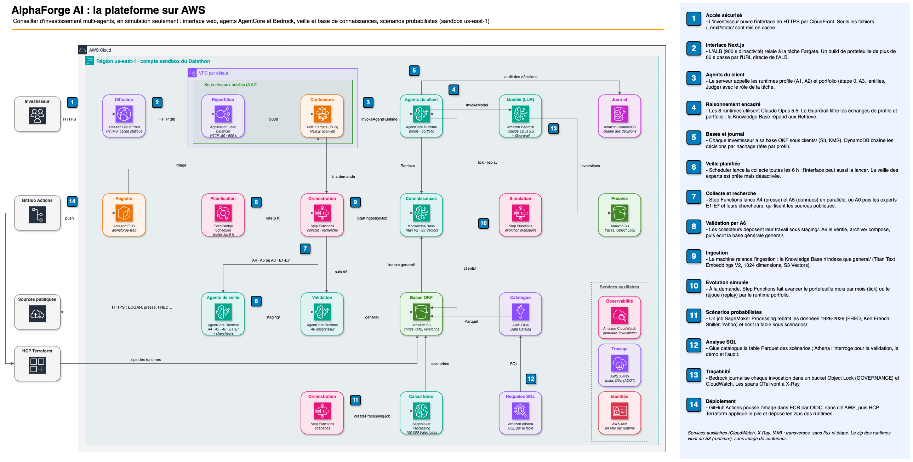
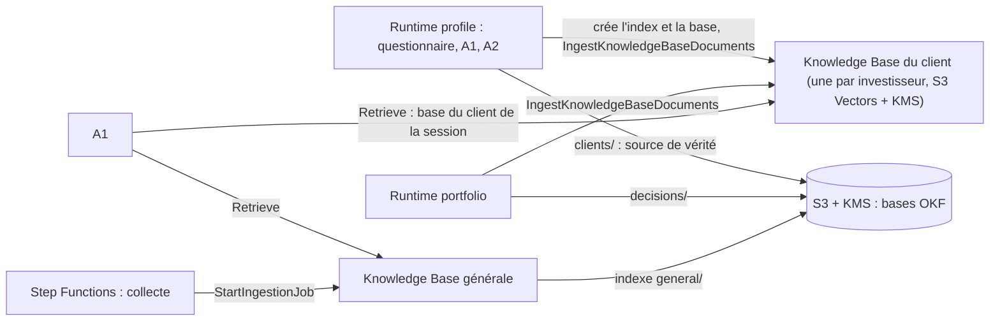

# AlphaForge AI : équipe larpathon

Aide à la décision d'investissement agentique et explicable, construite pour le Datathon PolyFinances 2026 (Banque Nationale et AWS). Chaque investisseur, de tout niveau de connaissances, construit son propre profil : des questions de base déterministes, puis des relances d'un agent qui ne demande que ce qui manque, et, s'il en a un, l'analyse de son portefeuille existant sous n'importe quelle forme. Sur ce profil, le volet finance construit un portefeuille simulé : le code choisit les titres et calcule les poids sous les limites du profil, un avocat et quatre lentilles critiques en débattent, un Judge déterministe contrôle chaque plafond, et l'explication cite la source de chaque chiffre. Une base générale, alimentée par des agents de veille web, garde les connaissances communes, datées par leur publication.

> **Simulation seulement** : aucune transaction réelle, aucun conseil financier personnalisé, aucun compte client réel. Le code calcule, le modèle explique, et chaque chiffre cite sa source.

**Essayer l'application déployée sur AWS :** https://d2gsaqmfxygugx.cloudfront.net (ouverte jusqu'au lundi 16 novembre 2026 à 13 h 59, fermeture du compte AWS du Workshop).

**Architecture AWS :** la plateforme et les trois flux de bout en bout (profil, portefeuille, veille web) sont dans [`docs/architecture/`](docs/architecture/README.md).

La mémoire du produit (besoin, personas, décisions, architecture) est le Brain de l'équipe : [`sf-bit24/brain`](https://github.com/sf-bit24/brain). Le contrat entre les composants est dans [`app/CONTRACTS.md`](app/CONTRACTS.md).

## Démo vidéo

https://github.com/user-attachments/assets/b2629c28-754f-4717-b255-53ac79fe743f

*2 min 19 s, en français, sous-titres incrustés.* Robert, 59 ans (FICTION), demande 50 000 $ dans l'action TSLA. On suit sa demande de bout en bout : son profil, l'optimisation sous les limites de ce profil, quatre lentilles critiques sur Amazon Bedrock, le Judge et ses 28 contrôles, puis le refus encadré, expliqué en quatre questions. Amira, 26 ans, sert de contrepoint. Enfin, Step Functions rejoue cinq ans de marché, mois par mois. Les chiffres du portefeuille et du rejeu viennent d'exécutions AWS du 2026-11-15. Simulation éducative : aucune transaction, aucun conseil.

<sub>Crédits du film : voix de synthèse Microsoft (fr-CA-SylvieNeural, via edge-tts) ; batterie « MuldjordKit » de Lars Muldjord (drumgizmo.org), version FreePats, sous licence [CC BY 4.0](https://creativecommons.org/licenses/by/4.0/) ; échantillons CC0 : Karoryfer Samples, Versilian Community Sample Library (Versilian Studios) ; polices Inter et JetBrains Mono (SIL OFL 1.1) ; icônes Lucide (ISC) ; mascotte « Braise » originale.</sub>

## Architecture



Les trois flux de bout en bout ont chacun leur diagramme, avec ses étapes numérotées : [création du profil](docs/architecture/alphaforge-flux-profil.png), [création du portefeuille](docs/architecture/alphaforge-flux-portefeuille.png) et [veille web](docs/architecture/alphaforge-flux-veille-web.png). Les sources modifiables (`.drawio`) sont dans [`docs/architecture/`](docs/architecture/README.md). Les 8 agents déployés et les buckets sont décrits dans [`docs/architecture/agents-et-stockage.md`](docs/architecture/agents-et-stockage.md).

- **Profil** (runtime `profile`) : questions de base déterministes, sans modèle ; A2 lit un portefeuille existant sous n'importe quelle forme, le code le valorise ; A1 relance sur ce qui manque. La complétude est calculée par le code (seuil de 70 %, plafond affiché de 95 %). Chaque investisseur a aussi sa propre Knowledge Base, un index de recherche construit à partir de sa base OKF, où A1 retrouve un passage (une décision passée, une note) ; les chiffres viennent toujours des documents OKF.
- **Portefeuille simulé** (runtime `portfolio`) : profil traduit en mandat, étape 0 (style et sélection), optimiseur, avocat A3 et quatre lentilles sur deux tours, Judge déterministe, explication ancrée sur des faits sourcés. Aucun poids ni chiffre ne vient d'un modèle.
- **Veille web** (Step Functions) : collecte toutes les 6 h (A4 presse, A5 données), recherche par experts de sujet (A0, E1 à E7 et leurs chercheurs), validation par A6, puis ingestion dans la Knowledge Base.
- **AWS** : 8 runtimes Bedrock AgentCore tirés d'un seul zip de code, Bedrock (Claude Opus 5.5 partout, effort réglé par agent) avec Guardrails, Knowledge Bases sur S3 Vectors (la base générale, et une par client), S3 chiffré par KMS, Step Functions et EventBridge Scheduler, SageMaker Processing, Glue et Athena pour les scénarios, DynamoDB pour la chaîne d'audit, interface sur ECS Fargate derrière un ALB et CloudFront, Cognito pour la connexion des investisseurs (un compte par profil). Détail et justification : [`infrastructure/README.md`](infrastructure/README.md).
- **Explicabilité** : chaque requête renvoie sa trace (étape déterministe, agent, outil, modèle, stockage, garde-fou, avec leurs sources), affichée à côté du dialogue ; chaque décision de portefeuille garde sa trace X-Ray.

Bases OKF et Knowledge Bases : la base générale n'indexe que `general/` ; chaque client a sa Knowledge Base, créée par le runtime `profile` à sa première action et alimentée document par document (détail : [`app/CONTRACTS.md`](app/CONTRACTS.md), section 5.3).



## Dépôt

```text
app/
  CONTRACTS.md      contrat entre l'interface, les runtimes et l'infra
  agents/           agents Python (Strands Agents, Bedrock AgentCore), un zip, huit rôles
  web/              interface Next.js (modes mock, local, aws), déployée sur ECS Fargate
  knowledge/        base générale de départ (OKF), poussée dans S3 par Terraform
infrastructure/     Terraform (HCP Terraform -> AWS), scripts du pipeline, bootstrap OIDC
docs/architecture/  diagrammes d'architecture AWS (sources draw.io et aperçus PNG)
.github/workflows/  pipeline.yml -> app.yml (tests, zip) -> infra.yml (plan, apply)
```

## Démarrer en local

Prérequis : Python 3.13 et [uv](https://docs.astral.sh/uv/), Node 24 (ou 20.9 et plus), et des identifiants AWS du Workshop (profil par défaut, `us-east-1`) pour les appels à Bedrock.

```sh
# Interface seule, sans AWS (simulateur du contrat)
cd app/web && cp .env.example .env.local && npm install && npm run dev

# Runtime profile en local, magasin de fichiers, modèles Bedrock réels
cd app/agents && uv sync && AGENT_ROLE=profile ALPHAFORGE_STORE=local uv run python main.py   # http://127.0.0.1:8080
# puis, dans app/web/.env.local : AGENT_MODE=local et LOCAL_AGENT_URL=http://127.0.0.1:8080/invocations

# Runtime portfolio en local (page /portfolio), avec le groupe uv finance (numpy, pandas, cvxpy) ;
# d'abord, une fois, reconstruire les données longues du moteur (non versionnées, section Données)
cd app/agents && uv run --group finance --group backtest-data python -I -m alphaforge.finance.backtest.build_data
cd app/agents && AGENT_ROLE=portfolio PORT=8081 ALPHAFORGE_STORE=local uv run --group finance python main.py
# puis, dans app/web/.env.local : LOCAL_PORTFOLIO_URL=http://127.0.0.1:8081/invocations
```

Pour essayer sans rien installer, l'application déployée suffit : https://d2gsaqmfxygugx.cloudfront.net. Pour viser les runtimes déployés depuis le poste : `AGENT_MODE=aws` dans `app/web/.env.local`. Le serveur Next.js trouve le runtime `alphaforge_sandbox_profile` et la machine `alphaforge-sandbox-collecte` par leur nom, avec les identifiants AWS du poste. Les détails sont dans [`app/agents/README.md`](app/agents/README.md) et [`app/web/README.md`](app/web/README.md).

## Déployer

Un push sur `master` lance les tests, construit le zip des runtimes et l'image de l'interface (poussée dans ECR), puis HCP Terraform (organisation `larpathon_2026`, workspace `larpathon`) planifie et applique sur le compte AWS. GitHub Actions n'a aucune clé AWS : HCP Terraform assume un rôle par OIDC, et le job de l'image un rôle limité au push ECR. L'interface déployée (ECS Fargate derrière CloudFront) est à l'URL de l'output Terraform `web_url` : https://d2gsaqmfxygugx.cloudfront.net. La mise en place unique (bootstrap AWS, workspace, secrets GitHub) est décrite dans [`infrastructure/README.md`](infrastructure/README.md).

## Données

- **Jeu de départ des organisateurs** (`app/agents/src/alphaforge/data/starter/`) : 31 actifs, prix quotidiens du 2021-11-12 au 2026-11-12 (Yahoo Finance via yfinance), change USD/CAD (Banque du Canada), 9 séries macroéconomiques (Banque du Canada, FRED). Libre d'utilisation dans le cadre du Datathon; sources, traitements et limites dans `sources_metadata.csv`.
- **Données longues du moteur de backtest** (`app/agents/src/alphaforge/data/long/`) : rendements mensuels 1926-2026 (Ken French, FRED, Shiller, DataHub pour l'or, Banque du Canada, yfinance et jeu de départ). Seuls le catalogue et `SOURCES.md` sont versionnés ; les parquets se reconstruisent (licences yfinance, Moody's, OCDE), voir [`app/agents/src/alphaforge/finance/backtest/README.md`](app/agents/src/alphaforge/finance/backtest/README.md).
- **Collecte** (A4, A5) : sources publiques sans clé (Banque du Canada Valet, FRED, Yahoo Finance, flux RSS, GDELT). A6 garde pour chaque document sa source, sa date d'observation et sa date de publication, et rejette ce qui n'en a pas.

## Avant la fermeture du compte AWS (lundi 16 novembre, fin de journée)

Le compte Workshop est supprimé avec toutes ses données. Exporter les bases OKF vers le poste :

```sh
aws s3 sync s3://alphaforge-sandbox-kb-024848478575/clients ./export/clients
aws s3 sync s3://alphaforge-sandbox-kb-024848478575/general ./export/general
```

Le code reste sur GitHub et la base générale de départ dans `app/knowledge/`.
