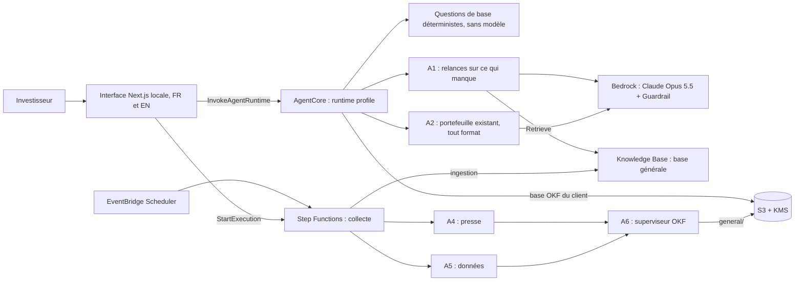

# AlphaForge AI : équipe larpathon

Aide à la décision d'investissement agentique et explicable, construite pour le Datathon PolyFinances 2026 (Banque Nationale et AWS). Chaque investisseur, de tout niveau de connaissances, construit son propre profil : des questions de base déterministes, puis des relances d'un agent qui ne demande que ce qui manque, et, s'il en a un, l'analyse de son portefeuille existant sous n'importe quelle forme. Une base générale, alimentée par des agents de collecte, garde les connaissances communes, datées par leur publication.

> **Simulation seulement** : aucune transaction réelle, aucun conseil financier personnalisé, aucun compte client réel. Le code calcule, le modèle explique, et chaque chiffre cite sa source.

La mémoire du produit (besoin, personas, décisions, architecture) est le Brain de l'équipe : [`sf-bit24/brain`](https://github.com/sf-bit24/brain). Le contrat entre les composants est dans [`app/CONTRACTS.md`](app/CONTRACTS.md).

## Architecture



- **Version 1** (ce dépôt aujourd'hui) : construire le profil (complétude calculée par le code, seuil de 70 %, plafond affiché de 95 %) et alimenter la base générale. Le portefeuille guidé (A3, agents d'analyse, Judge) viendra ensuite sur ces deux bases.
- **AWS** : AgentCore Runtime (quatre runtimes tirés d'un seul zip de code), Bedrock (Claude Opus 5.5 partout, effort réglé par agent), Knowledge Base sur S3 Vectors, Guardrails, S3 chiffré par KMS, Step Functions, EventBridge Scheduler. Détail et justification : [`infrastructure/README.md`](infrastructure/README.md).
- **Explicabilité** : chaque requête renvoie sa trace (étape déterministe, agent, outil, modèle, stockage, garde-fou, avec leurs sources), affichée à côté du dialogue.

## Dépôt

```text
app/
  CONTRACTS.md      contrat entre l'interface, les runtimes et l'infra
  agents/           agents Python (Strands Agents, Bedrock AgentCore), un zip, quatre rôles
  web/              interface Next.js locale (modes mock, local, aws)
  knowledge/        base générale de départ (OKF), poussée dans S3 par Terraform
infrastructure/     Terraform (HCP Terraform -> AWS), scripts du pipeline, bootstrap OIDC
.github/workflows/  pipeline.yml -> app.yml (tests, zip) -> infra.yml (plan, apply)
```

## Démarrer en local

Prérequis : Python 3.13 et [uv](https://docs.astral.sh/uv/), Node 24 (ou 20.9 et plus), et des identifiants AWS du Workshop (profil par défaut, `us-east-1`) pour les appels à Bedrock.

```sh
# Interface seule, sans AWS (simulateur du contrat)
cd app/web && cp .env.example .env.local && npm install && npm run dev

# Runtime profile en local, magasin de fichiers, modèles Bedrock réels
cd app/agents && uv sync && AGENT_ROLE=profile ALPHAFORGE_STORE=local uv run python main.py   # http://127.0.0.1:8080
# puis, dans app/web/.env.local : AGENT_MODE=local et LOCAL_AGENT_URL=http://127.0.0.1:8080/invocations
```

Pour viser les runtimes déployés : `AGENT_MODE=aws` dans `app/web/.env.local`. Le serveur Next.js trouve le runtime `alphaforge_sandbox_profile` et la machine `alphaforge-sandbox-collecte` par leur nom, avec les identifiants AWS du poste. Les détails sont dans [`app/agents/README.md`](app/agents/README.md) et [`app/web/README.md`](app/web/README.md).

## Déployer

Un push sur `master` lance les tests, construit le zip des runtimes, puis HCP Terraform (organisation `larpathon_2026`, workspace `larpathon`) planifie et applique sur le compte AWS. GitHub Actions n'a aucun identifiant AWS : HCP Terraform assume un rôle par OIDC. La mise en place unique (bootstrap AWS, workspace, secrets GitHub) est décrite dans [`infrastructure/README.md`](infrastructure/README.md).

## Données

- **Jeu de départ des organisateurs** (`app/agents/src/alphaforge/data/starter/`) : 31 actifs, prix quotidiens du 2021-11-12 au 2026-11-12 (Yahoo Finance via yfinance), change USD/CAD (Banque du Canada), 9 séries macroéconomiques (Banque du Canada, FRED). Libre d'utilisation dans le cadre du Datathon; sources, traitements et limites dans `sources_metadata.csv`.
- **Collecte** (A4, A5) : sources publiques sans clé (Banque du Canada Valet, FRED, Yahoo Finance, flux RSS, GDELT). A6 garde pour chaque document sa source, sa date d'observation et sa date de publication, et rejette ce qui n'en a pas.

## Avant la fermeture du compte AWS (lundi 16 novembre, fin de journée)

Le compte Workshop est supprimé avec toutes ses données. Exporter les bases OKF vers le poste :

```sh
aws s3 sync s3://alphaforge-sandbox-kb-024848478575/clients ./export/clients
aws s3 sync s3://alphaforge-sandbox-kb-024848478575/general ./export/general
```

Le code reste sur GitHub et la base générale de départ dans `app/knowledge/`.
