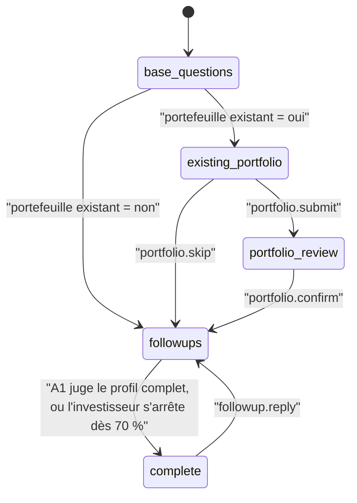
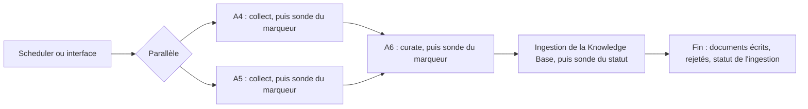
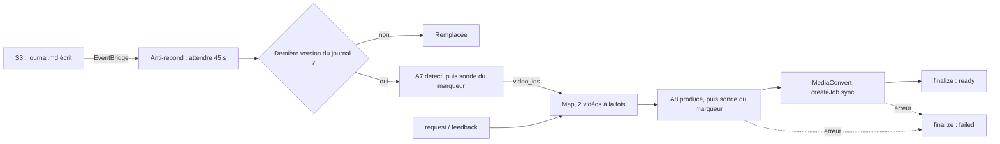
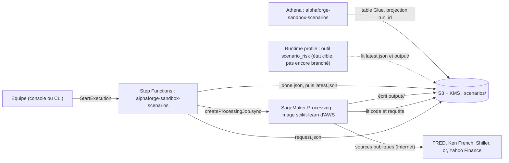

# Contrats d'AlphaForge AI

Version 1, 2026-11-14. Source de vérité entre `app/agents` (Python, AgentCore), `app/web` (Next.js local) et `infrastructure/` (Terraform). Un champ ajouté doit être optionnel et décrit ici; un champ retiré demande une nouvelle version de ce fichier.

Périmètre de la version 1 : construire le profil (questions de base déterministes, relances A1, portefeuille existant analysé par A2) et alimenter la base générale (collecte A4, A5, A6 orchestrée par Step Functions). Le portefeuille guidé (A3, agents d'analyse, Judge) et le test psychométrique viendront plus tard. Il n'y a pas de choix de persona : chaque utilisateur construit son propre profil.

## 1. Runtimes AgentCore

Un seul zip de code (`app/agents`, Python 3.13, linux/arm64) alimente quatre runtimes, qui ne diffèrent que par `AGENT_ROLE` et par leur rôle IAM.

| Runtime AgentCore | `AGENT_ROLE` | Appelé par | Accès S3 (moindre privilège) |
| --- | --- | --- | --- |
| `alphaforge_sandbox_profile` | `profile` | serveur Next.js | lit `general/`, lit et écrit `clients/` |
| `alphaforge_sandbox_press` | `press` | Step Functions | lit et écrit `staging/<run_id>/press/` |
| `alphaforge_sandbox_data` | `data` | Step Functions | lit et écrit `staging/<run_id>/data/` |
| `alphaforge_sandbox_supervisor` | `supervisor` | Step Functions | lit `staging/` et `general/`; écrit `staging/<run_id>/supervisor/`, `general/actualites/`, `general/donnees/` et `general/index.md`, jamais `general/methodologie/` ni `general/societes/` (gérés par Terraform). L'ingestion de la Knowledge Base est lancée par Step Functions, pas par A6. |

Chaque rôle n'a `s3:ListBucket` que sous ses propres préfixes. Pour un objet absent, S3 répond donc 403 (`AccessDenied`) et non 404 : le magasin vérifie alors l'absence par `ListObjectsV2` sur la clé exacte, et ne conclut à un refus que si l'objet existe.

Ajout facultatif (section 10), seulement si `scenarios_enabled = true` : le rôle de `profile` lit aussi `scenarios/latest.json` et `scenarios/output/` (lecture et liste seulement), pour l'outil `scenario_risk` (état cible : l'outil n'est pas encore branché dans le runtime).

Variables d'environnement posées par Terraform sur chaque runtime :

| Variable | Exemple | Rôle |
| --- | --- | --- |
| `AGENT_ROLE` | `profile` | Choisit le point d'entrée. |
| `ALPHAFORGE_ENV` | `sandbox` | Environnement. |
| `ALPHAFORGE_RELEASE` | `1a2b3c4d` | SHA court du commit déployé, renvoyé dans chaque réponse. |
| `ALPHAFORGE_REGION` | `us-east-1` | Région des appels AWS. |
| `ALPHAFORGE_STORE` | `s3` | `s3` en AWS, `local` en développement. |
| `ALPHAFORGE_BUCKET` | `alphaforge-sandbox-kb-024848478575` | Bucket des bases OKF. |
| `ALPHAFORGE_LOCAL_DIR` | `.local-kb` | Racine du magasin `local` (développement seulement). |
| `ALPHAFORGE_MODEL_ID` | `us.anthropic.claude-opus-5-5` | Profil d'inférence Bedrock de tous les agents. |
| `ALPHAFORGE_KB_ID` | `ABCDEFGHIJ` | Knowledge Base de la base générale (vide en local). |
| `ALPHAFORGE_GUARDRAIL_ID` / `ALPHAFORGE_GUARDRAIL_VERSION` | `abc123` / `1` | Guardrail du cadre responsable, appliqué aux agents du runtime `profile` (vide en local). |

Transport : `POST /invocations`, corps JSON, réponse JSON (`application/json`), ou SSE (`text/event-stream`) quand la requête contient `"stream": true` (section 3.4). `GET /ping` est servi par `BedrockAgentCoreApp`.

Session AgentCore (`runtimeSessionId`) : le `client_id` (UUID v4, 36 caractères) pour `profile`; `<nom d'exécution Step Functions>-<rôle>`, complété à au moins 33 caractères, pour les collecteurs.

Développement local : `AGENT_ROLE=profile ALPHAFORGE_STORE=local uv run python main.py` dans `app/agents` sert les mêmes requêtes sur `http://127.0.0.1:8080/invocations`. Le serveur n'écoute que sur `127.0.0.1` : préférer cette adresse à `localhost`, que Node peut résoudre d'abord en IPv6.

## 2. Enveloppe commune

Toute requête est un objet JSON avec `action` (chaîne). Toute réponse non streamée est l'un de :

```json
{ "ok": true, "release": "1a2b3c4d", "...": "champs propres à l'action" }
{ "ok": false, "release": "1a2b3c4d", "error": { "code": "invalid_answer", "message": "texte lisible", "details": {} } }
```

Codes d'erreur : `bad_request`, `unknown_action`, `not_found`, `invalid_answer`, `conflict`, `model_error`, `guardrail_blocked`, `internal`.

Toutes les actions de tous les rôles acceptent `{"action": "health"}` et répondent `{"ok": true, "role": "profile", "release": "…", "env": "sandbox"}`.

## 3. Runtime `profile`

### 3.1 Étapes



- `base_questions` : questions déterministes, sans modèle. D'abord le niveau de connaissances, puis les cinq dimensions du profil, puis « avez-vous un portefeuille existant ? ».
- `existing_portfolio` : l'investisseur fournit son portefeuille sous n'importe quelle forme (texte collé, CSV, tableur, PDF, image, JSON).
- `portfolio_review` : A2 propose des positions normalisées que l'investisseur corrige puis confirme.
- `followups` : A1 relance sur ce qui manque, sans s'écarter du sujet.
- `complete` : complétude d'au moins 70 %, et A1 n'a plus de relance utile, ou l'investisseur a choisi de s'arrêter.

### 3.2 Actions

| Action | Entrée (en plus de `action`) | Effet |
| --- | --- | --- |
| `session.start` | `locale` (`fr`, `en`), `client_id` facultatif | Crée la base du client si elle n'existe pas; renvoie la première question en attente. |
| `session.resume` | `client_id`, `locale` facultatif | Renvoie l'état courant, sans rien modifier. |
| `base.answer` | `client_id`, `question_id`, `value` | Valide la réponse, l'écrit dans la base du client, renvoie la question suivante ou l'étape suivante. |
| `portfolio.submit` | `client_id`, `text` facultatif, `files` facultatif : `[{ "name", "media_type", "data_base64" }]` | A2 extrait des positions; étape `portfolio_review`. Au moins `text` ou un fichier. 10 Mo au plus par fichier, 5 fichiers. |
| `portfolio.confirm` | `client_id`, `positions` (liste de `Position`, corrigée par l'investisseur) | Calcule les expositions par le code, écrit `portefeuille-existant.md`; étape `followups`. |
| `portfolio.skip` | `client_id` | Passe aux relances sans portefeuille. |
| `followup.reply` | `client_id`, `answers` facultatif : `[{ "question_id", "value" }]`, `message` facultatif, `stop` facultatif (booléen) | A1 enregistre, met le profil à jour, renvoie ses relances ou passe à `complete`. `stop: true` n'est accepté qu'à partir de 70 %. Sans `answers` ni `message` à l'arrivée en `followups`, A1 pose ses premières relances. |
| `settings.update` | `client_id`, `locale` facultatif, `knowledge_level` facultatif | Change la langue ou le niveau de connaissances (réglages). |
| `profile.get` | `client_id` | Comme `session.resume`, avec en plus `documents`. |
| `kb.list` | `prefix` (`general/` ou `clients/<client_id>/`) | `{ "items": [{ "key", "title", "type", "description", "updated_at" }] }` |
| `kb.get` | `key` | `{ "key", "content" }` : le document OKF complet (frontmatter et corps). Une clé `clients/` n'est servie qu'avec le `client_id` correspondant. |

Toutes les actions qui portent sur un client renvoient `ClientState` :

```json
{
  "ok": true,
  "release": "1a2b3c4d",
  "client_id": "8f0c3a8e-5d7b-4e2a-9f51-2c6d3b1a7e90",
  "locale": "fr",
  "stage": "base_questions",
  "message": null,
  "questions": [ "Question" ],
  "profile": "ProfileView",
  "completeness": "Completeness",
  "portfolio": null,
  "trace": [ "TraceStep" ]
}
```

- `questions` : les questions à afficher maintenant. En `base_questions`, exactement une. En `followups`, de zéro à trois, posées par A1. Vide en `existing_portfolio`, `portfolio_review` et `complete`.
- `message` : texte Markdown de l'agent (A1 ou A2) dans la langue de `locale`, adapté au niveau de connaissances. Il vaut `null` après une transition déterministe.
- `portfolio` : `PortfolioView` dès que A2 a proposé des positions, sinon `null`.
- `trace` : les étapes de cette requête seulement. L'historique complet est dans la base du client.

### 3.3 Types

`Question` (même forme pour les questions déterministes et celles d'A1) :

```json
{
  "id": "q_horizon",
  "source": "deterministic",
  "dimension": "horizon",
  "kind": "single_choice",
  "prompt": "Dans combien de temps aurez-vous besoin d'une part importante de cet argent ?",
  "help": "L'horizon ne se déduit ni de l'âge ni de la tolérance au risque.",
  "options": [ { "value": "lt3", "label": "Moins de 3 ans" }, { "value": "3to10", "label": "De 3 à 10 ans" }, { "value": "gt10", "label": "10 ans et plus" } ],
  "min": null,
  "max": null,
  "unit": null,
  "required": true,
  "field": "horizon.horizon_band"
}
```

- `source` : `deterministic` ou `a1`.
- `field` : champ du profil que la réponse renseigne, sous la même forme que `facts[].field` (`<dimension>.<nom>`), ou `null` (facultatif).
- `id` : `q_<nom>` pour une question de base (`questionnaire.yaml`), `a1_<tour>_<n>` pour une relance d'A1. Si A1 est indisponible, le code pose des questions de repli `fb_<tour>_<n>`, avec `source: deterministic`.
- `dimension` : `knowledge`, `objective`, `horizon`, `risk_tolerance`, `risk_capacity`, `constraints`, `preferences`, `context`.
- `kind` et type de `value` attendu : `single_choice` (chaîne parmi `options[].value`), `multi_choice` (liste de chaînes), `boolean` (booléen), `number` (nombre, borné par `min` et `max`), `money` (nombre, `unit` = devise, `CAD` par défaut), `percent` (nombre de 0 à 100), `scale` (entier de `min` à `max`), `text` (chaîne de 1 à 2 000 caractères).
- Les textes (`prompt`, `help`, `label`) sont déjà dans la langue de `locale`; l'interface n'en traduit aucun.

`Completeness` :

```json
{ "score": 0.62, "displayed": 0.62, "threshold": 0.7, "cap": 0.95, "ready": false, "missing": [ { "dimension": "risk_capacity", "field": "emergency_fund", "label": "Fonds d'urgence" } ] }
```

- `score` : part pondérée des champs requis connus, calculée par le code (de 0 à 1). `displayed` = `min(score, cap)`. `ready` = `score >= threshold`.

`ProfileView` :

```json
{
  "knowledge_level": "intermediate",
  "effective_risk": "medium",
  "dimensions": {
    "objective":      { "status": "known",   "summary": "Croissance à long terme", "fields": { "goal": "growth" } },
    "horizon":        { "status": "partial", "summary": "10 ans et plus", "fields": { "horizon_band": "gt10" } },
    "risk_tolerance": { "status": "known",   "summary": "Élevée", "fields": {} },
    "risk_capacity":  { "status": "missing", "summary": null, "fields": {} },
    "constraints":    { "status": "partial", "summary": "CELI", "fields": {} },
    "preferences":    { "status": "known",   "summary": "Exclut le tabac", "fields": {} },
    "context":        { "status": "partial", "summary": null, "fields": {} }
  },
  "risk": { "tolerance": "high", "capacity": "medium", "effective": "medium" },
  "facts": [ { "field": "horizon.horizon_band", "value": "gt10", "provenance": "base:q_horizon", "at": "2026-11-14T23:10:00Z" } ],
  "documents": [ { "key": "clients/8f0c…/profil.md", "title": "Profil investisseur" } ]
}
```

- `knowledge_level` : `beginner`, `intermediate`, `advanced` ou `null`; calculé par le code à partir des questions de niveau et de l'auto-évaluation.
- `effective_risk` : `low`, `low_medium`, `medium`, `medium_high`, `high` ou `null`; le minimum de la tolérance et de la capacité, calculé par le code. `risk` détaille les trois niveaux (facultatif).
- `status` : `known`, `partial`, `missing`. `provenance` : `base:<question_id>`, `a1:<numéro de tour>`, `a2:<numéro de tour>`, `settings`. Le numéro de tour est commun à A1 et A2 dans la session : un tour d'A1 qui suit A2 est `a1:2`.
- `documents` n'est rempli que par `profile.get`.

`Position` et `PortfolioView` :

```json
{
  "positions": [
    { "id": "p1", "raw": "100 RY.TO", "ticker": "RY.TO", "name": "Royal Bank of Canada", "asset_class": "equity", "sector": "Financials", "market": "TSX", "currency": "CAD", "quantity": 100, "market_value": null, "account_type": "tfsa", "price": 134.2, "price_date": "2026-11-12", "price_source": "starter:prices_daily.csv", "value_cad": 13420.0, "resolved": true, "notes": null }
  ],
  "unresolved": [ { "raw": "fonds maison XYZ", "reason": "titre introuvable", "position_id": "p2" } ],
  "fx": { "pair": "USDCAD", "rate": 1.4255, "date": "2026-11-12", "source": "starter:fx_usdcad_daily.csv" },
  "exposures": {
    "total_value_cad": 13420.0,
    "by_asset_class": { "equity": 1.0 },
    "by_currency": { "CAD": 1.0 },
    "by_market": { "TSX": 1.0 },
    "by_sector": { "Financials": 1.0 },
    "top_positions": [ { "id": "p1", "weight": 1.0 } ],
    "flags": [ "concentration_single_position", "home_bias_canada" ]
  },
  "status": "draft",
  "sources": [ { "id": "starter-prices", "title": "Jeu de départ, prices_daily.csv", "resource": "starter:prices_daily.csv", "retrieved_at": "2026-11-13" } ]
}
```

- `asset_class` : `equity`, `etf_equity`, `etf_bond`, `etf_commodity`, `bond`, `cash`, `crypto`, `fund`, `other`. `account_type` : `tfsa` (CELI), `rrsp` (REER), `resp` (REEE), `rrif` (FERR), `non_registered`, `unknown`, ou `null`.
- `ticker` peut être `null` : A2 garde en ligne ce qu'il n'a pas identifié, et l'investisseur peut confirmer une telle ligne. Une ligne ajoutée par l'investisseur demande un `ticker` ou une `market_value`.
- `flags` (seuils dans `portfolio.py`) : `concentration_single_position`, `concentration_sector`, `home_bias_canada`, `crypto_exposure_high`, `cash_heavy`, `few_holdings`, `unvalued_positions`. L'interface affiche le code brut d'un drapeau inconnu.
- Les expositions sont des parts de 0 à 1 de `total_value_cad`, calculées par le code (jamais par le modèle). La conversion USD/CAD utilise le dernier taux de `fx_usdcad_daily.csv`, cité dans `sources`.
- `status` : `draft` après `portfolio.submit`, `confirmed` après `portfolio.confirm`. `portefeuille-existant.md` est écrit dès `portfolio.submit`, avec le statut OKF `draft`, puis `stable` après `portfolio.confirm`.
- Un titre absent du jeu de départ est cherché sur Yahoo Finance (au plus 10 appels) : symbole américain, puis `.TO` si la devise est inconnue. L'URL est citée dans `sources`.

`TraceStep` :

```json
{ "id": "st_01", "at": "2026-11-14T23:10:00.120Z", "kind": "deterministic", "actor": "questionnaire", "title": "Question suivante choisie par les règles", "detail": "q_horizon après q_goal", "inputs": { "question_id": "q_goal" }, "outputs": { "next": "q_horizon" }, "sources": [], "duration_ms": 3 }
```

- `kind` : `deterministic`, `agent`, `model`, `tool`, `storage`, `guardrail`. `actor` : `questionnaire`, `completeness`, `A1`, `A2`, `A4`, `A5`, `A6`, `store`, `guardrail`. `A7`, `A8`, `polly` et `mediaconvert` sont réservés à la fonctionnalité vidéo tldoole, décrite dans sa propre section.
- `sources` : `[{ "id", "title", "resource", "published_at"?, "observed_at"?, "retrieved_at"? }]`.
- Une trace ne contient ni raisonnement interne du modèle ni secret : le titre et le détail décrivent l'action observable (outil appelé, entrées, résultat).

### 3.4 Streaming

Pour `portfolio.submit` et `followup.reply`, la requête peut contenir `"stream": true`. Le runtime répond alors en `text/event-stream`, un événement JSON par ligne `data:` :

```text
data: {"type": "trace", "step": { "...": "TraceStep" }}
data: {"type": "delta", "text": "morceau du message de l'agent"}
data: {"type": "result", "result": { "...": "ClientState" }}
data: {"type": "error", "error": { "code": "model_error", "message": "…" }}
```

- `delta` : un événement par message d'agent, qui porte le message entier, et non un événement par jeton. Opus 5.5 rend le texte placé entre deux appels d'outil comme un raisonnement masqué : le message passe donc par l'argument d'un outil `finish_turn`.
- Issues du modèle : `guardrail_intervened` donne `guardrail_blocked`; `content_filtered` et un refus donnent `model_error`.

Le flux se termine toujours par un seul `result` ou un seul `error`. Le `result` est identique à la réponse non streamée.

## 4. Runtimes de collecte

Les trois collecteurs acceptent leur tâche aussitôt, travaillent en arrière-plan dans leur session AgentCore (tâche asynchrone de `BedrockAgentCoreApp`, `/ping` à `HealthyBusy`), puis écrivent un marqueur que Step Functions sonde.

| Rôle | Requête | Réponse immédiate |
| --- | --- | --- |
| `press` (A4) | `{"action": "collect", "run_id", "since"?: "AAAA-MM-JJ", "tickers"?: ["RY.TO"]}` | `{"ok": true, "accepted": true, "run_id", "marker": "staging/<run_id>/press/_done.json"}`, avec `already_running: true` ou `already_done: true` si ce `run_id` est en cours ou déjà terminé |
| `data` (A5) | `{"action": "collect", "run_id", "since"?, "tickers"?}` | idem, `staging/<run_id>/data/_done.json` |
| `supervisor` (A6) | `{"action": "curate", "run_id"}` | idem, `staging/<run_id>/supervisor/_done.json` |

- `since` vaut par défaut sept jours avant la date du jour; `tickers` vaut par défaut l'univers du jeu de départ.
- Marqueur des collecteurs : `{"status": "ok" | "error", "role", "run_id", "items": 12, "keys": ["staging/<run_id>/press/<id>.json"], "error": null, "started_at", "finished_at"}`.
- Marqueur du superviseur : `{"status": "ok" | "error", "role": "supervisor", "run_id", "written": ["general/actualites/2026/11/<slug>.md"], "rejected": [{"key", "reason"}], "error": null, "started_at", "finished_at"}`.
- Les marqueurs portent aussi `warnings`, `release` et `trace` (les dernières étapes), facultatifs.
- Quand la revue éditoriale d'A6 est indisponible ou sans décision, A6 écrit quand même les données, dont le texte vient du code, mais retient les actualités en disant pourquoi. La collecte suivante les reproposera.
- Élément collecté (`staging/<run_id>/<role>/<id>.json`) : `{"id", "kind": "news" | "series" | "quote", "title", "url", "source", "published_at", "observed_at", "retrieved_at", "language", "tickers": [], "summary", "data": {}}`. `published_at` est la date de publication; `observed_at`, la date de référence d'une donnée (par exemple le mois d'un IPC). Pour une série, `published_at` est l'heure de récupération, une borne supérieure sûre (`data.published_at_basis = "retrieved_at_upper_bound"`). Pour une cotation, c'est l'heure du dernier cours donnée par Yahoo Finance (`regularMarketTime`).
- A6 rejette un élément sans source, sans date de publication, publié après sa date de récupération, ou en double d'un document existant, et dit pourquoi.

## 5. Magasin OKF (S3 ou local)

```text
general/index.md                            écrit par A6 seulement, absent avant la première collecte
general/methodologie/<slug>.md              seed versionné dans app/knowledge/general/, poussé par Terraform
general/notions/<slug>.md                   seed versionné : une notion financière par fichier (Financial Concept)
general/societes/<ticker>.md                seed versionné : chiffres publiés d'une société absente d'EDGAR (ATD, CSU), relevés à la main
general/actualites/<AAAA>/<MM>/<slug>.md    écrit par A6
general/donnees/<serie>/<slug>.md           écrit par A6
clients/<client_id>/index.md
clients/<client_id>/profil.md               profil et ses données structurées
clients/<client_id>/portefeuille-existant.md
clients/<client_id>/journal.md              chaque réponse, avec sa provenance et sa date
clients/<client_id>/traces/<horodatage>-<action>.json
staging/<run_id>/<role>/<id>.json
staging/<run_id>/<role>/_done.json
runtime/agents-<release>.zip                code des runtimes, poussé par Terraform
scenarios/...                               scénarios probabilistes, hors de la base OKF (section 10)
```

Chaque document `.md` est un document OKF : un frontmatter YAML puis un corps Markdown.

```yaml
type: Investor Profile            # Investor Profile, Existing Portfolio, Profile Journal, News, Data Series, Methodology, Financial Concept, Company Fundamentals, Index
title: Profil investisseur
description: Profil en cinq dimensions, niveau de connaissances et complétude.
tags: [profil-investisseur]
status: draft                     # draft ou stable
owners: [alphaforge-a1]
sensitivity: client               # client pour clients/, public pour general/
generated: { by: "agent:A1", at: "2026-11-14T23:10:00Z" }
stale_after: "2027-02-14T00:00:00Z"
sources:
  - { id: base-q_horizon, title: "Réponse à q_horizon", resource: "base:q_horizon", retrieved_at: "2026-11-14T23:10:00Z" }
data: {}                          # données structurées lues par le code (profil, positions, série…)
```

- `journal.md` porte ses entrées dans `data.entries[]`, en ajout seulement, une entrée par événement : `{at, kind, provenance, ...}`.
  - `kind` vaut `answer` (`field`, `value`, `question_id`?, `previous`?), `message` ou `stage` (`value`, `previous`, `note`).
  - Une entrée `message` garde le texte libre de l'investisseur (`followup.reply.message`) avec sa provenance `a1:<tour>`, `text` et `locale`. Elle n'est écrite qu'après un tour d'A1 réussi, donc jamais quand le garde-fou bloque.
  - Une requête écrit le journal au plus une fois.
- La base générale ne contient rien d'un client; une base de client ne recopie pas la base générale.
- Chaque document d'actualité ou de données garde sa date d'observation et sa date de publication.

## 6. Step Functions de collecte

Machine `alphaforge-sandbox-collecte`, déclenchée par EventBridge Scheduler et par l'interface. Entrée : `{"run_id"?: string, "since"?: "AAAA-MM-JJ", "tickers"?: [string]}`; `run_id` vaut par défaut le nom de l'exécution. `run_id` suit `^[A-Za-z0-9_-]{1,64}$`, car il entre dans les clés S3 et les identifiants de session. Un collecteur refuse tout autre `run_id` par `bad_request`, et l'interface laisse Step Functions nommer l'exécution, par un UUID.



- La machine sonde chaque marqueur par `ListObjectsV2` (préfixe `staging/`), puis le lit. Délai de 1200 s par agent, sondage toutes les 15 s.
- A4 ou A5 en échec (appel refusé, marqueur absent dans le délai, ou `status: "error"`) terminent leur branche avec `status: "error"` sans arrêter la collecte. A6 lit les marqueurs présents et traite ce qui est arrivé : un marqueur absent ou en erreur n'empêche pas la curation.
- Un échec d'A6 ou de l'ingestion fait échouer l'exécution.

## 7. Interface locale

Le serveur Next.js appelle AWS avec les identifiants AWS du poste (chaîne par défaut), jamais depuis le navigateur. Variables de `app/web/.env.local` :

| Variable | Valeurs | Rôle |
| --- | --- | --- |
| `AGENT_MODE` | `mock`, `local`, `aws` | `mock` : simulateur en mémoire du contrat; `local` : `LOCAL_AGENT_URL`; `aws` : `InvokeAgentRuntime`. |
| `LOCAL_AGENT_URL` | `http://127.0.0.1:8080/invocations` | Runtime `profile` lancé en local. |
| `AWS_REGION` | `us-east-1` | Région. |
| `ALPHAFORGE_PREFIX` | `alphaforge_sandbox` | Préfixe des runtimes; l'ARN de `<préfixe>_profile` est trouvé par son nom (`ListAgentRuntimes`). |
| `ALPHAFORGE_STATE_MACHINE` | `alphaforge-sandbox-collecte` | Machine de collecte, trouvée par son nom (`ListStateMachines`). |

## 8. tldoole : vidéos sur les concepts mal compris

Un agent repère les concepts que l'investisseur ne comprend pas encore. Pour chacun, l'investisseur reçoit une vidéo verticale d'environ une minute (1080 × 1920, sous-titres incrustés). Les points clés viennent du catalogue validé (`app/agents/src/alphaforge/tldoole/concepts.yaml`) et les chiffres du code (`facts.py`), chacun avec sa source. Tout tourne sur AWS : AgentCore, Bedrock, Polly, MediaConvert, Step Functions, EventBridge, S3 et KMS.

### 8.1 Runtime `alphaforge_sandbox_tldoole`

`AGENT_ROLE=tldoole`, même zip que les autres runtimes. Variables en plus de la section 1 : `ALPHAFORGE_KB_ID`, `ALPHAFORGE_GUARDRAIL_ID` et `ALPHAFORGE_GUARDRAIL_VERSION` (comme `profile`), puis :

| Variable | Exemple | Rôle |
| --- | --- | --- |
| `ALPHAFORGE_TLDOOLE_STATE_MACHINE_ARN` | `arn:aws:states:us-east-1:…:stateMachine:alphaforge-sandbox-tldoole` | Machine lancée par `request` et `feedback`. Vide en local : la vidéo reste `queued`, sauf si `ALPHAFORGE_TLDOOLE_INLINE=1`. |
| `ALPHAFORGE_TLDOOLE_MAX_PER_RUN` | `2` | Vidéos créées au plus par une détection. |
| `ALPHAFORGE_TLDOOLE_MAX_PER_DAY` | `6` | Vidéos créées au plus par investisseur et par jour (UTC). |

Accès S3, en motifs de clés exacts (comme `agentcore.tf`) :

- lecture et `s3:prefix` : `clients/*/profil.md`, `clients/*/journal.md`, `clients/*/portefeuille-existant.md`, `clients/*/tldoole/*` ;
- écriture : `clients/*/tldoole/*`.

S'y ajoutent `polly:SynthesizeSpeech`, `states:StartExecution` sur la machine, `bedrock:Retrieve` et `bedrock:ApplyGuardrail`.

Le rôle MediaConvert de tldoole a `GetObject`, `GetObjectVersion` et `PutObject` sur `clients/*/tldoole/*`. Le bucket est versionné, et les téléchargeurs d'incrustations et de polices de MediaConvert lisent une version précise de l'objet : sans `GetObjectVersion`, le job échoue (erreur 1404 sur la police, 1010 sur une image).

Sessions AgentCore : `<client_id>-detect` pour `detect`, `<client_id>-<video_id>` pour `produce` et `finalize`, `<client_id>-feed` pour l'interface.

Développement local : `AGENT_ROLE=tldoole ALPHAFORGE_STORE=local PORT=8081 uv run python main.py`. Le magasin local sert `detect`, `produce` (écrans, narration Polly réelle, sous-titres), `feed`, `feedback` et `request`. MediaConvert n'existe que sur AWS, donc `produce` y renvoie `settings: null`.

### 8.2 Actions

Enveloppe et codes d'erreur de la section 2. Toutes les actions acceptent `health`.

| Action | Appelée par | Entrée (en plus de `action`) | Réponse |
| --- | --- | --- | --- |
| `detect` | Step Functions | `client_id`, `run_id` | `{"accepted": true, "marker": "clients/<id>/tldoole/runs/<run_id>/detect.json", "client_id", "run_id"}`. Le travail tourne en arrière-plan (`/ping` à `HealthyBusy`). |
| `produce` | Step Functions | `client_id`, `video_id` | `{"accepted": true, "marker": "clients/<id>/tldoole/videos/<video_id>/_produced.json", …}`, en arrière-plan. |
| `finalize` | Step Functions | `client_id`, `video_id`, `job` : `{"status": "COMPLETE" \| "ERROR", "id"?, "duration_ms"?, "error"?}` | `{"video": VideoCard}`. Idempotente : une vidéo `ready` le reste. |
| `feed` | interface | `client_id` | `Feed` |
| `feedback` | interface | `client_id`, `video_id`, et au moins l'un de `verdict` (`understood` ou `unclear`) et `quiz_answer` (indice) | `{"video": VideoCard, "quiz": {"correct", "answer", "explanation"} \| null, "follow_up": VideoCard \| null}`. Une réponse `unclear`, ou un quiz raté, crée une version plus simple (au plus 3 versions par concept) et lance la machine. |
| `request` | interface | `client_id`, `concept_id` (du catalogue) | `{"video": VideoCard, "created": bool}`. Une vidéo déjà en cours pour ce concept est renvoyée telle quelle. Au-delà de la limite quotidienne : `conflict`. |

`"wait": true` exécute `detect` ou `produce` dans la requête et renvoie le marqueur sous `result`. C'est réservé au développement et aux tests.

Marqueur de `detect` : `{"status": "ok" | "error", "client_id", "run_id", "video_ids": [], "gaps": [Gap], "skipped"?: "no_new_signal", "error", "started_at", "finished_at", "release", "trace": [TraceStep]}`.

Marqueur de `produce` : `{"status", "client_id", "video_id", "duration_ms", "settings": {…réglages CreateJob de MediaConvert…} | null, "output_key", "error", …}`. Step Functions soumet `settings` avec son propre rôle MediaConvert : le runtime ne passe aucun rôle.

### 8.3 Types

`VideoCard` :

```json
{
  "video_id": "v20261115t002943-fnb-ffd7",
  "concept_id": "fnb", "label": "FNB", "title": "Un FNB, c'est quoi ?",
  "status": "ready", "level": "beginner", "locale": "fr", "reason": "detected", "version": 1,
  "created_at": "2026-11-15T00:29:43Z", "updated_at": "2026-11-15T00:31:02Z", "duration_ms": 68988,
  "why": [{ "kind": "message", "quote": "je ne comprends pas trop c'est quoi un FNB", "provenance": "a1:1", "at": "2026-11-15T00:29:39Z" }],
  "quiz": { "question": "Que recevez-vous en achetant une part d'un FNB ?", "options": ["…", "…"] },
  "sources": [{ "id": "starter-prices-daily", "title": "Jeu de départ, prix quotidiens ajustés (Yahoo Finance)", "resource": "starter:prices_daily.csv" }],
  "feedback": null, "error": null, "doc_key": "clients/<id>/tldoole/videos/<video_id>/fiche.md",
  "video_url": "https://…signée…", "poster_url": "https://…", "captions_url": "https://…"
}
```

- `status` : `queued`, puis `scripting` (A8), `rendering` (écrans, Polly, MediaConvert), et enfin `ready` ou `failed`.
- `reason` : `detected` (A7), `request` (demandée) ou `feedback` (version plus simple). `why[].kind` : `message`, `answer`, `portfolio`, `request` ou `feedback`.
- `quiz` ne contient jamais la bonne réponse : seul `feedback` la renvoie.
- Les URL sont des URL S3 signées valables une heure. Elles valent `null` en local et tant que la vidéo n'est pas prête (`poster_url` existe dès `rendering`).

`Gap` : `{"concept_id", "label", "status": "open" | "video" | "waiting" | "unclear" | "resolved", "confidence", "reason", "detector": "A7" | "rules", "video_id", "detected_at"}`.

`Feed` : `{"client_id", "locale", "videos": [VideoCard], "gaps": [Gap], "pending", "catalog": [{"concept_id", "label", "title"}]}`.

Trace : `actor` vaut aussi `A7` (détecteur), `A8` (scénariste), `polly` ou `mediaconvert`.

### 8.4 Détection (A7) et scénario (A8)

- **Signaux déterministes** (`signals.py`) : un message de l'investisseur qui nomme un concept avec une marque d'incompréhension (« c'est quoi », « je ne comprends pas », « what is »…), des réponses contradictoires (accepter de fortes variations mais tout vendre à la baisse ; horizon court et goût du risque élevé ; perte majeure mais attitude risquée ; comptes « je ne sais pas »…), et les drapeaux du portefeuille calculés par A2.
- **A7** juge les signaux nouveaux depuis la dernière détection. Chaque lacune cite sa preuve : une citation exacte vérifiée par le code, ou la preuve d'une règle. Sans modèle, les règles d'au moins 0,6 suffisent. Une lacune d'au moins 0,6 crée une vidéo si le concept n'en a pas déjà une en cours, prête ou comprise.
- **A8** écrit de 4 à 7 scènes (`hook`, `statement`, `number`, `chart`, `compare`, `list`, `outro`), au plus 950 caractères de narration et un quiz. Il ne s'appuie que sur les points clés du concept et sur les outils de faits (`asset_stats`, `compare_assets`, `macro_series`, `fx_usdcad`, `compound_growth`, `fee_drag`, `client_portfolio`). Tout nombre d'une scène vient d'un fait que la scène cite. Le code refuse aussi toute recommandation d'achat ou de vente. Le Guardrail (`ApplyGuardrail`, sortie) relit la narration.

### 8.5 Magasin

```text
clients/<client_id>/tldoole/index.json                       lacunes, vidéos, dernière détection (écritures If-Match)
clients/<client_id>/tldoole/lacunes.md                       OKF « Concept Gaps »
clients/<client_id>/tldoole/runs/<run_id>/detect.json        marqueur de detect
clients/<client_id>/tldoole/videos/<video_id>/fiche.md       OKF « Learning Video » (transcription, quiz, sources)
clients/<client_id>/tldoole/videos/<video_id>/storyboard.json
clients/<client_id>/tldoole/videos/<video_id>/scene-NN.png   écrans 1080 × 1920 dessinés par le code
clients/<client_id>/tldoole/videos/<video_id>/background.png, narration.mp3, captions.srt, captions.vtt, caption-font.ttf
clients/<client_id>/tldoole/videos/<video_id>/_produced.json marqueur de produce
clients/<client_id>/tldoole/videos/<video_id>/video.mp4      écrit par MediaConvert
```

### 8.6 Machine `alphaforge-sandbox-tldoole`

Elle est déclenchée par le runtime avec l'entrée `{"source": "request" | "feedback", "client_id", "video_ids"}`. Une règle EventBridge peut aussi la lancer à chaque écriture de `clients/*/journal.md` (une par requête du runtime `profile`). Cette règle existe mais reste `DISABLED` tant que `tldoole_trigger_enabled` vaut `false`, sa valeur par défaut : la détection A7 ne tourne alors pas d'elle-même.



### 8.7 Interface

- Page `/tldoole` : fil vertical (lecture muette automatique quand la vidéo est visible), boutons « J'ai compris » et « Encore flou », « Pourquoi ? » (les preuves d'A7), « Sources », quiz, concepts repérés et demande d'une vidéo.
- Route `POST /api/tldoole` (`feed`, `feedback`, `request`) côté serveur. Elle suit le même `AGENT_MODE` : `mock` (simulateur en mémoire), `local` (`LOCAL_TLDOOLE_URL`, par défaut `http://localhost:8081/invocations`) ou `aws` (`InvokeAgentRuntime` sur `<ALPHAFORGE_PREFIX>_tldoole`, trouvé par son nom).

## 9. Volet finance (proposition, hors version 1)

Pour le portefeuille guidé (A3, agents d'analyse, Judge), à valider par l'équipe. Rien ne change pour les
runtimes de la version 1. Les schémas Pydantic sont dans `app/agents/src/alphaforge/finance/contracts/` :

| Contrat | Produit par | Lu par | Rôle |
| --- | --- | --- | --- |
| `InvestorProfile` (v0.1) | profil (A1, A2), via un adaptateur de la base OKF du client | compilateur F1 | la personne, sans aucun poids ni cible de performance |
| `PolicySpec` (v0.2-draft) | F1 (`risk_levels.yaml`) | F2 optimiseur, F3 analyses, F4 Judge | le mandat : limites nommées (`rule_id`, `derived_from`) |
| `Decision`, `Fact`, `TraceEvent`, `ConstraintCheck` (v0.1) | A3 et Judge | interface, explication, audit | tout nombre affiché est un `Fact` sourcé, relié à un `TraceEvent` ; un énoncé ne peut citer que des faits existants |

- Le contrôle des plafonds (`alphaforge.finance.portfolio.check`) est déterministe et sans paramètre de dérogation.
- Les appels LLM du volet finance passent par `alphaforge.finance.llm` (rejeu enregistré, clé sha256). Le Guardrail
  est toujours référencé par une version numérotée, jamais `DRAFT`.
- `TraceEvent.otel_trace_id` relie chaque étape à sa trace OpenTelemetry (X-Ray, JSONL local).

## 10. Scénarios probabilistes (facultatif)

Ajout facultatif à la version 1, activé par la variable Terraform `scenarios_enabled` (faux par défaut : avec `false`, le plan ne change rien pour les scénarios). Le bundle du job n'est construit que si `ALPHAFORGE_PACKAGE_SCENARIOS=1` (en CI : ajouter `ALPHAFORGE_PACKAGE_SCENARIOS: ${{ vars.ALPHAFORGE_PACKAGE_SCENARIOS || '0' }}` à l'étape `package.sh` de `.github/workflows/app.yml`, pas encore fait car le jeton de l'équipe n'a pas le droit `workflow`; absente, la variable vaut 0), à poser avec `scenarios_enabled = true`. Simulation seulement : la table décrit l'incertitude du risque selon un modèle, ce n'est pas une prévision. Infra : `infrastructure/infra/scenarios.tf`; code : `app/agents/src/alphaforge/scenarios/`.



### 10.1 Lancer une exécution

Machine `alphaforge-sandbox-scenarios` (output Terraform `scenarios_state_machine_arn`). Aucun déclencheur périodique.

```sh
aws stepfunctions start-execution --region us-east-1 \
  --state-machine-arn "arn:aws:states:us-east-1:<compte>:stateMachine:alphaforge-sandbox-scenarios" \
  --input '{"params": {"config": "small", "seed": 20261114}}'
```

Entrée : `{"run_id"?: string, "params"?: object}`.

- `run_id` vaut par défaut le nom de l'exécution (un UUID) et suit `^[A-Za-z0-9-]{1,36}$` : il entre dans les clés S3 et dans le nom du job SageMaker, `alphaforge-sandbox-scn-<run_id>`. Unicité : `request.json` et les deux marqueurs `_done.json` sont écrits par `PutObject` conditionnel (`IfNoneMatch: "*"`). Un `run_id` déjà utilisé fait échouer l'exécution dès l'écriture de la requête (`RunIdAlreadyUsed`, S3 `PreconditionFailed`), avant tout calcul, sans marqueur; la requête, les sorties et le marqueur d'un run existant ne sont jamais réécrits.
- `params` est recopié dans `request.json`. `run.sh` n'en accepte que `config` (nom d'une configuration livrée, `small` ou `full`, ou chemin), `seed`, `fitted_through` (`AAAA-MM`) et `workers`, traduits en options de `python -m alphaforge.scenarios.job`. Toute autre clé fait échouer le job avant le calcul.

Sortie : `{"run_id", "processing_job": {"name", "arn", "status", "started_at", "ended_at"}, "latest": "scenarios/latest.json"}`. En cas d'échec du job, la machine écrit `_done.json` avec `status: "error"` (s'il n'existe pas déjà), laisse `latest.json` inchangé et échoue (`ScenariosJobFailed`).

### 10.2 Job SageMaker Processing

- Image : `683313688378.dkr.ecr.us-east-1.amazonaws.com/sagemaker-scikit-learn:1.4-2-py312-1.0.3403.0` (image AWS, Python 3.12, linux/amd64; variable `scenarios_image_uri`, étiquette de build complète obligatoire). Aucune image du projet, aucun ECR du projet.
- Instance : `ml.m5.4xlarge` × 1, 30 Go, 8 h au plus (28 800 s; variables `scenarios_instance_*`, `scenarios_volume_size_gb`, `scenarios_max_runtime_seconds`). `configs/full.yaml` utilise 8 processus sur cette instance (3 à 4 Go chacun).
- Réseau : configuration par défaut de SageMaker (sans VPC ni isolation réseau), donc accès Internet sortant, nécessaire pour reconstruire les données depuis les sources publiques.
- Code : `scenarios/code/<release_id>/` contient `run.sh` et `scenarios.zip`, construits par `app/agents/scripts/package.sh` (section 6 du script) et envoyés par Terraform, comme `runtime/agents-<release>.zip`.

| Chemin dans le conteneur | Contenu |
| --- | --- |
| `/opt/ml/processing/input/code/` | `run.sh` (point d'entrée : `/bin/sh run.sh --request … --output …`) et `scenarios.zip` |
| `/opt/ml/processing/input/request/request.json` | `{"schema": "scenarios-request/v0.1", "run_id", "release", "execution", "requested_at", "params"}` |
| `/opt/ml/processing/app/` | `scenarios.zip` extrait : `alphaforge/scenarios/`, `alphaforge/data/starter/`, `alphaforge/finance/backtest/` (`__init__`, `build_data`, `bonds`, `paths`), le catalogue versionné de `alphaforge/data/long/` (jamais de parquet ni `raw/`), dépendances figées |
| `/opt/ml/processing/work/long/` | `ALPHAFORGE_BT_DATA` : données longues reconstruites par le job, jamais envoyées dans S3 |
| `/opt/ml/processing/output/` | tout ce que le job y écrit est envoyé sous `scenarios/output/<run_id>/` à la fin du job |

`run.sh` place `/opt/ml/processing/app` en tête de `sys.path` (fichier `.pth`, lu même sous `python -I`), pose `ALPHAFORGE_STARTER_DIR` et `ALPHAFORGE_BT_DATA=/opt/ml/processing/work/long`, lance `python3 -I -m alphaforge.finance.backtest.build_data` (échec si le module manque au bundle), puis `python3 -m alphaforge.scenarios.job --input $ALPHAFORGE_BT_DATA --output /opt/ml/processing/output` et les options de `params`.

Variables d'environnement du job : `ALPHAFORGE_RUN_ID`, `ALPHAFORGE_RELEASE` (SHA court du commit, à reporter dans `code_sha` ou le manifeste), `ALPHAFORGE_ENV`, `ALPHAFORGE_REGION`, `ALPHAFORGE_IMAGE`, `ALPHAFORGE_STARTER_DIR` (posée par `run.sh`). Le job ne fait aucun appel AWS : il lit et écrit seulement des fichiers locaux.

### 10.3 Disposition S3

```text
scenarios/code/<release_id>/run.sh, scenarios.zip   Terraform
scenarios/input/requests/<run_id>/request.json      Step Functions
scenarios/output/<run_id>/manifest.json             le job : configuration, graine, data_sha256, code_sha, durées
scenarios/output/<run_id>/request.json              le job (copie par run.sh)
scenarios/output/<run_id>/runtime/                  le job : JSON et CSV compacts lus par l'outil scenario_risk
scenarios/output/<run_id>/table/scenarios.parquet   le job : table complète, seul fichier lu par Athena
scenarios/output/<run_id>/_done.json                Step Functions : {"status": "ok" | "error", "run_id", "release", "image", "processing_job", "output_prefix", "table_prefix", "finished_at", "error"?}
scenarios/latest.json                               Step Functions, après un run réussi : {"run_id", "release", "marker", "output_prefix", "manifest", "updated_at"}
scenarios/athena-results/                           Athena, expire après 7 jours
```

- Hors `general/` : la Knowledge Base n'indexe jamais les scénarios.
- Le job n'écrit que sous `scenarios/output/` et jamais `_done.json` (refus explicite dans son rôle IAM). Le runtime `profile` lit seulement `scenarios/latest.json` et `scenarios/output/`.
- Le dossier `table/` ne doit contenir que des fichiers parquet : Athena lit tout ce qui s'y trouve.
- Les données construites par `alphaforge.finance.backtest.build_data` (sources sous licence : Yahoo Finance, Moody's, OCDE) restent dans le volume du job; elles ne sont ni versionnées, ni dans le bundle de code, ni dans les sorties.
- L'outil `scenario_risk` refuse une table dont le sha256 n'est pas déclaré par le manifeste, et un run figé (`run_id` fixé) dont `_done.json` n'a pas `status: "ok"`.

### 10.4 Table et requêtes Athena

Base Glue `alphaforge_sandbox_scenarios`, table `scenarios`, partition `run_id` par projection `injected` : aucune partition à ajouter après un run, mais chaque requête nomme son `run_id` (lu dans `latest.json`). Groupe de travail `alphaforge-sandbox-scenarios` : résultats chiffrés par la clé KMS du bucket, 1 Gio lu au plus par requête.

Colonnes (miroir de `schema.COLUMNS`, schéma 0.2) : `schema_version`, `model_id`, `family`, `currency`, `mix_id`, `horizon_years` (int), `basis`, `metric`, `value`, `ci_lo`, `ci_hi` (double), `n_paths`, `n_boot` (int), `seed` (bigint), `fitted_through`, `window_start`, `n_hist_months` (int), `hypothese` (boolean), `data_sha256`, `code_sha`. Les types parquet doivent correspondre (int32, int64, float64, bool); une colonne ajoutée au schéma doit l'être aussi dans `scenarios.tf`.

```sql
SELECT model_id, mix_id, horizon_years, basis, value, ci_lo, ci_hi
FROM alphaforge_sandbox_scenarios.scenarios
WHERE run_id = '<run_id de latest.json>' AND family = 'CAD77' AND metric = 'p_loss_gt_20';
```
