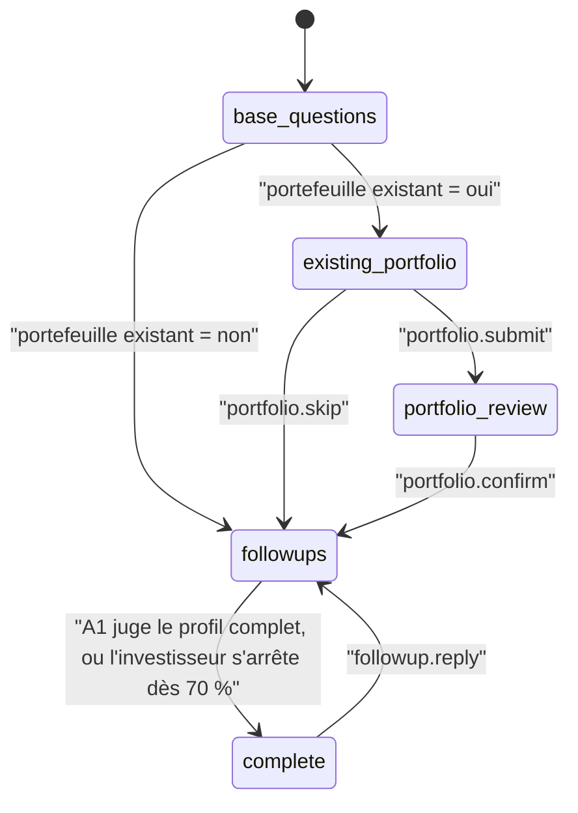
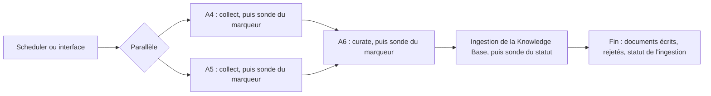
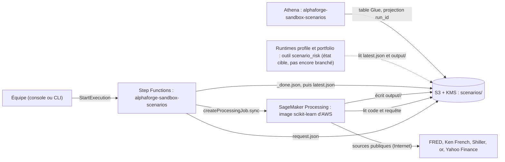
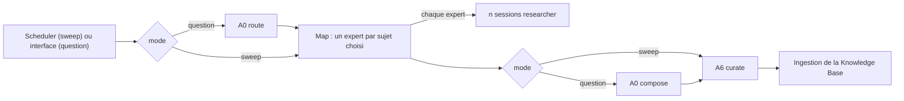

# Contrats d'AlphaForge AI

Version 1, 2026-11-14. Source de vérité entre `app/agents` (Python, AgentCore), `app/web` (Next.js local) et `infrastructure/` (Terraform). Un champ ajouté doit être optionnel et décrit ici; un champ retiré demande une nouvelle version de ce fichier.

Périmètre de la version 1 : construire le profil (questions de base déterministes, relances A1, portefeuille existant analysé par A2) et alimenter la base générale (collecte A4, A5, A6 orchestrée par Step Functions). Le portefeuille guidé (A3, agents d'analyse, Judge) et le test psychométrique viendront plus tard. Il n'y a pas de choix de persona : chaque utilisateur construit son propre profil.

## 1. Runtimes AgentCore

Un seul zip de code (`app/agents`, Python 3.13, linux/arm64) alimente tous les runtimes, qui ne diffèrent que par `AGENT_ROLE` et par leur rôle IAM.

| Runtime AgentCore | `AGENT_ROLE` | Appelé par | Accès S3 (moindre privilège) |
| --- | --- | --- | --- |
| `alphaforge_sandbox_profile` | `profile` | serveur Next.js | lit `general/`, lit et écrit `clients/` |
| `alphaforge_sandbox_press` | `press` | Step Functions | lit et écrit `staging/<run_id>/press/` |
| `alphaforge_sandbox_data` | `data` | Step Functions | lit et écrit `staging/<run_id>/data/` |
| `alphaforge_sandbox_supervisor` | `supervisor` | Step Functions | lit `staging/`, `general/` et `archive/`; écrit `staging/<run_id>/supervisor/`, `general/actualites/`, `general/donnees/`, `general/faits/`, `general/signaux/`, `general/depots/`, `general/recherches/`, `general/societes/` (fondamentaux EDGAR, jamais un seed : refus explicite par IAM sur les clés des seeds, et refus du code) et `general/index.md`, jamais `general/methodologie/` (géré par Terraform). L'ingestion de la Knowledge Base est lancée par Step Functions, pas par A6. |
| `alphaforge_sandbox_router` | `router` | Step Functions (`recherche`) | lit `staging/<run_id>/router/` et `staging/<run_id>/experts/`; écrit `staging/<run_id>/router/` (section 11) |
| `alphaforge_sandbox_expert` | `expert` | Step Functions (`recherche`) | lit `staging/<run_id>/experts/` et `staging/<run_id>/researchers/`; écrit `staging/<run_id>/experts/`; Knowledge Base; `InvokeAgentRuntime` sur le runtime `researcher` seulement (section 11) |
| `alphaforge_sandbox_researcher` | `researcher` | runtime `expert` | lit et écrit `staging/<run_id>/researchers/`; écrit `archive/` (section 11) |

Chaque rôle n'a `s3:ListBucket` que sous ses propres préfixes. Pour un objet absent, S3 répond donc 403 (`AccessDenied`) et non 404 : le magasin vérifie alors l'absence par `ListObjectsV2` sur la clé exacte, et ne conclut à un refus que si l'objet existe.

Ajout facultatif (section 12), seulement si `portfolio_enabled = true` : runtime `alphaforge_sandbox_portfolio` (`AGENT_ROLE=portfolio`), appelé par le serveur Next.js; mêmes droits S3 que `profile` (lit `general/`, lit et écrit `clients/`, dont `clients/<id>/decisions/`), Knowledge Base et Guardrail, plus le journal des décisions et le rejeu LLM (`finance_trace_runtimes`). Son zip est `runtime/agents-portfolio-<release>.zip` (groupe uv `finance` en plus).

Knowledge Base de chaque client (section 5.3), si `client_kb_enabled = true` (vrai par défaut) : `profile` crée l'index S3 Vectors `client-<client_id>`, la Knowledge Base étiquetée `alphaforge:scope=client` et sa source `CUSTOM` (`iam:PassRole` sur le seul rôle des Knowledge Bases des clients); `profile` et `portfolio` y ingèrent, y retirent des documents et y cherchent (`IngestKnowledgeBaseDocuments`, `DeleteKnowledgeBaseDocuments`, `Retrieve`), sur les seules bases étiquetées client. Aucun runtime ne peut supprimer une Knowledge Base.

Ajout facultatif (section 10), seulement si `scenarios_enabled = true` : les rôles de `profile` et de `portfolio` (si `portfolio_enabled`) lisent aussi `scenarios/latest.json` et `scenarios/output/` (lecture et liste seulement), pour l'outil `scenario_risk` (état cible : l'outil n'est encore branché dans aucun runtime; le débat finance de `portfolio` en est l'appelant probable).

Variables d'environnement posées par Terraform sur chaque runtime :

| Variable | Exemple | Rôle |
| --- | --- | --- |
| `AGENT_ROLE` | `profile` | Choisit le point d'entrée. |
| `ALPHAFORGE_ENV` | `sandbox` | Environnement. |
| `ALPHAFORGE_RELEASE` | `1a2b3c4d` | SHA court du commit déployé, renvoyé dans chaque réponse. |
| `ALPHAFORGE_REGION` | `us-east-1` | Région des appels AWS. |
| `ALPHAFORGE_STORE` | `s3` | `s3` en AWS, `local` en développement. |
| `ALPHAFORGE_BUCKET` | `alphaforge-sandbox-kb-024848478575` | Bucket des bases OKF. |
| `ALPHAFORGE_LOCAL_DIR` | `.local-kb` | Racine du magasin `local` (développement seulement). |
| `ALPHAFORGE_MODEL_ID` | `us.anthropic.claude-opus-5-5` | Profil d'inférence Bedrock de tous les agents. |
| `ALPHAFORGE_KB_ID` | `ABCDEFGHIJ` | Knowledge Base de la base générale (vide en local). |
| `ALPHAFORGE_GUARDRAIL_ID` / `ALPHAFORGE_GUARDRAIL_VERSION` | `abc123` / `1` | Guardrail du cadre responsable, appliqué aux agents du runtime `profile` (vide en local). |
| `ALPHAFORGE_CLIENT_KB_VECTOR_BUCKET` | `alphaforge-sandbox-client-vectors` | `profile` et `portfolio` : bucket S3 Vectors des index des clients (section 5.3). Avec les quatre suivantes; une seule absente, ou `ALPHAFORGE_STORE=local`, et la Knowledge Base des clients est désactivée. |
| `ALPHAFORGE_CLIENT_KB_ROLE_ARN` | `arn:aws:iam::…:role/alphaforge-sandbox-client-knowledge-base` | Rôle de service des Knowledge Bases des clients. |
| `ALPHAFORGE_CLIENT_KB_PREFIX` | `alphaforge-sandbox` | Préfixe des noms (`<préfixe>-client-<client_id>`) et des `clientToken`. |
| `ALPHAFORGE_CLIENT_KB_EMBEDDING_MODEL_ARN` / `ALPHAFORGE_CLIENT_KB_EMBEDDING_DIMENSIONS` | `arn:aws:bedrock:us-east-1::foundation-model/amazon.titan-embed-text-v2:0` / `1024` | Mêmes réglages d'embedding que la base générale. |
| `ALPHAFORGE_RESEARCHER_NAME` | `alphaforge_sandbox_researcher` | Runtime `expert` : nom du runtime des chercheurs, dont l'ARN est trouvé par `ListAgentRuntimes`. `ALPHAFORGE_RESEARCHER_ARN` le remplace s'il est posé; sans l'un ni l'autre (local), les chercheurs tournent dans des fils. |
| `ALPHAFORGE_RESEARCHER_MODEL_ID` | (vide) | Facultatif : modèle des chercheurs; par défaut `ALPHAFORGE_MODEL_ID`. Le rôle IAM n'autorise que `ALPHAFORGE_MODEL_ID`. |
| `ALPHAFORGE_CONTACT_EMAIL` | (vide) | Facultatif : courriel ajouté au User-Agent pour la SEC seulement (accès équitable d'EDGAR); sans lui, la SEC répond 403 et ses hôtes sont déclarés bloqués, et A5 ne lit pas les fondamentaux EDGAR (avertissement dans son marqueur). Posé par Terraform (`sec_contact_email`) sur `press`, `data` et `researcher` seulement. |

Transport : `POST /invocations`, corps JSON, réponse JSON (`application/json`), ou SSE (`text/event-stream`) quand la requête contient `"stream": true` (section 3.4). `GET /ping` est servi par `BedrockAgentCoreApp`.

Session AgentCore (`runtimeSessionId`) : le `client_id` (UUID v4, 36 caractères) pour `profile`; `<nom d'exécution Step Functions>-<rôle>`, complété à au moins 33 caractères, pour les collecteurs.

Développement local : `AGENT_ROLE=profile ALPHAFORGE_STORE=local uv run python main.py` dans `app/agents` sert les mêmes requêtes sur `http://127.0.0.1:8080/invocations`. Le serveur n'écoute que sur `127.0.0.1` : préférer cette adresse à `localhost`, que Node peut résoudre d'abord en IPv6.

## 2. Enveloppe commune

Toute requête est un objet JSON avec `action` (chaîne). Toute réponse non streamée est l'un de :

```json
{ "ok": true, "release": "1a2b3c4d", "...": "champs propres à l'action" }
{ "ok": false, "release": "1a2b3c4d", "error": { "code": "invalid_answer", "message": "texte lisible", "details": {} } }
```

Codes d'erreur : `bad_request`, `unknown_action`, `not_found`, `invalid_answer`, `conflict`, `model_error`, `guardrail_blocked`, `internal`. Le serveur Next.js ajoute `unauthorized` et `forbidden` quand la connexion est active (section 7.1).

Toutes les actions de tous les rôles acceptent `{"action": "health"}` et répondent `{"ok": true, "role": "profile", "release": "…", "env": "sandbox"}`.

## 3. Runtime `profile`

### 3.1 Étapes



- `base_questions` : questions déterministes, sans modèle. D'abord le niveau de connaissances (dont un mini-quiz), puis les cinq dimensions du profil et une mise en situation de comportement, puis « avez-vous un portefeuille existant ? ».
- `existing_portfolio` : l'investisseur fournit son portefeuille sous n'importe quelle forme (texte collé, CSV, tableur, PDF, image, JSON).
- `portfolio_review` : A2 propose des positions normalisées que l'investisseur corrige puis confirme.
- `followups` : A1 relance sur ce qui manque, sans s'écarter du sujet.
- `complete` : complétude d'au moins 70 %, et A1 n'a plus de relance utile, ou l'investisseur a choisi de s'arrêter.

### 3.2 Actions

| Action | Entrée (en plus de `action`) | Effet |
| --- | --- | --- |
| `session.start` | `locale` (`fr`, `en`), `client_id` facultatif | Crée la base du client si elle n'existe pas, puis lance la création de sa Knowledge Base (section 5.3); renvoie la première question en attente. |
| `session.resume` | `client_id`, `locale` facultatif | Renvoie l'état courant, sans rien modifier du profil. Le rapprochement de la Knowledge Base du client peut écrire `kb.json` (section 5.3). |
| `base.answer` | `client_id`, `question_id`, `value` | Valide la réponse, l'écrit dans la base du client, renvoie la question suivante ou l'étape suivante. |
| `portfolio.submit` | `client_id`, `text` facultatif, `files` facultatif : `[{ "name", "media_type", "data_base64" }]` | A2 extrait des positions; étape `portfolio_review`. Au moins `text` ou un fichier. 10 Mo au plus par fichier, 5 fichiers. |
| `portfolio.confirm` | `client_id`, `positions` (liste de `Position`, corrigée par l'investisseur) | Calcule les expositions par le code, écrit `portefeuille-existant.md`; étape `followups`. |
| `portfolio.skip` | `client_id` | Passe aux relances sans portefeuille. |
| `followup.reply` | `client_id`, `answers` facultatif : `[{ "question_id", "value" }]`, `message` facultatif, `stop` facultatif (booléen) | A1 enregistre, met le profil à jour, renvoie ses relances ou passe à `complete`. `stop: true` n'est accepté qu'à partir de 70 %. Sans `answers` ni `message` à l'arrivée en `followups`, A1 pose ses premières relances. Au passage à `complete` (y compris par `stop: true`), A1 écrit la base du client avec son skill (section 5) ; un échec est inscrit à la trace et n'empêche pas l'étape. |
| `settings.update` | `client_id`, `locale` facultatif, `knowledge_level` facultatif | Change la langue ou le niveau de connaissances (réglages). |
| `profile.get` | `client_id` | Comme `session.resume`, avec en plus `documents`. Comme lui, renvoie `client_kb` quand la fonction est active. |
| `kb.list` | `prefix` (`general/` ou `clients/<client_id>/`) | `{ "items": [{ "key", "title", "type", "description", "updated_at", "links", "tickers" }] }`. `links` : les documents de la même base vers lesquels pointe le corps, par ses liens Markdown, relatifs au dossier du document (`../methodologie/x.md`) ou à la racine de la base (`faits/<source>/<date>-<hash>.md`), sans doublon ni lien vers lui-même. `tickers` : ses symboles canoniques (section 5.1), ceux de `data.ticker`, `data.symbol` et `data.tickers`, puis ses tags (frontmatter et `data.tags`) qui nomment un symbole qu'un autre document de la base déclare par ces champs. |
| `kb.get` | `key` | `{ "key", "content" }` : le document OKF complet (frontmatter et corps). Une clé `clients/` n'est servie qu'avec le `client_id` correspondant. |

Toutes les actions qui portent sur un client renvoient `ClientState` :

```json
{
  "ok": true,
  "release": "1a2b3c4d",
  "client_id": "8f0c3a8e-5d7b-4e2a-9f51-2c6d3b1a7e90",
  "locale": "fr",
  "stage": "base_questions",
  "message": null,
  "questions": [ "Question" ],
  "profile": "ProfileView",
  "completeness": "Completeness",
  "portfolio": null,
  "trace": [ "TraceStep" ],
  "client_kb": "ClientKb"
}
```

- `questions` : les questions à afficher maintenant. En `base_questions`, exactement une. En `followups`, de zéro à trois, posées par A1 ou par le code (secours `fb_`, confirmations `cf_`). Vide en `existing_portfolio`, `portfolio_review` et `complete`.
- `message` : texte Markdown de l'agent (A1 ou A2) dans la langue de `locale`, adapté au niveau de connaissances. Il vaut `null` après une transition déterministe.
- `portfolio` : `PortfolioView` dès que A2 a proposé des positions, sinon `null`.
- `trace` : les étapes de cette requête seulement. L'historique complet est dans la base du client.
- `client_kb` (facultatif) : état de la Knowledge Base du client (`ClientKb`, section 3.3). Chaque action qui porte sur un client le renvoie, dont `session.resume` et `profile.get`, quand la Knowledge Base des clients est active. Fonction désactivée (magasin local ou variables absentes), ou runtime plus ancien : le champ est absent et la réponse est celle d'avant.

### 3.3 Types

`Question` (même forme pour les questions déterministes et celles d'A1) :

```json
{
  "id": "q_horizon",
  "source": "deterministic",
  "dimension": "horizon",
  "kind": "single_choice",
  "prompt": "Dans combien de temps aurez-vous besoin d'une part importante de cet argent ?",
  "help": "L'horizon ne se déduit ni de l'âge ni de la tolérance au risque.",
  "options": [ { "value": "lt3", "label": "Moins de 3 ans" }, { "value": "3to10", "label": "De 3 à 10 ans" }, { "value": "gt10", "label": "10 ans et plus" } ],
  "min": null,
  "max": null,
  "unit": null,
  "required": true,
  "field": "horizon.horizon_band"
}
```

- `source` : `deterministic` ou `a1`.
- `field` : champ du profil que la réponse renseigne, sous la même forme que `facts[].field` (`<dimension>.<nom>`), ou `null` (facultatif).
- `id` : `q_<nom>` pour une question de base (`questionnaire.yaml`), `a1_<tour>_<n>` pour une relance d'A1. Si A1 est indisponible, le code pose des questions de repli `fb_<tour>_<n>`, avec `source: deterministic`. `cf_<tour>_<n>` est une question de confirmation posée par le code quand A1 a tiré une valeur d'un texte libre (`source: deterministic`, `kind: boolean`, `field: null`) : « oui » garde la valeur, « non » la retire. Au plus deux par tour, comptées dans les trois questions du tour.
- `dimension` : `knowledge`, `objective`, `horizon`, `risk_tolerance`, `risk_capacity`, `constraints`, `preferences`, `behavior`, `context`. `behavior` (réaction à un titre très médiatisé) n'a pas d'entrée dans `ProfileView.dimensions` : ses réponses sont dans `facts`.
- `kind` et type de `value` attendu : `single_choice` (chaîne parmi `options[].value`), `multi_choice` (liste de chaînes), `boolean` (booléen), `number` (nombre, borné par `min` et `max`), `money` (nombre, `unit` = devise, `CAD` par défaut), `percent` (nombre de 0 à 100), `scale` (entier de `min` à `max`), `text` (chaîne de 1 à 2 000 caractères).
- Les textes (`prompt`, `help`, `label`) sont déjà dans la langue de `locale`; l'interface n'en traduit aucun.

`Completeness` :

```json
{ "score": 0.62, "displayed": 0.62, "threshold": 0.7, "cap": 0.95, "ready": false, "missing": [ { "dimension": "risk_capacity", "field": "emergency_fund", "label": "Fonds d'urgence" } ] }
```

- `score` : part pondérée des champs requis connus, calculée par le code (de 0 à 1). `displayed` = `min(score, cap)`. `ready` = `score >= threshold`.
- Un champ de poids nul dans `questionnaire.yaml` n'y compte pas et n'est jamais dans `missing`. C'est le cas des variables du profil court que lit l'étape 0 du volet finance (section 9) : `knowledge.quiz_diversification`, `knowledge.quiz_bond_rates`, `risk_tolerance.sell_threshold_pct`, `risk_capacity.employment_sector`, `preferences.exclusion_strictness`, `preferences.crypto_place`, `preferences.crypto_max_pct`, `preferences.favored_tickers`, `behavior.hype_reaction` et `behavior.hype_position_share`. Elles sont posées parmi les questions de base, certaines seulement après une réponse qui les déclenche, et leurs codes sont ceux que compare `finance/strategy/strategy.yaml` (`profile_codes`).
  - `preferences.favored_tickers` (liste fermée : les actions de l'univers, ou `none`) n'est posée qu'à qui connaît les actions (`knowledge.products_known` contient `stocks`), et A1 peut aussi la renseigner, avec confirmation. L'étape 0 en tire un bonus de score, une fois par titre : jamais un plancher propre, jamais une exception à l'éligibilité ni à une limite. Seule une demande précise (`request` du runtime `portfolio`) impose un montant.
  - L'intérêt `gold` de `preferences.interests` donne un plancher non bloquant sur GLD (`strat.floor.GLD`), au plus min(φ · `alloc.gold`, f_abs), retiré en premier par le repli et abaissé si `alloc.gold` baisse au débat.

`ProfileView` :

```json
{
  "knowledge_level": "intermediate",
  "effective_risk": "medium",
  "dimensions": {
    "objective":      { "status": "known",   "summary": "Croissance à long terme", "fields": { "goal": "growth" } },
    "horizon":        { "status": "partial", "summary": "10 ans et plus", "fields": { "horizon_band": "gt10" } },
    "risk_tolerance": { "status": "known",   "summary": "Élevée", "fields": {} },
    "risk_capacity":  { "status": "missing", "summary": null, "fields": {} },
    "constraints":    { "status": "partial", "summary": "CELI", "fields": {} },
    "preferences":    { "status": "known",   "summary": "Exclut le tabac", "fields": {} },
    "context":        { "status": "partial", "summary": null, "fields": {} }
  },
  "risk": { "tolerance": "high", "capacity": "medium", "effective": "medium" },
  "facts": [ { "field": "horizon.horizon_band", "value": "gt10", "provenance": "base:q_horizon", "at": "2026-11-14T23:10:00Z" } ],
  "documents": [ { "key": "clients/8f0c…/profil.md", "title": "Profil investisseur" } ]
}
```

- `knowledge_level` : `beginner`, `intermediate`, `advanced` ou `null`; calculé par le code à partir des questions de niveau et de l'auto-évaluation.
- `effective_risk` : `low`, `low_medium`, `medium`, `medium_high`, `high` ou `null`; le minimum de la tolérance et de la capacité, calculé par le code. `risk` détaille les trois niveaux (facultatif).
- `status` : `known`, `partial`, `missing`. `provenance` : `base:<question_id>`, `a1:<numéro de tour>`, `a2:<numéro de tour>`, `settings`. Le numéro de tour est commun à A1 et A2 dans la session : un tour d'A1 qui suit A2 est `a1:2`.
- `documents` n'est rempli que par `profile.get`.
- `facts[].band` (facultatif) : la tranche choisie quand une question à choix renseigne un champ numérique (`number`, `money`, `percent`), `{option, label, min, max}`, avec `label` dans la langue de la vue et des bornes `null` quand la tranche n'en a pas. `value` reste le nombre que le code calcule et que lit le volet finance (section 5, `data.facts.<champ>.band`) ; l'interface affiche `label` (« Moins de 1 mois », pas « 0 »). Le web écarte une `band` mal formée sans rejeter la réponse.
- `facts[].label` (facultatif) : la valeur telle que l'investisseur la lit, dans la langue de la vue, tirée de `questionnaire.yaml` par le code : le libellé de l'option choisie (« Plutôt stables »), des options choisies séparées par des virgules (« CELI, REER »), « Oui » ou « Non », un nombre avec son unité, ou la tranche d'une réponse numérique (« Moins de 1 mois », comme `band.label`). Un code sans libellé connu y reste tel quel, jamais en JSON. `value` reste le code ou le nombre que lit le volet finance. Le web montre `band.label`, sinon `label`, sinon la valeur (une liste de codes séparés par des virgules) ; il écarte un `label` mal formé sans rejeter la réponse.

`Position` et `PortfolioView` :

```json
{
  "positions": [
    { "id": "p1", "raw": "100 RY.TO", "ticker": "RY.TO", "name": "Royal Bank of Canada", "asset_class": "equity", "sector": "Financials", "market": "TSX", "currency": "CAD", "quantity": 100, "market_value": null, "account_type": "tfsa", "price": 134.2, "price_date": "2026-11-12", "price_source": "starter:prices_daily.csv", "value_cad": 13420.0, "resolved": true, "notes": null }
  ],
  "unresolved": [ { "raw": "fonds maison XYZ", "reason": "titre introuvable", "position_id": "p2" } ],
  "fx": { "pair": "USDCAD", "rate": 1.4255, "date": "2026-11-12", "source": "starter:fx_usdcad_daily.csv" },
  "exposures": {
    "total_value_cad": 13420.0,
    "by_asset_class": { "equity": 1.0 },
    "by_currency": { "CAD": 1.0 },
    "by_market": { "TSX": 1.0 },
    "by_sector": { "Financials": 1.0 },
    "top_positions": [ { "id": "p1", "weight": 1.0 } ],
    "flags": [ "concentration_single_position", "home_bias_canada" ]
  },
  "status": "draft",
  "sources": [ { "id": "starter-prices", "title": "Jeu de départ, prices_daily.csv", "resource": "starter:prices_daily.csv", "retrieved_at": "2026-11-13" } ]
}
```

- `asset_class` : `equity`, `etf_equity`, `etf_bond`, `etf_commodity`, `bond`, `cash`, `crypto`, `fund`, `other`. `account_type` : `tfsa` (CELI), `rrsp` (REER), `resp` (REEE), `rrif` (FERR), `non_registered`, `unknown`, ou `null`.
- `ticker` peut être `null` : A2 garde en ligne ce qu'il n'a pas identifié, et l'investisseur peut confirmer une telle ligne. Une ligne ajoutée par l'investisseur demande un `ticker` ou une `market_value`.
- `flags` (seuils dans `portfolio.py`) : `concentration_single_position`, `concentration_sector`, `home_bias_canada`, `crypto_exposure_high`, `cash_heavy`, `few_holdings`, `unvalued_positions`. L'interface affiche le code brut d'un drapeau inconnu.
- Les expositions sont des parts de 0 à 1 de `total_value_cad`, calculées par le code (jamais par le modèle). La conversion USD/CAD utilise le dernier taux de `fx_usdcad_daily.csv`, cité dans `sources`.
- `status` : `draft` après `portfolio.submit`, `confirmed` après `portfolio.confirm`. `portefeuille-existant.md` est écrit dès `portfolio.submit`, avec le statut OKF `draft`, puis `stable` après `portfolio.confirm`.
- Un titre absent du jeu de départ est cherché sur Yahoo Finance (au plus 10 appels) : symbole américain, puis `.TO` si la devise est inconnue. L'URL est citée dans `sources`.

`ClientKb` (section 5.3) :

```json
{ "status": "active", "knowledge_base_id": "ABCDEFGHIJ", "documents": 6, "pending": 0 }
```

- `status` : `creating` (index et base en création, ou base pas encore `ACTIVE`), `active`, `failed` ou `quota` (nouvel essai plus tard, le questionnaire n'en dépend jamais). Fonction désactivée : pas de `client_kb` du tout (la première version du runtime envoyait `disabled`, que l'interface lit encore sans afficher de carte).
- `documents` : documents de la base du client indexés. `pending` : documents écrits mais pas encore indexés (base pas encore active, ou appel limité).
- La trace de l'action montre la création et les ingestions (`kind: storage`, `actor: store`); une recherche d'A1 est une étape `kind: tool`.

`TraceStep` :

```json
{ "id": "st_01", "at": "2026-11-14T23:10:00.120Z", "kind": "deterministic", "actor": "questionnaire", "title": "Question suivante choisie par les règles", "detail": "q_horizon après q_goal", "inputs": { "question_id": "q_goal" }, "outputs": { "next": "q_horizon" }, "sources": [], "duration_ms": 3 }
```

- `kind` : `deterministic`, `agent`, `model`, `tool`, `storage`, `guardrail`. `actor` : `questionnaire`, `completeness`, `A1`, `A2`, `A4`, `A5`, `A6`, `store`, `guardrail`.
- `sources` : `[{ "id", "title", "resource", "published_at"?, "observed_at"?, "retrieved_at"? }]`.
- Une trace ne contient ni raisonnement interne du modèle ni secret : le titre et le détail décrivent l'action observable (outil appelé, entrées, résultat).

### 3.4 Streaming

Pour `portfolio.submit` et `followup.reply`, la requête peut contenir `"stream": true`. Le runtime répond alors en `text/event-stream`, un événement JSON par ligne `data:` :

```text
data: {"type": "trace", "step": { "...": "TraceStep" }}
data: {"type": "delta", "text": "morceau du message de l'agent"}
data: {"type": "result", "result": { "...": "ClientState" }}
data: {"type": "error", "error": { "code": "model_error", "message": "…" }}
```

- `delta` : un événement par message d'agent, qui porte le message entier, et non un événement par jeton. Opus 5.5 rend le texte placé entre deux appels d'outil comme un raisonnement masqué : le message passe donc par l'argument d'un outil `finish_turn`.
- Issues du modèle : `guardrail_intervened` donne `guardrail_blocked`; `content_filtered` et un refus donnent `model_error`.

Le flux se termine toujours par un seul `result` ou un seul `error`. Le `result` est identique à la réponse non streamée.

## 4. Runtimes de collecte

Les trois collecteurs acceptent leur tâche aussitôt, travaillent en arrière-plan dans leur session AgentCore (tâche asynchrone de `BedrockAgentCoreApp`, `/ping` à `HealthyBusy`), puis écrivent un marqueur que Step Functions sonde.

| Rôle | Requête | Réponse immédiate |
| --- | --- | --- |
| `press` (A4) | `{"action": "collect", "run_id", "since"?: "AAAA-MM-JJ", "tickers"?: ["RY.TO"]}` | `{"ok": true, "accepted": true, "run_id", "marker": "staging/<run_id>/press/_done.json"}`, avec `already_running: true` ou `already_done: true` si ce `run_id` est en cours ou déjà terminé |
| `data` (A5) | `{"action": "collect", "run_id", "since"?, "tickers"?}` | idem, `staging/<run_id>/data/_done.json` |
| `supervisor` (A6) | `{"action": "curate", "run_id"}` | idem, `staging/<run_id>/supervisor/_done.json` |

- `since` vaut par défaut sept jours avant la date du jour; `tickers` vaut par défaut l'univers du jeu de départ.
- Marqueur des collecteurs : `{"status": "ok" | "error", "role", "run_id", "items": 12, "keys": ["staging/<run_id>/press/<id>.json"], "error": null, "started_at", "finished_at"}`.
- Marqueur du superviseur : `{"status": "ok" | "error", "role": "supervisor", "run_id", "written": ["general/actualites/2026/11/<slug>.md"], "rejected": [{"key", "reason"}], "error": null, "started_at", "finished_at"}`.
- Les marqueurs portent aussi `warnings`, `release` et `trace` (les dernières étapes), facultatifs.
- Quand la revue éditoriale d'A6 est indisponible ou sans décision, A6 écrit quand même les données, dont le texte vient du code, mais retient les actualités en disant pourquoi. La collecte suivante les reproposera.
- Élément collecté (`staging/<run_id>/<role>/<id>.json`) : `{"id", "kind": "news" | "series" | "quote", "title", "url", "source", "published_at", "observed_at", "retrieved_at", "language", "tickers": [], "summary", "data": {}}`. `published_at` est la date de publication; `observed_at`, la date de référence d'une donnée (par exemple le mois d'un IPC). Pour une série, `published_at` est l'heure de récupération, une borne supérieure sûre (`data.published_at_basis = "retrieved_at_upper_bound"`). Pour une cotation, c'est l'heure du dernier cours donnée par Yahoo Finance (`regularMarketTime`).
- A6 rejette un élément sans source, sans date de publication, publié après sa date de récupération, ou en double d'un document existant, et dit pourquoi.
- Fondamentaux EDGAR (`kind: "fundamentals"`, `collect.edgar`) : A5 les construit **par le code, sans modèle**, avant son agent, pour les actions de l'univers présentes dans EDGAR (`company_tickers.json` puis `companyfacts`, jamais `frames`; CN sous `CNI`; ancien CIK d'ExxonMobil lu en plus du nouveau). `data.fundamentals` est exactement le bloc `data` d'un document `Company Fundamentals` (`finance/strategy/okf_facts.py`), `data.sources` ses sources (un dépôt par entrée). Point dans le temps : une période ou un bilan vient du premier dépôt qui le publie (date `filed`), ses comparatifs `prior_year` du même dépôt; formulaires 10-Q, 10-K, 20-F, 40-F et 6-K, jamais leurs amendements; taxonomie `ifrs-full` si l'émetteur l'utilise, `us-gaap` sinon; un concept dans une autre unité que la devise des résultats est ignoré (`data.skipped`), jamais converti. Ce type n'est jamais produit par un agent ni par la recherche, et ne passe pas par la revue éditoriale d'A6.
- A6 relit chaque élément `fundamentals` avec `okf_facts.parse_company_fundamentals`, puis écrit `general/societes/<ticker>.md` (`RY.TO` → `ry.md`) seulement si `data` a changé (sinon la clé va dans `unchanged` du marqueur), et n'écrase jamais un document qu'il n'a pas écrit (`generated.by` ≠ `agent:A6` : les seeds ATD et CSU).

## 5. Magasin OKF (S3 ou local)

```text
general/index.md                            écrit par A6 seulement, absent avant la première collecte
general/methodologie/<slug>.md              seed versionné dans app/knowledge/general/, poussé par Terraform
general/notions/<slug>.md                   seed versionné : une notion financière par fichier (Financial Concept)
general/societes/<ticker>.md                seed versionné : chiffres publiés d'une société absente d'EDGAR (ATD, CSU), relevés à la main;
                                            écrit par A6 pour les autres actions de l'univers, à partir d'EDGAR (section 4)
general/actualites/<AAAA>/<MM>/<slug>.md    écrit par A6
general/donnees/<serie>/<slug>.md           écrit par A6
general/donnees/features/<ticker-slug>/<as_of>.md   Stock Features : caractéristiques d'un titre à une date, écrites
                                            par le code du volet finance via A6 (write_stock_features), en ajout seulement
general/**/<document>.md.metadata.json      métadonnées filtrables de la Knowledge Base (section 5.1), écrites avec le document
clients/<client_id>/index.md
clients/<client_id>/profil.md               profil et ses données structurées
clients/<client_id>/portefeuille-existant.md   écrit par profile (A2); lu par le runtime portfolio (holdings)
clients/<client_id>/journal.md              chaque réponse, avec sa provenance et sa date
clients/<client_id>/<note>.md               notes écrites par A1 avec son skill (Profile Note), par exemple dimensions/horizon.md et synthese.md
clients/<client_id>/traces/<horodatage>-<action>.json
clients/<client_id>/kb.json                 état de la Knowledge Base du client (section 5.3), écrit par le code seul
clients/<client_id>/decisions/<decision_id>.md         Portfolio Decision : résumé OKF d'une décision simulée (runtime portfolio)
clients/<client_id>/decisions/<decision_id>.json       Decision complète (Facts, contrôles, trace)
clients/<client_id>/decisions/<decision_id>.policy.json   mandat (PolicySpec) appliqué
staging/<run_id>/<role>/<id>.json
staging/<run_id>/<role>/_done.json
general/faits/<source>/<AAAA-MM-JJ>-<hash>.md         écrit par A6 (section 11)
general/signaux/<source>/<AAAA-MM-JJ>-<hash>.md       écrit par A6
general/depots/<ticker>/<accession>.md                écrit par A6
general/recherches/<AAAA>/<MM>/<slug>-<hash>.md       écrit par A6 (synthèses d'A0)
staging/<run_id>/router/plan.json, _routed.json, _composed.json, brief-<hash>.json
staging/<run_id>/experts/<sujet>/<id>.json, brief.json, _done.json
staging/<run_id>/researchers/<sujet>-<rk>/findings.json, _done.json
staging/<run_id>/supervisor/quarantine.json           éléments et hôtes en quarantaine
archive/<hôte>/<AAAA-MM-JJ>/<sha256>.json              réponse brute archivée par un chercheur
runtime/agents-<release>.zip                code des runtimes, poussé par Terraform
runtime/data/long/*.parquet, manifest.json  données longues et quotidiennes de marché (section 5.2), déposées par scripts/finance/upload_long_data.py
scenarios/...                               scénarios probabilistes, hors de la base OKF (section 10)
```

Chaque document `.md` est un document OKF : un frontmatter YAML puis un corps Markdown.

```yaml
type: Investor Profile            # Investor Profile, Existing Portfolio, Profile Journal, Profile Note, News, Data Series, Methodology, Financial Concept, Company Fundamentals, Index, Fact, Market Signal, Regulatory Filing, Research Brief (section 11), Stock Features, Portfolio Decision
title: Profil investisseur
description: Profil en cinq dimensions, niveau de connaissances et complétude.
tags: [profil-investisseur]
status: draft                     # draft ou stable
owners: [alphaforge-a1]
sensitivity: client               # client pour clients/, public pour general/
generated: { by: "agent:A1", at: "2026-11-14T23:10:00Z" }
stale_after: "2027-02-14T00:00:00Z"
sources:
  - { id: base-q_horizon, title: "Réponse à q_horizon", resource: "base:q_horizon", retrieved_at: "2026-11-14T23:10:00Z" }
data: {}                          # données structurées lues par le code (profil, positions, série…)
```

- Dans `profil.md`, un fait tiré d'un texte libre porte `confirmed: false` (`data.facts.<champ>`) jusqu'à la réponse à sa question `cf_`. Il n'entre ni dans `ProfileView`, ni dans la complétude, ni dans les scores. S'il remplace une valeur confirmée, il la garde dans `replaces` (`value`, `provenance`, `at`, et `band` si elle en avait une; facultatif) : elle reste en vigueur jusqu'à la réponse, et « non » la rétablit. Un fait sans la clé `confirmed` est confirmé.
- Un fait répondu par une tranche (question à choix sur un champ `number`, `money` ou `percent`) porte `band` (`data.facts.<champ>.band`, facultatif) : `{option, min, max, label: {fr, en}}`, la tranche choisie, avec ses bornes (`null` quand elle n'en a pas, par exemple « Je ne sais pas ») et son libellé dans les deux langues. `value` reste le nombre que le code calcule et que lit le volet finance : le plus souvent une borne prudente de la tranche, parfois son milieu (`q_amount` `lt10k` : 5 000) ou une valeur par défaut (`unknown` : 10 000). Le résumé, le corps de `profil.md`, les notes du client et le contexte d'A1 citent la tranche, jamais `value` seule. Un fait réécrit sans tranche (texte libre, réglages) la perd.
- Les questions de relance en attente (`data.pending_questions`) gardent hors des questions, par identifiant de question, `data.pending_choices` (tranche → nombre écrit dans le champ), `data.pending_bands` (tranche → `band`, facultatif) et `data.pending_confirmations` (question `cf_` → champ visé). Une question répondue quitte les trois tables; une session écrite sans `pending_bands` écrit le fait sans `band`.
- Notes du client (`Profile Note`) : à la fin du questionnaire, le runtime `profile` invoque A1 avec le skill `app/agents/src/alphaforge/profile/skills/client-brain-init/SKILL.md`, qui fixe la structure des notes ; ensuite, `client-brain-update` les met à jour quand les faits confirmés ou les skills changent. Changer la structure dans le skill suffit : la mise à jour suivante réorganise chaque base. A1 écrit le chemin, le titre et le texte ; le code construit le frontmatter (`sources` tirées des champs cités, `data.skill`, `data.skills_version`, `data.cites`), vérifie l'OKF, refuse les chemins hors du dossier du client et les documents écrits par le code (`index.md`, `profil.md`, `journal.md`, `portefeuille-existant.md`, `kb.json`, `traces/`), et n'y admet aucune valeur à confirmer. Le runtime n'a pas `s3:DeleteObject` : une note retirée est réécrite avec `data.retired: true`, et `kb.list` comme `index.md` l'omettent. L'état est dans `profil.md`, `data.brain` (`skills_version`, `values`, `documents`).
- `journal.md` porte ses entrées dans `data.entries[]`, en ajout seulement, une entrée par événement : `{at, kind, provenance, ...}`.
  - `kind` vaut `answer` (`field`, `value`, `question_id`?, `option`?, `previous`?), `message` ou `stage` (`value`, `previous`, `note`).
  - `option` (facultatif) : identifiant de la tranche choisie quand une question à choix renseigne un champ numérique (`number`, `money`, `percent`). `value` est alors le nombre que le code a écrit dans le champ, tiré de `questionnaire.yaml` (option `number`) ou calculé par le code pour une relance.
  - Une entrée `message` garde le texte libre de l'investisseur (`followup.reply.message`) avec sa provenance `a1:<tour>`, `text` et `locale`. Elle n'est écrite qu'après un tour d'A1 réussi, donc jamais quand le garde-fou bloque.
  - Une requête écrit le journal au plus une fois.
- La base générale ne contient rien d'un client; une base de client ne recopie pas la base générale. La Knowledge Base générale n'indexe que `general/`; chaque client a la sienne (section 5.3).
- **Arborescence fermée de `general/`.** Un document n'y est écrit que sous l'un de ces neuf dossiers : `methodologie/`, `notions/`, `societes/` (seeds), `actualites/`, `donnees/`, `faits/`, `signaux/`, `depots/` et `recherches/` (A6), plus `index.md`. Le code calcule la clé à partir du type de l'élément et de champs fixés par le code (`research.checks.target`). Ni A6 ni un autre agent ne choisit un dossier ou n'en crée un : le modèle d'A6 décide du résumé, des tags, des liens et du rejet, jamais de l'adresse.
  - Un dossier correspond à un type de document. Un sous-dossier ne sert qu'à l'identité (série, ticker, source) ou au temps (`AAAA/MM`). Un thème (ESG, logement, taux) est un tag, jamais un dossier.
  - `<source>` d'un fait ou d'un signal est l'hôte lu, sans `www.`, passé par `staging.slugify` (`www.bankofcanada.ca` donne `bankofcanada-ca`), et `<hash>` vient de l'identifiant de l'élément, lui-même tiré de l'adresse, des localisateurs et de la date d'observation. Les tickers d'un fait ou d'un signal vont dans ses tags. Deux sources qui publient la même valeur donnent deux documents, chacun dans le dossier de sa source.
  - Pour ajouter un dossier, on le décrit d'abord ici. Puis, dans la même PR : `research.checks.target` (ou `collect.supervisor`), les sections de `write_general_index`, `GENERAL_FOLDERS` (`app/web/src/lib/okf.ts`) et ses libellés, et les préfixes IAM du rôle `supervisor` (section 1).
- Chaque document d'actualité ou de données garde sa date d'observation et sa date de publication.
- `Stock Features` (`general/donnees/features/<ticker-slug>/<as_of>.md`, `ticker-slug` = `shop-to` pour `SHOP.TO`) : un document par titre et par date `as_of` (`AAAA-MM-JJ`), jamais réécrit (une seconde écriture donne `conflict`). Les définitions des caractéristiques appartiennent au volet finance; A6 ne calcule rien, il valide et écrit. `data` :

  ```yaml
  data:
    ticker: SHOP.TO                   # forme canonique (section 5.1)
    as_of: "2026-11-12"
    feature_set: core-v1              # nom versionné du jeu de caractéristiques (volet finance)
    features:
      vol_252d:                       # nom : [a-z][a-z0-9_]*
        value: 0.41                   # nombre, ou null si status n'est pas ok
        unit: ratio
        currency: null                # devise à trois lettres, ou null
        status: ok
        observed_at: "2026-11-12"     # date de la dernière donnée utilisée
        published_at: "2026-11-12T21:00:00Z"   # pas après la fin du jour as_of (aucune anticipation)
        formula: "écart type annualisé des rendements quotidiens (adj_close), 252 séances"
        source_key: "starter:prices_daily.csv"
        source_sha256: "<64 caractères hexadécimaux>"
    missing: [beta_252d]              # caractéristiques demandées mais non calculables, jamais dans features
    inputs: [{ key: "starter:prices_daily.csv", etag: "\"<etag>\"" }]
  ```

- Le runtime `portfolio` lit `portefeuille-existant.md` avec le profil (`finance/debate/okf_bridge.py`, `OkfClientStore.existing_portfolio`). Seule une vue `confirmed` compte : chaque position évaluée par le code (`resolved`, `value_cad`), hors encaisse, devient un `Holding` du profil finance (valeur en CAD, compte). Une position non évaluée, ou une vue non confirmée, est signalée par une `Claim` « déclaré non vérifié », sans effet sur le mandat. La clé et l'ETag du document entrent dans la version des données de la décision; sans ce document, la décision est la même qu'avant.
- `Portfolio Decision` (`clients/<client_id>/decisions/<decision_id>.md`) : écrit par `finance/debate/okf_bridge.py`, statut `draft`, `data.simulation_only: true`, positions et nombre de faits et de contrôles; la `Decision` complète est dans le `.json` voisin.

### 5.1 Métadonnées de la Knowledge Base

À côté de chaque document qu'il écrit (`general/actualites/`, `general/donnees/`, `general/societes/` pour EDGAR, et ceux de la recherche de la section 11 : `general/faits/`, `general/signaux/`, `general/depots/`, `general/recherches/`), A6 écrit d'abord `<clé du document>.metadata.json` (règle de nommage de Bedrock : `2026-11-12.md.metadata.json`), puis le document (`okf.kb_metadata`). Format S3 de Bedrock Knowledge Bases, attributs filtrables et hors embedding (`includeForEmbedding: false`) :

```json
{ "metadataAttributes": {
    "type":            { "value": { "type": "STRING", "stringValue": "News" }, "includeForEmbedding": false },
    "ticker":          { "value": { "type": "STRING", "stringValue": "SHOP.TO" }, "includeForEmbedding": false },
    "kind":            { "value": { "type": "STRING", "stringValue": "news" }, "includeForEmbedding": false },
    "published_epoch": { "value": { "type": "NUMBER", "numberValue": 1794497400 }, "includeForEmbedding": false } } }
```

- `type` : type OKF. `kind` : `data.kind` (`news`, `series`, `quote`), `features` pour Stock Features.
- `ticker` : forme canonique, en majuscules, suffixe de bourse avec un point (`SHOP.TO`). Elle est tirée de `data.ticker`, `data.symbol` ou du premier de `data.tickers` (étiquette `shop.to` et slug `shop-to` donnent aussi `SHOP.TO`; `BTC-USD` garde son tiret). Une actualité qui cite plusieurs titres n'est filtrable que par le premier. Absent pour une série macroéconomique.
- `published_epoch` : date de publication en **secondes UTC depuis l'époque Unix** (entier; une date seule vaut minuit UTC). Pour Stock Features, la plus récente des `published_at` de ses caractéristiques; pour Company Fundamentals, la plus récente des `published_at` de ses périodes et de ses bilans. Absent si la date est inconnue : un filtre `lessThanOrEquals` l'écarte alors, ce qui évite toute anticipation.
- Filtres possibles sur S3 Vectors : `equals`, `notEquals`, `in`, `notIn`, comparaisons numériques, `andAll`, `orAll`. Jamais `startsWith` ni `stringContains`.
- Les seeds `general/methodologie/`, `general/notions/` et `general/societes/` n'ont pas encore de fichier compagnon; Terraform enverrait ceux qui seraient versionnés dans `app/knowledge/general/` (`**/*.metadata.json`).

### 5.2 Données de marché (`alphaforge.market`)

Les prix, le change et les opérations sur titres ne sont pas de l'OKF : ce sont des parquets lus par le code, à travers une seule interface, `alphaforge.market`. Elle a la même API que `alphaforge.starter` (`universe`, `daily`, `close_on_or_before`, `dividends`, `dividend_yield_ttm`, `usdcad_on_or_before`, `median_dollar_volume_cad`, `last_prices`, `last_fx`, `find_asset`, `source_entry`), avec la même garantie : rien après `as_of`. Aucun autre module ne lit le jeu de départ directement (test `tests/test_market.py`).

- **Univers** : `app/agents/src/alphaforge/data/market/universe.yaml`, tenu par le volet finance. Un actif `proposed: true` (aujourd'hui XRE.TO, immobilier) n'entre dans `market.universe()` qu'avec `ALPHAFORGE_MARKET_INCLUDE_PROPOSED=1`.
- **Parquets quotidiens**, écrits par `finance/backtest/build_data.py` (module `daily_data.py`), à côté des parquets longs (`ALPHAFORGE_BT_DATA`) :
  - `daily_prices.parquet` : `date`, `ticker`, `close` (ajusté des fractionnements), `adj_close` (ajusté aussi des dividendes), `volume`, `currency` (Yahoo Finance via `yfinance`);
  - `fx_daily.parquet` : `date`, `usdcad`, `cadusd` (Banque du Canada, Valet `FXUSDCAD`);
  - `corporate_actions.parquet` : `ex_date`, `ticker`, `action` (`dividend` ou `split`), `value`, `unit`.
- **Version** : bloc `daily` de `data_version.json` (`data_sha256`, `built_utc`, `last_date`, sha256 de chaque fichier, manifestes des téléchargements bruts), repris dans `runtime/data/long/manifest.json`. Une décision du runtime `portfolio` qui lit ces parquets ajoute `+market:<data_sha256>` à sa `data_version`.
- **Repli** : sans ces parquets (CI, développement local, runtimes qui ne téléchargent pas les données longues) ou avec `ALPHAFORGE_MARKET_SOURCE=starter`, `alphaforge.market` lit le jeu de départ, et ses sources restent `starter:…`. Avec les parquets, elles deviennent `market:daily_prices.parquet`, `market:fx_daily.parquet` ou `market:universe.yaml`.
- Le runtime `portfolio` télécharge les parquets quotidiens avec les parquets longs quand le manifeste les déclare tous les trois, et vérifie leur sha256.

### 5.3 Knowledge Base de chaque client

Chaque investisseur a sa propre Knowledge Base Bedrock, construite à partir de sa base OKF `clients/<client_id>/` (`app/agents/src/alphaforge/profile/client_kb.py`). L'OKF reste la source de vérité : le code lit toujours les valeurs exactes dans les documents, la Knowledge Base ne sert qu'à retrouver un passage. Isolation par silo : une Knowledge Base et un index par client, aucun filtre de métadonnées.

- **Création** (runtime `profile` seulement, à `session.start` d'une base nouvelle, ou à la première action d'une base plus ancienne) : index `client-<client_id>` dans le bucket S3 Vectors des clients (`float32`, dimension de l'embedding, `cosine`, `AMAZON_BEDROCK_TEXT` et `AMAZON_BEDROCK_METADATA` non filtrables), puis Knowledge Base `<préfixe>-client-<client_id>` (Titan Text Embeddings V2, 1024, comme la base générale; étiquettes `alphaforge:scope=client`, `alphaforge:client_id`, `alphaforge:prefix`; `clientToken` `<préfixe>-kb-<client_id>`), puis, quand `GetKnowledgeBase` la dit `ACTIVE`, sa source `CUSTOM` `client-okf` (passages de 400 jetons, 15 % de recouvrement, `dataDeletionPolicy: RETAIN`). Deux requêtes simultanées obtiennent la même base (`clientToken`, index en `ConflictException` repris par `GetIndex`).
- **Rapprochement**, à la fin de chaque action qui porte sur un client (après les écritures OKF, avant la trace) : une lecture de `kb.json`; tant que la base n'est pas active, une lecture `GetKnowledgeBase`; ensuite, aucun appel si rien n'attend. Aucune erreur de Knowledge Base ne fait échouer l'action : elle va dans la trace et dans `kb.json`.
- **Ingestion directe** (`IngestKnowledgeBaseDocuments`, jamais `StartIngestionJob`) : chaque document `.md` écrit dans la base du client (profil, journal, index, portefeuille existant, notes d'A1, décisions `.md` du runtime `portfolio`, versions `portefeuilles/*.md`) est envoyé en ligne, identifiant = clé OKF (une réingestion remplace le document), métadonnées `type`, `updated_at` et `client_id`. Jamais `traces/`, jamais un `.json`. Une note retirée (`data.retired: true`) sort par `DeleteKnowledgeBaseDocuments`. Lots de 10 documents (borne du client botocore; le service en accepte 25), et au plus 30 documents envoyés ou retirés par action : à l'activation d'une base déjà fournie, le reste attend les actions suivantes (les documents notés de l'action d'abord, puis les plus anciens en attente). Un lot refusé tel quel (`ValidationException`) est renvoyé document par document : seul le fautif va dans `document_errors`, comme un document rendu `FAILED` par Bedrock. Base pas encore active, appel limité (`ThrottlingException`) : les clés restent dans `pending` et partent au rapprochement suivant. `pending` va des clés les plus anciennes aux plus récentes, 200 au plus : au-delà, les versions `portefeuilles/` les plus anciennes partent d'abord, puis les autres clés les plus anciennes. Le runtime `portfolio` ingère ou met en attente, sans jamais créer de base ni lire son état Bedrock.
- **Recherche** : A1 a l'outil `search_client_knowledge` quand la fonction est active. La base interrogée est celle du client de la session, lue dans `kb.json`, jamais donnée par le modèle; chaque passage cite sa clé OKF (`customDocumentLocation.id`), et un passage hors du dossier du client est écarté. Les chiffres cités viennent toujours du contexte, pas des extraits. Base pas encore active : l'outil le dit (`status`).
- **État** `clients/<client_id>/kb.json`, écrit par le code seul (A1 n'écrit que des notes `.md`; `kb.get` ne le sert pas), avec une précondition sur l'ETag : une écriture concurrente relit l'état et y reporte ses changements.

  ```json
  { "schema": "alphaforge.client_kb/1", "client_id": "8f0c…", "status": "active",
    "vector_bucket": "alphaforge-sandbox-client-vectors", "index_name": "client-8f0c…", "index_arn": "arn:aws:s3vectors:…",
    "knowledge_base_name": "alphaforge-sandbox-client-8f0c…", "knowledge_base_id": "ABCDEFGHIJ", "knowledge_base_arn": "arn:aws:bedrock:…",
    "data_source_id": "KLMNOPQRST", "created_at": "…", "updated_at": "…", "active_at": "…", "ingested_at": "…",
    "retry_at": null, "error": null, "pending": [], "indexed": ["clients/8f0c…/profil.md", "…"], "document_errors": {} }
  ```

- **Statuts** : `creating`, `active`, `failed` (nouvel essai 3 minutes après l'erreur, `error.at` : un premier appel juste après l'apply peut échouer le temps que les droits IAM se propagent), `quota` (`ServiceQuotaExceededException` : 100 Knowledge Bases par compte, non ajustable, dont la base générale; nouvel essai une heure après). Le délai se compte depuis l'erreur : un `kb.json` qui porte un `retry_at` plus lointain réessaie au délai actuel. Fonction désactivée : aucun `kb.json`.
- **Hors de l'état Terraform** : `infrastructure/scripts/clean-client-kbs.sh` liste les bases et index des clients (`--dry-run`, par défaut) ou les supprime (`--apply`).

## 6. Step Functions de collecte

Machine `alphaforge-sandbox-collecte`, déclenchée par EventBridge Scheduler et par l'interface. Entrée : `{"run_id"?: string, "since"?: "AAAA-MM-JJ", "tickers"?: [string]}`; `run_id` vaut par défaut le nom de l'exécution. `run_id` suit `^[A-Za-z0-9_-]{1,64}$`, car il entre dans les clés S3 et les identifiants de session. Un collecteur refuse tout autre `run_id` par `bad_request`, et l'interface laisse Step Functions nommer l'exécution, par un UUID.



- La machine sonde chaque marqueur par `ListObjectsV2` (préfixe `staging/`), puis le lit. Délai de 1200 s par agent, sondage toutes les 15 s.
- A4 ou A5 en échec (appel refusé, marqueur absent dans le délai, ou `status: "error"`) terminent leur branche avec `status: "error"` sans arrêter la collecte. A6 lit les marqueurs présents et traite ce qui est arrivé : un marqueur absent ou en erreur n'empêche pas la curation.
- Un échec d'A6 ou de l'ingestion fait échouer l'exécution.

## 7. Interface locale

Le serveur Next.js appelle AWS avec les identifiants AWS du poste (chaîne par défaut), jamais depuis le navigateur. Variables de `app/web/.env.local` :

| Variable | Valeurs | Rôle |
| --- | --- | --- |
| `AGENT_MODE` | `mock`, `local`, `aws` | `mock` : simulateur en mémoire du contrat; `local` : `LOCAL_AGENT_URL`; `aws` : `InvokeAgentRuntime`. |
| `LOCAL_AGENT_URL` | `http://127.0.0.1:8080/invocations` | Runtime `profile` lancé en local. |
| `AWS_REGION` | `us-east-1` | Région. |
| `ALPHAFORGE_PREFIX` | `alphaforge_sandbox` | Préfixe des runtimes; l'ARN de `<préfixe>_profile` est trouvé par son nom (`ListAgentRuntimes`). |
| `ALPHAFORGE_STATE_MACHINE` | `alphaforge-sandbox-collecte` | Machine de collecte, trouvée par son nom (`ListStateMachines`). |
| `AUTH_MODE` | `off`, `cognito` | Connexion des investisseurs (section 7.1); `off` par défaut. |

### 7.1 Identité et connexion

Avec `AUTH_MODE=off` (par défaut), rien ne change : le serveur Next.js nomme un nouveau client au premier `session.start` et le navigateur garde son `client_id` dans le `localStorage`.

Avec `AUTH_MODE=cognito` (`infrastructure/infra/auth.tf`, `auth_enabled = true`), l'identité vient d'un compte Amazon Cognito. Un compte = un `client_id` = une base `clients/<client_id>/`; la base générale `general/` reste commune.

- Inscription libre sur la connexion gérée de Cognito : le courriel est l'identifiant, vérifié par un code. Terraform ne crée aucun utilisateur.
- `client_id` du compte : le `sub` Cognito s'il est un UUID v4 (le cas des comptes du User Pool), sinon un UUID dérivé de SHA-256(`alphaforge:` + `sub`), aux bits de version 4 et de variante RFC 4122 (`app/web/src/lib/server/auth/client-id.ts`). Le même compte retrouve donc sa base sur n'importe quel appareil.
- Le serveur tire le `client_id` de la session, jamais du corps de la requête. Dans `POST /api/agent` : un `client_id` différent de celui du compte donne 403 (`forbidden`); `session.start` sans `client_id` ouvre la base du compte, créée au premier usage; `kb.list` sur `clients/<autre>/` et `kb.get` d'une clé `clients/<autre>/...` donnent 403. Dans `POST /api/portfolio`, même règle; un profil de démonstration FICTION (`persona` sans `client_id`) reste permis à tout compte connecté.
- `POST /api/collect` (lancer une collecte) exige le groupe Cognito `admin` (revendication `cognito:groups`), sinon 403; `GET /api/collect` reste permis à tout compte connecté.
- Toute page et toute route `/api/*` exigent une session, sauf `/api/auth/*`, `/api/health` et `/api/ping`. Sans session, une page redirige vers `/login` et une route répond 401 (`unauthorized`) avec l'enveloppe de la section 2. Ces deux codes, `unauthorized` (401) et `forbidden` (403), ne viennent que du serveur Next.js (`details.source = "gateway"`), jamais d'un runtime.

Flux (client d'application public, sans secret) :

| Route | Rôle |
| --- | --- |
| `GET /api/auth/login?next=/chemin` | Crée `state`, `nonce` et le vérificateur PKCE (S256), les garde 10 min dans un cookie chiffré propre à cette connexion, `af_login_<16 premiers caractères du state>` (chemin `/api/auth` ; deux onglets ne s'écrasent pas), puis redirige vers `/oauth2/authorize` de la connexion gérée, avec `lang` (`fr`, `en`) selon la langue de l'interface. |
| `GET /api/auth/callback?code&state` | Vérifie `state`, échange le code (`/oauth2/token`), vérifie l'ID token (signature par le JWKS du User Pool, RS256, `iss`, `aud`, `exp`, `token_use = id`, `nonce`), puis pose la session et revient à `next` (un chemin de l'interface seulement : tout chemin qui, normalisé, commence par `//`, contient un antislash, ou vise `/login` ou `/api/` devient `/`). Un échec renvoie à `/login?error=denied\|state\|token`. |
| `POST /api/auth/logout` | Efface la session, puis `/logout` de Cognito (`logout_uri` = l'interface). Un formulaire venu d'un autre site donne 403 (`forbidden`) : `Sec-Fetch-Site` autre que `same-origin` ou `none`, ou, sans cet en-tête, un `Origin` autre que `APP_URL` et que `null` (avec `Referrer-Policy: no-referrer`, Chrome envoie `Origin: null` même pour le formulaire de l'interface). |
| `GET /api/auth/me` | `{ "ok": true, "mode": "off", "user": null }`, ou `{ "ok": true, "mode": "cognito", "user": { "email", "client_id", "groups", "admin", "expires_at" } }`; 401 en `cognito` sans session. |
| `POST /api/auth/delete-account` | « Supprimer mon compte » : corps JSON `{ "confirmation": "SUPPRIMER" }` (ou `DELETE`, sans égard aux espaces ni à la casse). Supprime la base du compte de la session, puis son utilisateur Cognito (voir plus bas), puis répond `{ "ok": true, "deleted": { "knowledge_bases": [ids], "vector_index": "deleted" \| "absent", "objects": n, "account": "deleted" \| "absent" }, "logout_url" }` en effaçant la session ; l'interface vide le `localStorage` de ce client et suit `logout_url` (`/logout` de Cognito), puis `/login` dit « Compte supprimé » (cookie `af_notice`, 5 min, chemin `/login`). 401 sans session, 403 depuis un autre site (même règle que la déconnexion), 400 sans la confirmation, 404 en `AUTH_MODE=off`, 400 en `AGENT_MODE=local`; une étape qui échoue donne 502 (`internal`, `details.step` et `details.completed`) et garde le compte. |

Session : cookie `af_session`, `httpOnly`, `SameSite=Lax`, `Secure` sauf sur `http://localhost`, chiffré et authentifié (AES-256-GCM, clé dérivée de `AUTH_SESSION_SECRET` par HKDF). Il ne contient que `sub`, `email`, `groups`, `client_id` et `exp`, jamais un jeton Cognito. Il expire avec l'ID token (`auth_session_hours`, 8 h par défaut); l'investisseur se reconnecte alors. Un changement de groupe vaut à la connexion suivante.

**Suppression du compte.** Elle est faite par le serveur Next.js, en code déterministe (`app/web/src/lib/server/auth/account-deletion.ts`), jamais par un runtime ni un modèle : les runtimes gardent leur règle (aucun droit de suppression). Le serveur ne supprime que la base du `client_id` de la session, jamais un identifiant venu du corps; le `client_id` doit être un UUID v4 (jamais une base `clients/demo-*`), et chaque clé supprimée doit commencer par `clients/<client_id>/`, vérifié avant chaque appel. Étapes, dans cet ordre, chacune idempotente (ce qui est déjà absent n'est pas une erreur) :

1. la Knowledge Base `<préfixe>-client-<client_id>` (section 5.3), trouvée par son nom (`ListKnowledgeBases`, sans lire `kb.json`), dont les étiquettes `alphaforge:scope=client`, `alphaforge:client_id` et `alphaforge:prefix` sont vérifiées avant `DeleteKnowledgeBase`; sa source `CUSTOM`, en `RETAIN`, part avec elle;
2. l'index S3 Vectors `client-<client_id>` (`DeleteIndex`);
3. toutes les versions et tous les marqueurs de suppression sous `clients/<client_id>/` (le bucket est versionné) : `ListObjectVersions` page par page, `DeleteObjects` par lots de 1000; une passe de plus rattrape une écriture encore en cours, trois passes au plus;
4. l'utilisateur Cognito (`AdminDeleteUser`, nom d'utilisateur = `sub`).

Si une étape échoue, la suite n'a pas lieu : le compte Cognito et la session restent, l'investisseur peut réessayer. Ensuite, le serveur refuse les sessions encore ouvertes de ce compte sur d'autres appareils pendant 24 h (la plus longue session possible); cette liste vit dans le processus du serveur (une tâche ECS par défaut) et se perd à son redémarrage. Une action d'un runtime encore en cours au moment de la suppression (un build du portefeuille, par exemple) peut écrire après la dernière passe.

Ce qui reste, et pourquoi :

- la chaîne d'audit des décisions simulées (`finance/observability/audit.py`) : dans la table DynamoDB `<préfixe>-decisions`, la tête `head#<client_id>` et un maillon par décision (empreintes, numéro, clé du corps), et le corps de chaque décision sous `decisions/<client_id>/` du bucket de traces, en Object Lock GOVERNANCE. La chaîne est faite pour ne jamais se réécrire : en retirer un maillon la rendrait invérifiable. Elle reste liée au `client_id`, qui ne mène plus à aucun courriel une fois l'utilisateur Cognito supprimé;
- le rejeu LLM (`<préfixe>-llm-replay` et `llm-replay/` du bucket de traces), le journal des invocations Bedrock (réglage du compte AWS), les journaux CloudWatch (14 jours) et les marqueurs `staging/` (expirés par le cycle de vie) : ils ne sont pas rangés par client (clés tirées d'un SHA-256 ou d'un `run_id`).

Le texte de confirmation de l'interface dit ce qui est supprimé, ce qui reste et que c'est irréversible. En `AGENT_MODE=mock`, la suppression est simulée : le client du simulateur et ses documents sont oubliés.

Variables posées par Terraform sur la tâche ECS de l'interface (`web.tf`) :

| Variable | Exemple | Rôle |
| --- | --- | --- |
| `AUTH_MODE` | `cognito` | `off` si `auth_enabled = false`. |
| `COGNITO_ISSUER` | `https://cognito-idp.us-east-1.amazonaws.com/us-east-1_AbCdEfGhI` | Émetteur des ID tokens. |
| `COGNITO_CLIENT_ID` | `1a2b3c4d5e6f7g8h9i0j1k2l3m` | Client d'application public. |
| `COGNITO_DOMAIN` | `https://alphaforge-sandbox-024848478575.auth.us-east-1.amazoncognito.com` | Domaine de la connexion gérée. |
| `APP_URL` | `https://d2gsaqmfxygugx.cloudfront.net` | Origine publique : URL de retour et de déconnexion. |
| `AUTH_SESSION_SECRET` | (64 caractères, `random_password`) | Clé du cookie de session. |
| `ALPHAFORGE_BUCKET` | `alphaforge-sandbox-kb-024848478575` | Bucket des bases OKF : la suppression du compte y vide `clients/<client_id>/`. |
| `ALPHAFORGE_CLIENT_KB_PREFIX` | `alphaforge-sandbox` | Préfixe des Knowledge Bases des clients et de leur étiquette `alphaforge:prefix`. |
| `ALPHAFORGE_CLIENT_KB_VECTOR_BUCKET` | `alphaforge-sandbox-client-vectors` | Bucket S3 Vectors des index `client-<client_id>`. |

Limite : l'ALB n'écoute qu'en HTTP (pas de certificat sans nom de domaine), d'où la connexion dans Next.js plutôt que l'action `authenticate-cognito` de l'ALB. Le lien direct de l'ALB (`web_alb_url`) ne garde pas de session : le cookie est `Secure` et Cognito n'accepte un retour en HTTP que sur `localhost`.

## 9. Volet finance (proposition, hors version 1)

Pour le portefeuille guidé (A3, agents d'analyse, Judge), à valider par l'équipe. Rien ne change pour les
runtimes de la version 1. Les schémas Pydantic sont dans `app/agents/src/alphaforge/finance/contracts/` :

| Contrat | Produit par | Lu par | Rôle |
| --- | --- | --- | --- |
| `InvestorProfile` (v0.1) | profil (A1, A2), via un adaptateur de la base OKF du client | compilateur F1 | la personne, sans aucun poids ni cible de performance |
| `PolicySpec` (v0.2-draft) | F1 (`risk_levels.yaml`) | F2 optimiseur, F3 analyses, F4 Judge | le mandat : limites nommées (`rule_id`, `derived_from`) |
| `Decision`, `Fact`, `TraceEvent`, `ConstraintCheck` (v0.1) | A3 et Judge | interface, explication, audit | tout nombre affiché est un `Fact` sourcé, relié à un `TraceEvent` ; un énoncé ne peut citer que des faits existants |

- Le contrôle des plafonds (`alphaforge.finance.portfolio.check`) est déterministe et sans paramètre de dérogation.
- Les appels LLM du volet finance passent par `alphaforge.finance.llm` (rejeu enregistré, clé sha256). Le Guardrail
  est toujours référencé par une version numérotée, jamais `DRAFT`.
- `TraceEvent.otel_trace_id` relie chaque étape à sa trace OpenTelemetry (X-Ray, JSONL local).

## 10. Scénarios probabilistes (facultatif)

Ajout facultatif à la version 1, activé par la variable Terraform `scenarios_enabled` (faux par défaut : avec `false`, le plan ne change rien pour les scénarios; vrai dans `infrastructure/deploy/envs/sandbox.tfvars`). Ce tfvars est la seule source de vérité : `package.sh` y lit `scenarios_enabled` (fichier `deploy/envs/<DEPLOY_ENV>.tfvars`, `sandbox` par défaut, commentaires et espaces ignorés) et construit le bundle du job si la valeur est `true`, sans rien changer à `.github/workflows/`. `ALPHAFORGE_PACKAGE_SCENARIOS` (`0` ou `1`), posée et non vide, l'emporte (essais locaux, ou retrait d'urgence); une autre valeur, ou une ligne `scenarios_enabled` illisible ou en double, fait échouer `package.sh`. Simulation seulement : la table décrit l'incertitude du risque selon un modèle, ce n'est pas une prévision. Infra : `infrastructure/infra/scenarios.tf`; code : `app/agents/src/alphaforge/scenarios/`.



### 10.1 Lancer une exécution

Machine `alphaforge-sandbox-scenarios` (output Terraform `scenarios_state_machine_arn`). Aucun déclencheur périodique.

```sh
aws stepfunctions start-execution --region us-east-1 \
  --state-machine-arn "arn:aws:states:us-east-1:<compte>:stateMachine:alphaforge-sandbox-scenarios" \
  --input '{"params": {"config": "small", "seed": 20261114}}'
```

Entrée : `{"run_id"?: string, "params"?: object}`.

- `run_id` vaut par défaut le nom de l'exécution (un UUID) et suit `^[A-Za-z0-9-]{1,36}$` : il entre dans les clés S3 et dans le nom du job SageMaker, `alphaforge-sandbox-scn-<run_id>`. Unicité : `request.json` et les deux marqueurs `_done.json` sont écrits par `PutObject` conditionnel (`IfNoneMatch: "*"`). Un `run_id` déjà utilisé fait échouer l'exécution dès l'écriture de la requête (`RunIdAlreadyUsed`, S3 `PreconditionFailed`), avant tout calcul, sans marqueur; la requête, les sorties et le marqueur d'un run existant ne sont jamais réécrits.
- `params` est recopié dans `request.json`. `run.sh` n'en accepte que `config` (nom d'une configuration livrée, `small` ou `full`, ou chemin), `seed`, `fitted_through` (`AAAA-MM`) et `workers`, traduits en options de `python -m alphaforge.scenarios.job`. Toute autre clé fait échouer le job avant le calcul.

Sortie : `{"run_id", "processing_job": {"name", "arn", "status", "started_at", "ended_at"}, "latest": "scenarios/latest.json"}`. En cas d'échec du job, la machine écrit `_done.json` avec `status: "error"` (s'il n'existe pas déjà), laisse `latest.json` inchangé et échoue (`ScenariosJobFailed`).

### 10.2 Job SageMaker Processing

- Image : `683313688378.dkr.ecr.us-east-1.amazonaws.com/sagemaker-scikit-learn:1.4-2-py312-1.0.3403.0` (image AWS, Python 3.12, linux/amd64; variable `scenarios_image_uri`, étiquette de build complète obligatoire). Aucune image du projet, aucun ECR du projet.
- Instance : `ml.m5.4xlarge` × 1, 30 Go, 8 h au plus (28 800 s; variables `scenarios_instance_*`, `scenarios_volume_size_gb`, `scenarios_max_runtime_seconds`). `configs/full.yaml` utilise 8 processus sur cette instance (3 à 4 Go chacun).
- Réseau : configuration par défaut de SageMaker (sans VPC ni isolation réseau), donc accès Internet sortant, nécessaire pour reconstruire les données depuis les sources publiques.
- Code : `scenarios/code/<release_id>/` contient `run.sh` et `scenarios.zip`, construits par `app/agents/scripts/package.sh` (section 6 du script) et envoyés par Terraform, comme `runtime/agents-<release>.zip`.

| Chemin dans le conteneur | Contenu |
| --- | --- |
| `/opt/ml/processing/input/code/` | `run.sh` (point d'entrée : `/bin/sh run.sh --request … --output …`) et `scenarios.zip` |
| `/opt/ml/processing/input/request/request.json` | `{"schema": "scenarios-request/v0.1", "run_id", "release", "execution", "requested_at", "params"}` |
| `/opt/ml/processing/app/` | `scenarios.zip` extrait : `alphaforge/scenarios/`, `alphaforge/data/starter/`, `alphaforge/finance/backtest/` (`__init__`, `build_data`, `bonds`, `paths`), le catalogue versionné de `alphaforge/data/long/` (jamais de parquet ni `raw/`), dépendances figées |
| `/opt/ml/processing/work/long/` | `ALPHAFORGE_BT_DATA` : données longues reconstruites par le job, jamais envoyées dans S3 |
| `/opt/ml/processing/output/` | tout ce que le job y écrit est envoyé sous `scenarios/output/<run_id>/` à la fin du job |

`run.sh` place `/opt/ml/processing/app` en tête de `sys.path` (fichier `.pth`, lu même sous `python -I`), pose `ALPHAFORGE_STARTER_DIR` et `ALPHAFORGE_BT_DATA=/opt/ml/processing/work/long`, lance `python3 -I -m alphaforge.finance.backtest.build_data` (échec si le module manque au bundle), puis `python3 -m alphaforge.scenarios.job --input $ALPHAFORGE_BT_DATA --output /opt/ml/processing/output` et les options de `params`.

Variables d'environnement du job : `ALPHAFORGE_RUN_ID`, `ALPHAFORGE_RELEASE` (SHA court du commit, à reporter dans `code_sha` ou le manifeste), `ALPHAFORGE_ENV`, `ALPHAFORGE_REGION`, `ALPHAFORGE_IMAGE`, `ALPHAFORGE_STARTER_DIR` (posée par `run.sh`). Le job ne fait aucun appel AWS : il lit et écrit seulement des fichiers locaux.

### 10.3 Disposition S3

```text
scenarios/code/<release_id>/run.sh, scenarios.zip   Terraform
scenarios/input/requests/<run_id>/request.json      Step Functions
scenarios/output/<run_id>/manifest.json             le job : configuration, graine, data_sha256, code_sha, durées
scenarios/output/<run_id>/request.json              le job (copie par run.sh)
scenarios/output/<run_id>/runtime/                  le job : JSON et CSV compacts lus par l'outil scenario_risk
scenarios/output/<run_id>/table/scenarios.parquet   le job : table complète, seul fichier lu par Athena
scenarios/output/<run_id>/_done.json                Step Functions : {"status": "ok" | "error", "run_id", "release", "image", "processing_job", "output_prefix", "table_prefix", "finished_at", "error"?}
scenarios/latest.json                               Step Functions, après un run réussi : {"run_id", "release", "marker", "output_prefix", "manifest", "updated_at"}
scenarios/athena-results/                           Athena, expire après 7 jours
```

- Hors `general/` : la Knowledge Base n'indexe jamais les scénarios.
- Le job n'écrit que sous `scenarios/output/` et jamais `_done.json` (refus explicite dans son rôle IAM). Les runtimes `profile` et `portfolio` lisent seulement `scenarios/latest.json` et `scenarios/output/`.
- Le dossier `table/` ne doit contenir que des fichiers parquet : Athena lit tout ce qui s'y trouve.
- Les données construites par `alphaforge.finance.backtest.build_data` (sources sous licence : Yahoo Finance, Moody's, OCDE) restent dans le volume du job; elles ne sont ni versionnées, ni dans le bundle de code, ni dans les sorties.
- L'outil `scenario_risk` refuse une table dont le sha256 n'est pas déclaré par le manifeste, et un run figé (`run_id` fixé) dont `_done.json` n'a pas `status: "ok"`.

### 10.4 Table et requêtes Athena

Base Glue `alphaforge_sandbox_scenarios`, table `scenarios`, partition `run_id` par projection `injected` : aucune partition à ajouter après un run, mais chaque requête nomme son `run_id` (lu dans `latest.json`). Groupe de travail `alphaforge-sandbox-scenarios` : résultats chiffrés par la clé KMS du bucket, 1 Gio lu au plus par requête.

Colonnes (miroir de `schema.COLUMNS`, schéma 0.2) : `schema_version`, `model_id`, `family`, `currency`, `mix_id`, `horizon_years` (int), `basis`, `metric`, `value`, `ci_lo`, `ci_hi` (double), `n_paths`, `n_boot` (int), `seed` (bigint), `fitted_through`, `window_start`, `n_hist_months` (int), `hypothese` (boolean), `data_sha256`, `code_sha`. Les types parquet doivent correspondre (int32, int64, float64, bool); une colonne ajoutée au schéma doit l'être aussi dans `scenarios.tf`.

```sql
SELECT model_id, mix_id, horizon_years, basis, value, ci_lo, ci_hi
FROM alphaforge_sandbox_scenarios.scenarios
WHERE run_id = '<run_id de latest.json>' AND family = 'CAD77' AND metric = 'p_loss_gt_20';
```

### 10.5 Branchement dans le volet finance (débat du runtime `portfolio`)

- **Judge (F4), mesure `PROB_LOSS`** (contrôle seulement, `finance/portfolio/scenario_risk.py`, proposition `scenarios/PROPOSAL_PROB_LOSS.md`) : P(perte cumulée à l'horizon H > L) ≤ α, avec `Limit.max` = α, `selector.loss_level` = L, `selector.horizon_years` = H ; la borne haute `ci_hi` de l'IC à 90 % décide. Champs facultatifs du `PolicySpec` : `scenario_blocks`, `scenario_family`, `scenario_model_id`, `scenario_run_id`. F1 n'émet pas encore de limite `PROB_LOSS` : sans elle, le Judge ne lit jamais la table et son rapport est inchangé.
- Non vérifiable (actif sans bloc, table absente, magasin refusé, scénarios désactivés, refus de l'outil, seuil sous le plus petit palier) = **violée** (refus prudent, comme `STRESS_2022` sans 2022), Fact à `-1`, raison dans `Source.processing` et `JudgeReport.warnings`. Le `TraceEvent` de l'outil est un enfant de celui du Judge (`JudgeReport.child_traces`, absorbé par `FactBook.absorb_report`).
- **Explication** (`finance/debate/scenarios.py`, `attach_scenarios`, appelé par `build_portfolio(..., scenarios=None)`) : par défaut, l'étape ne tourne que si le mandat final déclare une limite `PROB_LOSS` ; sans elle, l'explication, les Facts et la trace de la décision sont inchangés (`scenarios=True` force l'étape, `scenarios=False` l'interdit). L'outil est appelé sur le portefeuille final (gabarits en mode `rules`, agent `explainer_scenarios` avec l'outil Strands `scenario_risk` en mode `llm`) ; ses Facts entrent dans `Decision.facts`, le rapport de l'étape (phrases rejetées, repli sur les gabarits) dans le `TraceEvent.message` de l'étape `explainer.scenarios`. Table absente, AccessDenied ou `ALPHAFORGE_SCENARIOS=0` : une limite « scénarios indisponibles », aucun appel au modèle, jamais d'erreur.
- Sérialisation : les champs `PROB_LOSS` restés à leur valeur par défaut (`selector.loss_level`, `selector.horizon_years`, `scenario_*`) ne sont pas écrits ; un mandat sans `PROB_LOSS` se sérialise comme avant (`policy.json`).
- Variable lue : `ALPHAFORGE_SCENARIOS` (`0`, `off`, `false`, `no` : désactivés ; sinon lecture du magasin `ALPHAFORGE_STORE`). Le rôle du runtime `portfolio` doit avoir le droit de lecture sur `scenarios/latest.json` et `scenarios/output/` (section 1) ; sans ce droit, les scénarios sont simplement indisponibles.

## 11. Recherche par experts de sujet

Un expert par sujet lance lui-même n chercheurs, un par session AgentCore (une microVM chacun), et juge ce qu'ils
rapportent. Le code de `app/agents/src/alphaforge/research/` applique toutes les règles : le modèle choisit quoi
chercher et combien de chercheurs, le code décide si c'est permis. Les collecteurs A4 et A5 (sections 4 et 6)
restent en place.

### 11.1 Rôles

| Rôle | Agent | Actions | Marqueur |
| --- | --- | --- | --- |
| `router` | A0 : choisit 1 à 4 sujets et une sous-question par sujet, puis rédige la synthèse finale | `route`, `compose` | `staging/<run_id>/router/_routed.json`, `_composed.json` |
| `expert` | E1 Macro et politique, E2 Taux, change et matières, E3 Sociétés et marchés, E4 Fonds et durabilité, E5 Logement et économie réelle, E6 Attentes et positionnement, E7 Actualités et attention | `research` | `staging/<run_id>/experts/<sujet>/_done.json` |
| `researcher` | Sous-agent générique, une mission par session | `research` | `staging/<run_id>/researchers/<sujet>-<rk>/_done.json` |

Toutes les actions suivent la section 4 : acceptation immédiate (`accepted`, `already_running`, `already_done`),
travail en tâche asynchrone, marqueur `{status, role, action, run_id, …, error, started_at, finished_at, release,
trace}` écrit à la fin, que la tâche réussisse ou non.

### 11.2 Requêtes

```json
{"action": "route", "run_id": "…", "question": "…", "issuers"?: ["ENB.TO"], "themes"?: ["esg"], "as_of"?: "2026-11-01", "depth"?: "quick|standard|deep", "since"?: "AAAA-MM-JJ"}
{"action": "compose", "run_id": "…"}
{"action": "research", "run_id": "…", "subject": "E4", "mode": "sweep|question", "question"?, "sub_question"?, "issuers"?, "themes"?, "as_of"?, "depth"?, "since"?, "max_researchers"?}
{"action": "research", "run_id": "…", "subject": "E4", "researcher": "r2", "objective": "…", "evidence_wanted"?: [], "packs": ["funds-sustainability"], "issuers"?, "themes"?, "since"?, "as_of"?, "budget_s"?, "max_tool_calls"?}
```

- `since` vaut par défaut sept jours avant la date du jour (un an au plus); `issuers` vaut l'univers du jeu de
  départ en mode `sweep`. `question` est requise en mode `question`, sans aucune donnée de client.
- `depth` fixe le nombre de chercheurs par tour : `quick` 3, `standard` 6, `deep` 10, avec deux tours au plus
  et 24 chercheurs par exécution, partagés par A0 entre les sujets (`max_researchers`).
- Un chercheur ne reçoit que des paquets de son sujet; budget de 240 s et 20 appels d'outils par défaut (300 s et
  20 appels au plus). Session : `<run_id>-<sujet>-<rk>` complété à 48 caractères.

### 11.3 Paquets de sources et règles de collecte

`research/packs.py` tient les 14 paquets (hôtes permis, sources de recherche, points d'accès connus, pièges), le
registre des hôtes (licence, lien, texte d'attribution, plafond de requêtes par session, exception au robots.txt) et
les sept sujets. Phase 1 : sources sans clé seulement.

- HTTPS seulement, hôtes du paquet seulement (redirections comprises), User-Agent déclaré (section 4).
- robots.txt lu avant chaque hôte (RFC 9309, groupe du robot sinon `*`, et `Claude-User` en plus); seule exception :
  `query1.finance.yahoo.com`, notée dans le constat.
- Coupe-circuit : 401, 403, 407, 429, 451, coupure ou défi anti-robot bloquent l'hôte pour la session.
- Pages HTML refusées; XLSX, ZIP et PDF refusés en phase 1.
- Chaque réponse est archivée (`archive/…`) avec l'adresse, le statut, `Last-Modified`, `ETag` et `retrieved_at`.
- Quarantaine : `propose_host` (2 hôtes par chercheur) n'accepte qu'un hôte qui résout vers des adresses publiques
  et dont le robots.txt permet le chemin; 3 lectures au plus; ses éléments ne vont jamais dans `general/`.
- Hacker News et Bluesky ne servent qu'à compter des mentions : le texte lu en transit n'est ni archivé ni gardé.

### 11.4 Constats

`staging/<run_id>/researchers/<sujet>-<rk>/findings.json` : `{"brief": {…}, "findings": [ … ]}`. Un constat est un
pointeur : le modèle donne des localisateurs (`observations[3].FXUSDCAD.v`, `rows[12].Value`, `items[0].title`),
le code lit les valeurs et les dates dans la réponse archivée.

```json
{"finding_id": "E2-r1-f01", "kind": "fact|signal|quote|filing|news|series", "label": "…", "claim": "phrase neutre en français",
 "values": {"value": "1.4257"}, "locators": {"value": "observations[2].FXUSDCAD.v"}, "series_spec"?: {"rows", "date_field", "value_field", "publication_field"},
 "observations"?: [{"date", "value"}], "observation_date", "observation_basis": "source|researcher", "publication_date",
 "publication_basis": "source|retrieved_at_upper_bound", "retrieved_at", "url", "item_url", "host", "host_status": "allowed|exception|quarantined|derived",
 "robots_ok_at_fetch", "response_id", "archive_key", "licence", "licence_url", "attribution_text", "licence_note", "as_of", "issuers"}
```

Refusés à la consignation : localisateur non résolu, valeur vide, date de publication postérieure à la récupération
ou à `as_of`, observation sans date, cote de marché sans `resolution_rules`, nombre de la phrase absent des valeurs
lues (un nombre suivi d'une unité doit venir d'une valeur, jamais d'une date).

### 11.5 Éléments et synthèses

L'expert met en attente un élément par constat retenu (`staging/<run_id>/experts/<sujet>/<id>.json`), au format de la
section 4 avec les types `fact`, `signal`, `filing` en plus, et deux blocs : `data.provenance` (dates, millésime,
requête, archive, localisateurs, licence, attribution, robots, `as_of`, `adjustment`) et `data.market` (`venue`,
`venue_market_id`, `bid`, `ask`, `volume`, `open_interest`, `resolution_rules`, `settlement_source`,
`quality_tier` : `high` si volume d'au moins 1 M et fourchette d'au plus 2 cents, sinon `medium` ou
`illustrative`). En mode `question`, il écrit aussi `brief.json` (synthèse du sujet, citations, lacunes). A0 écrit
`brief-<hash>.json`, de type `brief` : `data.text`, `data.citations` (identifiants d'éléments), `data.subjects`,
`data.gaps`, `data.as_of`.

**Preuves ESG.** Un fait ESG est un élément `fact` qui porte en plus `data.esg = {kind, metric, period}` :

- `kind` est l'un de `emissions`, `incident`, `index_exclusion`, `sector_activity` (`okf.ESG_KINDS`), une liste
  fermée vérifiée par le code. Le chercheur choisit la catégorie (`esg_kind` de `record_finding`) ; la valeur reste
  lue au localisateur, comme pour tout fait.
- `metric` : minuscules, chiffres et `_` (40 au plus). Pour `sector_activity`, c'est une catégorie d'exclusion du
  questionnaire : `tobacco`, `weapons`, `fossil_fuels`, `gambling`, `alcohol` (`okf.ESG_ACTIVITIES`).
- `period` : `AAAA`, `AAAA-MM` ou `AAAA-MM-JJ` ; par défaut, la date d'observation.
- Côté recherche, seuls les hôtes du paquet `funds-sustainability` peuvent en produire. Le document reste rangé
  sous `general/faits/<source>/` (section 5), avec le tag `esg`. Comme tout document de la recherche, son `data`
  porte `tickers`.
- Côté collecte, sans modèle : A5 lit le code SIC de chaque émetteur dans EDGAR (`submissions`) et le joint à
  l'élément `fundamentals` (`data.sic`). Si le code figure dans la table fixe `collect.edgar.SIC_ACTIVITY` (pétrole,
  gaz, charbon, pipelines, raffinage, tabac, alcool, armement), A6 écrit un fait `sector_activity` sous
  `general/faits/data-sec-gov/<AAAA-MM-JJ>-<empreinte>.md`, relu par `okf_facts.parse_esg`. L'empreinte vient du titre
  et du code SIC : le fait n'est pas réécrit tant que le code ne change pas. `published_at` est l'heure de
  récupération (`published_at_basis = "retrieved_at_upper_bound"`).
- Le runtime `portfolio` les lit (`OkfMarketStore`, sujet `esg`) : faits publiés au plus tard à `as_of`, statut
  FAIT, identifiants `okf.esg.<TICKER>.<n>`, et leurs (clé, ETag) entrent dans la version des données. Avant
  l'étape 0, un titre qu'un fait `sector_activity` relie à une catégorie exclue par l'investisseur est exclu, avec
  le fait comme raison, sauf s'il fait l'objet de la demande précise. Dans la fusion, un amendement autre que
  `flag_only` qui cite un fait ESG n'est appliqué que si l'investisseur a des exclusions ou `esg_required`, et un
  `exclude_asset` doit citer un fait ESG du titre visé.

### 11.6 Contrôles d'A6

En plus de ceux de la section 4, avec une raison pour chaque rejet : réponse archivée relue et chaque valeur (chaque
observation d'une série) identique; `licence` et `attribution_text` présents; robots.txt respecté sauf exception;
éléments en quarantaine retenus dans `staging/<run_id>/supervisor/quarantine.json` avec les hôtes proposés; nombres
du titre et du résumé fondés; rien de publié après `as_of`; cotes avec leurs règles; synthèse dont chaque citation
renvoie à un élément retenu et chaque nombre à un élément cité; bloc `data.esg` conforme, sur un `fact`, venu d'un
hôte du paquet `funds-sustainability`. Types OKF : `Fact`, `Market Signal`,
`Regulatory Filing`, `Research Brief`. Le marqueur d'A6 ajoute `quarantined` et `proposed_hosts`.

### 11.7 Machine `alphaforge-sandbox-recherche`



- Entrée : `{"mode"?: "sweep" | "question", "run_id"?, "question"?, "subjects"?: ["E1", …], "issuers"?,
  "themes"?, "as_of"?, "depth"?, "since"?}`; `mode` vaut `sweep` par défaut, `subjects` les sept sujets, `depth`
  `quick` en `sweep` et `standard` en `question`.
- Un expert en échec n'arrête pas les autres; un échec d'A0, d'A6 ou de l'ingestion fait échouer l'exécution.
  Délai de 1800 s par expert ou par étape d'A0, sondage toutes les 15 s.
- La planification `alphaforge-sandbox-recherche` (jours ouvrables, 17 h 30 HE, mode `sweep`) est désactivée par
  défaut (`recherche_schedule_enabled`).

## 12. Runtime `portfolio` (facultatif)

Construction du portefeuille simulé d'un client par le volet finance (section 9 : étape 0 de style et de sélection, A3 avocat, quatre lentilles, Judge), derrière `AGENT_ROLE=portfolio`. Le service (`app/agents/src/alphaforge/portfolio_service.py`) est mince : il valide la requête, lit le profil par `finance/debate/okf_bridge.py`, appelle `finance.debate.pipeline.build_portfolio`, puis écrit la décision. Le moteur (numpy, pandas, scipy, cvxpy) n'est importé qu'au premier `build`; les autres rôles ne le chargent jamais. Simulation seulement : aucune transaction, aucun conseil personnalisé.

| Action | Entrée (en plus de `action`) | Réponse |
| --- | --- | --- |
| `health` | — | `{"ok": true, "role": "portfolio", "release", "env"}`, sans charger le moteur |
| `build` | `client_id` (UUID v4) **ou** `persona` (`amira`, `mateo`, `robert` : profils FICTION de démonstration, `finance/personas/`), `as_of` facultatif (`AAAA-MM-JJ`, par défaut `DEFAULT_AS_OF` du moteur), `strategy` facultatif (booléen, `true` par défaut : étape 0 active), `style_preference` facultatif (`defensive`, `dynamique` ou `offensive`, `finance.strategy.STYLES`), `request` facultatif (`{ticker, amount_cad?, weight?}`, demande précise de l'investisseur), `mode` facultatif (`llm` par défaut, `rules` pour le repli déterministe), `locale` facultatif (`fr`, `en`) | `{"client_id", "persona", "persona_label", "fiction", "audit", "xray_trace_id", "as_of", "mode", "simulation_only": true, "decision_key": "clients/<id>/decisions/<decision_id>.md", "decision": Decision, "rounds": [{"round", "verdicts", "amendments"}], "explanation_report", "grounding", "strategy": StrategyResult.summary() \| null, "client_kb": ClientKb \| null}` |

- Étape 0 (`strategy: true`) : les variables de style viennent du profil court (`style_inputs_from_view` sur `OkfClientStore.view`), comme `finance/debate/app.py`; `style_preference` est prioritaire sur l'objectif du profil. `strategy` vaut `null` dans la réponse quand l'étape 0 est désactivée.
- `client_kb` : après l'écriture de `decisions/<decision_id>.md`, le document est ingéré dans la Knowledge Base du client si elle est active, sinon mis en attente (section 5.3). `null` pour une persona, pour un client sans Knowledge Base (ce runtime n'en crée jamais) ou quand la fonction est désactivée.
- Erreurs : `bad_request` (requête mal formée ou style inconnu, refusée avant tout calcul), `not_found` (pas de `profil.md`), `model_error` (Bedrock ou Strands), `conflict`, `internal`.
- Réponse JSON seulement (pas de streaming en version 1); une construction en mode `llm` prend plusieurs appels de modèle.
- `persona` (démo, FICTION) : profil de test du moteur (`demo-<persona>`), variables de style et demande précise de `finance/personas/demo.yaml` (Robert : TSLA). La décision est écrite sous `clients/demo-<persona>/decisions/`; aucun vrai profil n'est lu.
- `audit` : chaîne de décisions (`finance/observability/audit.py`) si `ALPHAFORGE_DECISIONS_TABLE` et `ALPHAFORGE_TRACE_BUCKET` sont posées (tête `head#<profil>` dans DynamoDB, décision sous `decisions/` du bucket de traces); un échec est rapporté (`{"error"}`) sans annuler la simulation.
- `xray_trace_id` : la construction tourne sous un span racine `portfolio.build` ; les outils du moteur et l'audit en sont les enfants, donc une seule trace X-Ray par décision. Son identifiant, au format X-Ray `1-<8 hex>-<24 hex>`, est aussi dans `audit` (avec `otel_trace_id`). `null` sans traceur.
- Les traces OpenTelemetry du moteur sont configurées au premier `build` (`telemetry.setup`, X-Ray si `ALPHAFORGE_OTLP_XRAY=1`) et vidées après chaque construction.

Déploiement (`infrastructure/infra/agentcore.tf`) : seulement si `portfolio_enabled = true` (faux par défaut, le plan ne change alors rien). Zip `runtime/agents-portfolio-<release>.zip`, construit par `package.sh` si `ALPHAFORGE_PACKAGE_PORTFOLIO=1` (roues `aarch64-manylinux_2_28`); s'il manque, le runtime prend le zip commun et `build` renvoie `internal` en le disant. Variables en plus de celles de `profile` :

| Variable | Valeur posée par Terraform | Lue par |
| --- | --- | --- |
| `ALPHAFORGE_DECISIONS_TABLE` | `alphaforge-sandbox-decisions` (table gérée de `traceability.tf`) | `finance/observability/audit.py` |
| `ALPHAFORGE_LOG_GROUP` | `/alphaforge-sandbox/finance` | `finance/observability/telemetry.py` (`log_event`) |
| `ALPHAFORGE_CLOUDWATCH_LOGS` | `1` | idem : journaux structurés dans CloudWatch Logs |
| `ALPHAFORGE_OTLP_XRAY` | `1` | idem : spans OTLP vers X-Ray (Transaction Search) |
| `ALPHAFORGE_MODEL_MAIN` / `ALPHAFORGE_MODEL_LENS` | `var.agentcore_model_id` (Opus 5.5, seul profil autorisé par le rôle IAM) | `finance/debate/roles.py` (A3 et lentilles; Sonnet et Haiku par défaut hors AWS) |
| `ALPHAFORGE_LLM_STORE` | `/tmp/alphaforge-llm-records` | `finance/debate/roles.py` (enregistrements du rejeu LLM, `FileStore`) |
