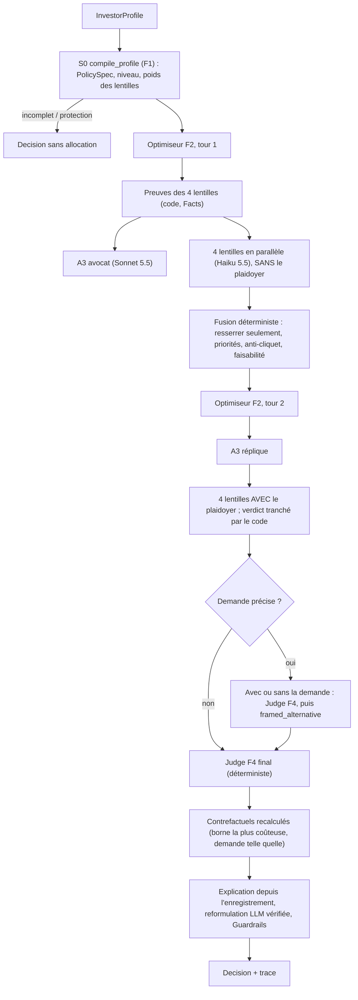

# agents : construire le portefeuille (débat A3 contre 4 lentilles)

> Simulation uniquement, aucun conseil financier. Le code calcule, le modèle explique, et chaque
> chiffre cite sa source.

`build_portfolio(profile, as_of, request=None, mode="rules"|"llm")` renvoie une `contracts.Decision`
complète et l'enregistrement des deux tours du débat.



## Garanties (testées)

- **Aucun poids ni chiffre ne vient d'un LLM.**
  - Les poids viennent de `portfolio.optimizer.optimize`, le contrôle de `portfolio.judge.check`.
  - Les lentilles émettent des `Amendment` d'une liste fermée (`schemas.py`). La fusion (`merge.py`)
    rejette tout amendement qui relâche une borne, cite un `fact_id` inconnu, passe sous le plancher
    anti-cliquet (0,6 × la borne d'origine pour une limite de risque) ou rend le mandat infaisable.
- **Indépendance au tour 1** : les lentilles ne voient pas le plaidoyer (contre l'effet d'ancrage).
- **Pas de persuasion au tour 2** : une objection n'est jamais « levée » par argumentation.
  - Un amendement appliqué est « satisfait ».
  - Une objection du tour 2 est « maintenue » et apparaît dans les limites de l'explication.
  - Il n'y a pas de 3e optimisation.
- **Insister ne change rien** : la `Decision` ne dépend que du profil, des données, du mandat et de
  la demande (test : 3 exécutions identiques).
- **Explication fidèle par construction** :
  - les phrases sont générées depuis l'enregistrement (limites saturées et leur prix dual, amendements
    appliqués, demande) ;
  - les contrefactuels sont **recalculés** par l'optimiseur ;
  - la reformulation LLM est vérifiée phrase par phrase (`explain.verify`) : tout nombre doit être la
    valeur formatée d'un `Fact` cité, sinon le gabarit reste.

## Modes

| Mode | Rôles | Usage |
|---|---|---|
| `rules` | `roles.rules_lens`, `roles.rules_advocate` : règles fixes, même contrat | tests, démo hors ligne, repli |
| `llm` | `strands.Agent` par rôle, `structured_output_model`, outils `@tool` propres à chaque lentille (`tools.strands_tools`) | démo AgentCore |

En mode `llm`, `roles.model()` utilise `llm.strands_replay.ReplayModel` (équipe finance) quand il est
disponible : chaque appel est enregistré puis rejouable (`ALPHAFORGE_LLM_MODE=record|replay|live`).
**Pas de `temperature`** sur Claude 5.5, effort `medium`.

Testé en réel le 2026-11-14 (us-east-1) : la lentille Risque (Haiku 5.5) a appelé d'elle-même
`horizon_distribution` et n'a cité que des `fact_id` existants.

## Déploiement

`app.py` est le point d'entrée `BedrockAgentCoreApp` en streaming (`start` → `round` × 2 →
`decision`). Le profil est lu et la décision écrite dans l'OKF client, avec le magasin de l'app
(`okf_bridge.stores_from_env`, `ALPHAFORGE_STORE` = `s3` ou `local`) : `clients/<id>/profil.md` en
lecture, `clients/<id>/decisions/` en écriture. Les variables `ALPHAFORGE_GUARDRAIL_ID` et
`ALPHAFORGE_GUARDRAIL_VERSION` activent l'ancrage contextuel.

## Modules utilisés

- `alphaforge.finance.contracts` : `InvestorProfile`, `Decision`, `PolicySpec` ;
- `alphaforge.finance.policy` (F1), `alphaforge.finance.portfolio` (F2-F4),
  `alphaforge.finance.llm` (rejeu) ;
- `alphaforge.finance.backtest` : moteur et données longues (`python -m alphaforge.finance.backtest.build_data`).

## Tests

```sh
cd app/agents && uv sync --group dev --group finance && uv run pytest tests/finance/debate -q
```

Les tests qui demandent les données longues sont sautés quand elles sont absentes
(`alphaforge.finance.backtest.paths.long_data_available`).

`test_pipeline_rules.py` (3 tests, environ 15 s) : la décision est valide et chaque phrase est
vérifiée ; la demande TSLA de 50 000 $ donne `refus_encadre` avec un contrefactuel ; trois
exécutions donnent une décision identique.

## Questions ouvertes

- **Divergence avec le brain.** Le questionnaire de profil (brain `a65a0b3`) choisit la catégorie
  par le stress 2022. `risk_levels.yaml` v0.2 l'ancre sur l'historique long.
- **Seuils des règles de repli** (`rules_lens`) : heuristiques, à valider par le volet finance.
- **Contrats du débat** (`schemas.py`) : à verser dans `contracts/` après validation.
