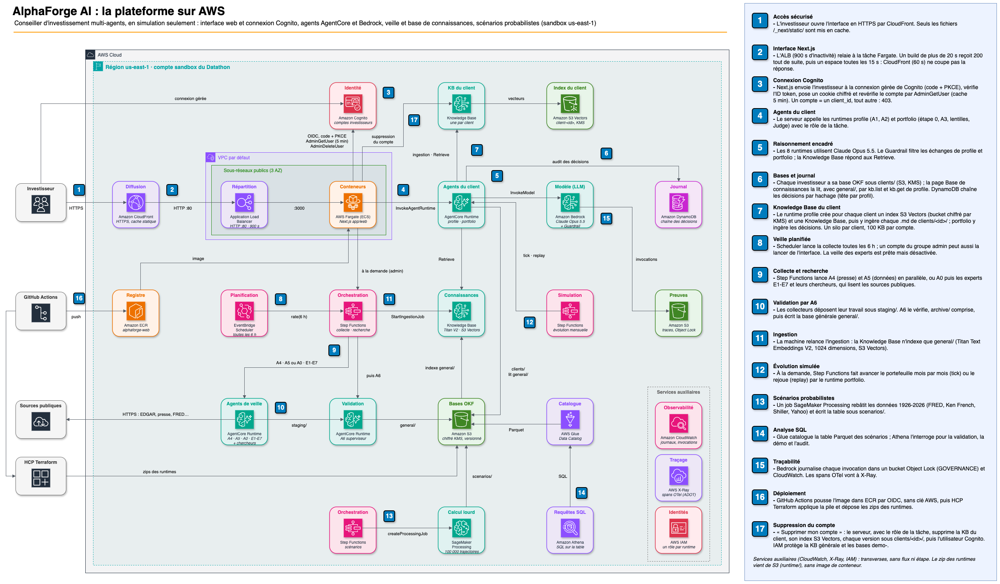

# Architecture AWS

L'architecture d'AlphaForge AI sur AWS (sandbox us-east-1), établie d'après le code de `master` du 15 novembre 2026. Simulation seulement : aucune transaction réelle.

| Document | Contenu |
| --- | --- |
| [Document d'architecture AWS (PDF)](alphaforge-architecture-aws.pdf) | Le document remis au jury : la plateforme, le rôle et la justification de chaque service, les trois cas d'utilisation étape par étape, les agents et le stockage, la sécurité, la traçabilité et le déploiement. |
| [`diagrams/`](diagrams/README.md) | Les quatre diagrammes, avec leur source draw.io : la plateforme, puis un diagramme par cas d'utilisation. |
| [Agents déployés et stockage](agents-et-stockage.md) | Les 8 runtimes AgentCore, les buckets S3 et S3 Vectors, DynamoDB et ECR. |

Les cas d'utilisation, du point de vue de l'investisseur, sont dans [`docs/use-cases/`](../use-cases/README.md).

