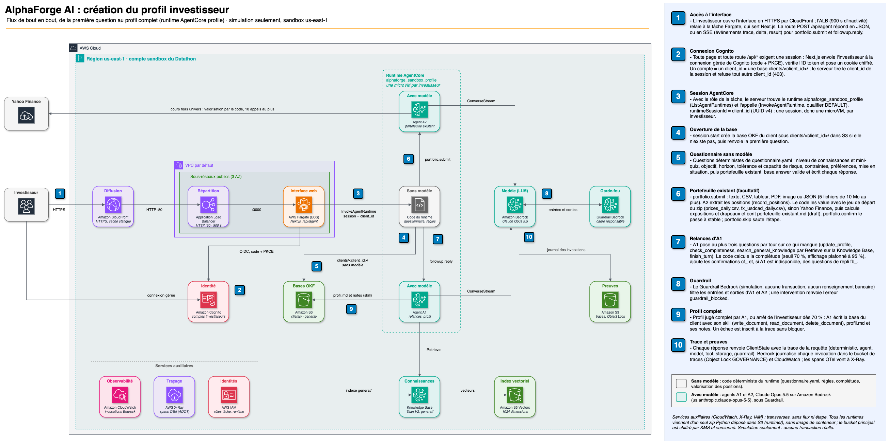
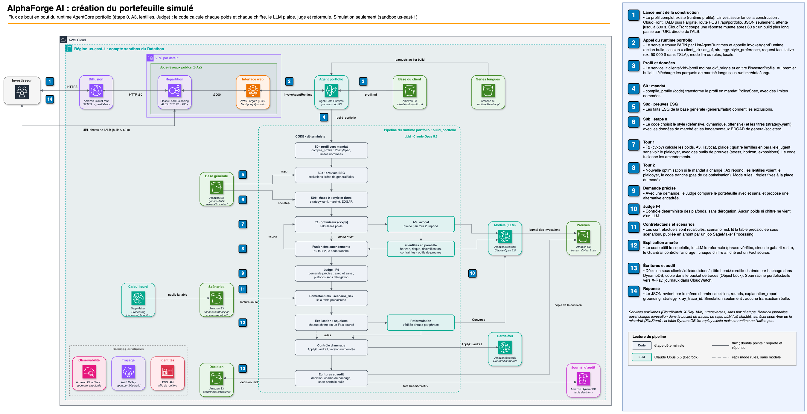
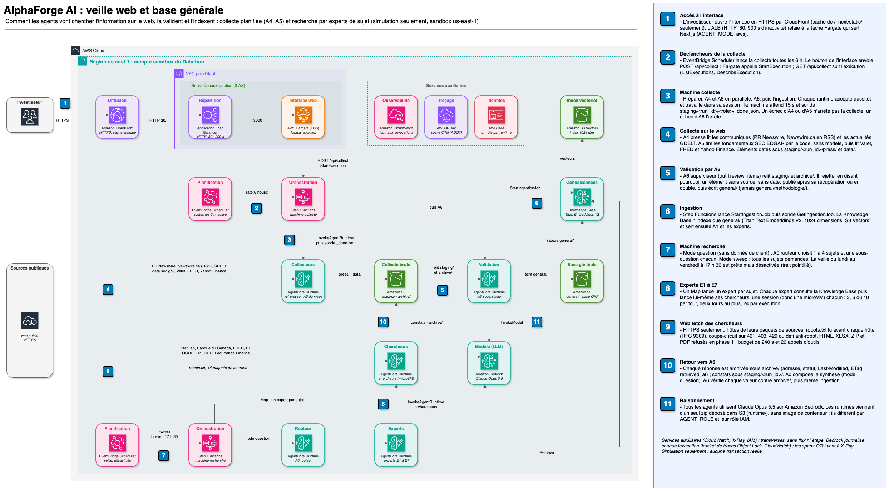

# Diagrammes d'architecture AWS

Quatre diagrammes d'AlphaForge AI sur AWS (sandbox us-east-1) : la plateforme complète, puis les trois flux de bout en bout de l'application. Ils ont été établis d'après le code de `master` du 2026-11-15 (Terraform de `infrastructure/`, `app/CONTRACTS.md`, code de `app/agents` et `app/web`). Simulation seulement : aucune transaction réelle.

Chaque diagramme existe en deux fichiers :

- `.drawio` : la source modifiable, à ouvrir dans draw.io (application de bureau ou [app.diagrams.net](https://app.diagrams.net)) ;
- `.png` : l'aperçu affiché ici.

Les pastilles bleues numérotent les étapes, décrites dans la légende à droite de chaque diagramme.

## Plateforme complète

Interface web, agents AgentCore et Bedrock, veille et base de connaissances, scénarios probabilistes, traçabilité et déploiement. L'investisseur se connecte par la connexion gérée d'Amazon Cognito (code + PKCE, vérifié par Next.js) : un compte = un `client_id` = une base `clients/<client_id>/`, et le serveur refuse tout autre `client_id` (403).

Source : [alphaforge-plateforme-aws.drawio](alphaforge-plateforme-aws.drawio)

## 1. Création du profil

De la première question au profil complet : questionnaire déterministe sans modèle, A2 pour le portefeuille existant, relances d'A1, Guardrail, Knowledge Base et base OKF du client sous `clients/`.

Source : [alphaforge-flux-profil.drawio](alphaforge-flux-profil.drawio)

## 2. Création du portefeuille

Runtime `portfolio` : étape 0, optimiseur, A3 et quatre lentilles sur deux tours, Judge, explication ancrée, décision et audit. Le code calcule chaque poids et chaque chiffre ; le LLM plaide, juge et reformule.

Source : [alphaforge-flux-portefeuille.drawio](alphaforge-flux-portefeuille.drawio)

## 3. Veille web et base générale

Comment les agents vont chercher l'information sur le web : collecte planifiée (A4, A5) et recherche par experts (A0, E1 à E7, chercheurs), validation par A6, puis ingestion dans la Knowledge Base.

Source : [alphaforge-flux-veille-web.drawio](alphaforge-flux-veille-web.drawio)
