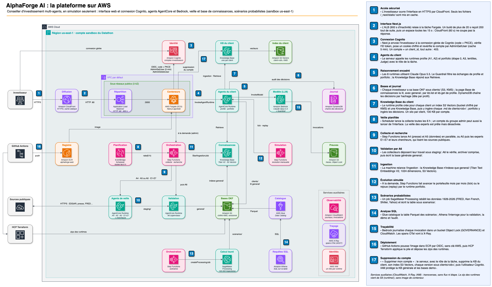
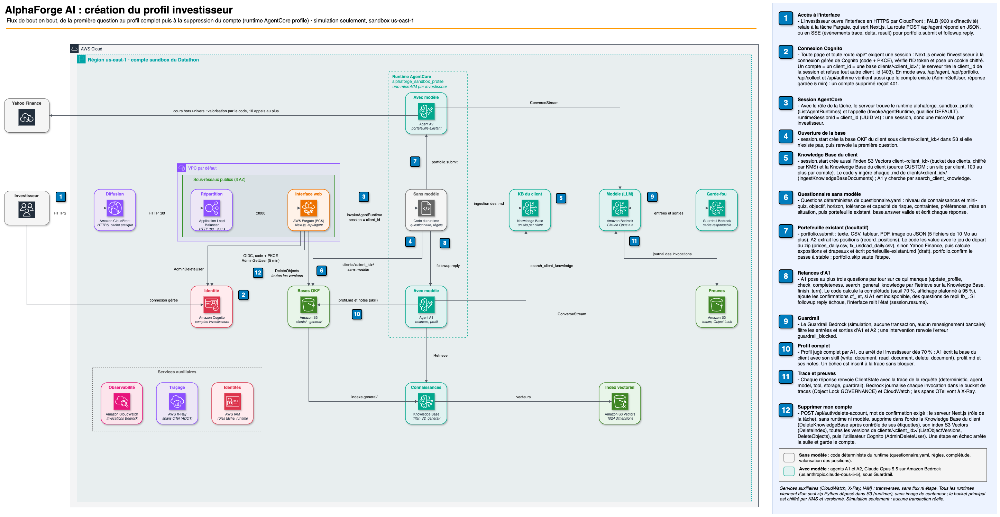
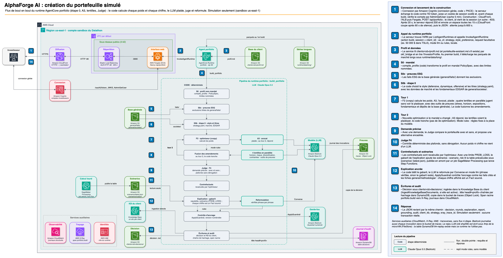
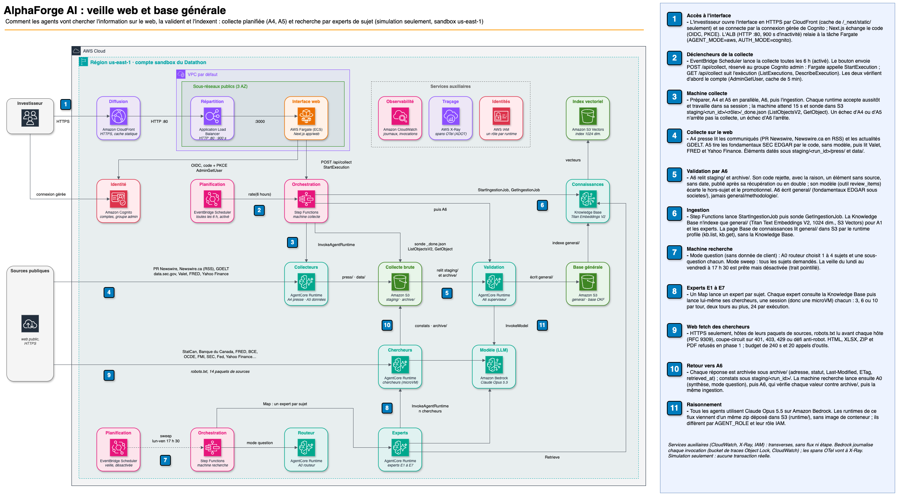

# Diagrammes d'architecture AWS

Les quatre diagrammes d'AlphaForge AI sur AWS (sandbox us-east-1) : la plateforme complète, puis un diagramme par cas d'utilisation. Ils sont établis d'après le code de `master` du 15 novembre 2026 : le Terraform de `infrastructure/`, `app/CONTRACTS.md` et le code de `app/agents` et `app/web`. Simulation seulement : aucune transaction réelle.

| Diagramme | Ce qu'il montre | Source | Cas d'utilisation |
| --- | --- | --- | --- |
| [La plateforme](#la-plateforme) | Tous les services AWS et leurs liens, en 17 étapes | [`alphaforge-plateforme-aws.drawio`](alphaforge-plateforme-aws.drawio) | les trois |
| [Créer son profil](#créer-son-profil) | Connexion, questionnaire, A2, A1, Guardrail, les deux Knowledge Bases, suppression du compte | [`alphaforge-flux-profil.drawio`](alphaforge-flux-profil.drawio) | [UC01](../../use-cases/uc01.md) |
| [Construire un portefeuille simulé](#construire-un-portefeuille-simulé) | Connexion, runtime `portfolio` : mandat, optimiseur, débat, Judge, explication ancrée, audit, Knowledge Base du client | [`alphaforge-flux-portefeuille.drawio`](alphaforge-flux-portefeuille.drawio) | [UC02](../../use-cases/uc02.md) |
| [Tenir la base de connaissances à jour](#tenir-la-base-de-connaissances-à-jour) | Collecte planifiée ou lancée par un admin, recherche par experts, validation par A6, ingestion | [`alphaforge-flux-veille-web.drawio`](alphaforge-flux-veille-web.drawio) | [UC03](../../use-cases/uc03.md) |

Chaque diagramme existe en deux fichiers : le `.drawio`, source modifiable à ouvrir dans draw.io (application de bureau ou [app.diagrams.net](https://app.diagrams.net)), et le `.png`, l'aperçu affiché ici. Les pastilles bleues numérotent les étapes, décrites dans la légende à droite de chaque diagramme.

## La plateforme

Interface web et connexion Cognito, agents AgentCore et Bedrock, veille et bases de connaissances, scénarios probabilistes, traçabilité, déploiement et suppression du compte. Un compte = un `client_id` = une base `clients/<client_id>/`, et le serveur refuse tout autre `client_id` (403). Chaque investisseur a sa propre Knowledge Base ; la Knowledge Base générale n'indexe que `general/`.

## Créer son profil

De la connexion au profil complet, puis à la suppression du compte : questionnaire déterministe sans modèle, A2 pour le portefeuille existant, relances d'A1, Guardrail, Knowledge Base générale, Knowledge Base du client et base OKF du client sous `clients/`.

## Construire un portefeuille simulé

Connexion Cognito, puis le runtime `portfolio` : étape 0, optimiseur, A3 et quatre lentilles sur deux tours, Judge, explication ancrée, décision, audit et ingestion dans la Knowledge Base du client. Le code calcule chaque poids et chaque chiffre ; le modèle plaide, juge et reformule.

## Tenir la base de connaissances à jour

La veille web : collecte planifiée toutes les 6 h ou lancée par un membre du groupe `admin` (A4, A5), recherche par experts (A0, E1 à E7, chercheurs), validation par A6, puis ingestion dans la Knowledge Base générale.

[Retour à l'architecture](../README.md)
