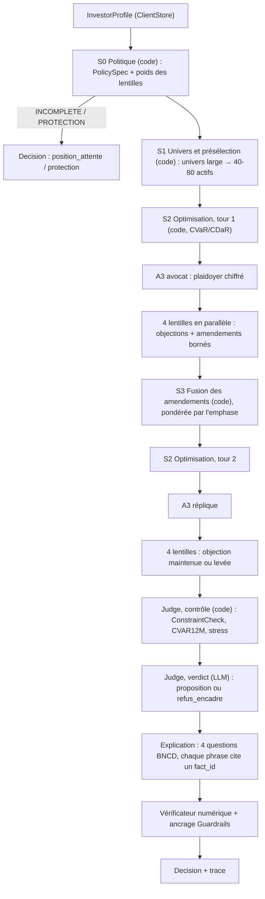

# Construire le portefeuille : plan technique (section 2 de l'architecture)

> Simulation uniquement : aucun conseil personnalisé, aucune transaction.
> Le code calcule, le modèle explique, et chaque chiffre cite sa source.

Version 1 du 2026-11-14. Ce document traduit en plan d'implémentation les décisions de la séance
d'architecture (A3 → agents d'analyse → Judge) et celles du volet finance. Ces dernières sont
consignées dans le Brain (`architecture/construction-portefeuille.md`).

Documents liés :
- [`data-sources.md`](data-sources.md) : sources de données gratuites testées pour l'univers large ;
- [`../../research/calibration/`](../../research/calibration/) : calibration empirique des niveaux de risque.

## 1. Décisions

| Sujet | Décision |
|---|---|
| Débat | **A3 est l'avocat** : il défend le portefeuille candidat. **Quatre lentilles sont les contradictrices** : Timeline (horizon), Risque (tolérance et capacité d'absorption), Diversité et préférences (ESG compris), Contraintes. Toutes lisent le profil complet, mais chacune met l'accent sur son élément. **Leur poids dépend du profil.** |
| Tours | **Deux tours d'optimisation** avant le Judge |
| Univers | **Large** : plusieurs marchés, types d'actifs et secteurs (actions US et CA, FNB d'actions, FNB d'obligations, FNB de matières premières, cryptoactifs) |
| Données | **Aucune clé d'API payante** |
| Calculs | Dans **AgentCore Runtime**, avec les agents |
| Judge | Contrôle **déterministe** par le code (pas de dérogation possible), puis un verdict rédigé par un LLM |

## 2. Pipeline

**Règles :**
- Les lentilles ne produisent **jamais** de poids. Elles émettent des `Amendment` d'une liste fermée :
  `tighten_limit`, `cap_group`, `exclude_asset` (avec preuve), `require_min_group`,
  `switch_risk_measure`, `flag_only`.
- Un amendement ne peut que **resserrer** une borne. Le code rejette tout amendement hors schéma ou
  hors bornes.
- Les conflits se tranchent dans cet ordre : contraintes légales > capacité de risque > horizon >
  préférences > diversification.
- **Demande précise** (par exemple « 50 000 $ dans TSLA ») : on optimise **avec** et **sans** la
  demande, et le débat porte sur l'écart (CVaR, stress en $, probabilité de manquer l'objectif).
  Si la demande viole la politique, le Judge rend un `refus_encadre` avec une variante en bac à
  sable plafonnée.
- **Poids des lentilles** : des règles fixes, versionnées en YAML. Exemples :
  - horizon court ou retraits → Timeline ;
  - tolérance supérieure à la capacité, FOMO → Risque ;
  - ESG, filtres, thèmes ou concentration → Diversité ;
  - contraintes légales, actions de l'employeur, demande hors politique → Contraintes.

**Ne pas connaître encore les OKF ne bloque rien.** Le volet portefeuille consomme
`InvestorProfile` et produit `Decision`, à travers deux interfaces :
- `ClientStore.load_profile()` et `save_decision()` ;
- `MarketStore.universe()`, `returns()`, `lookthrough()` et `evidence()`.

On les implémente d'abord sur des profils de test et des parquet locaux. Quand le format OKF sera
fixé, seuls ces adaptateurs changeront.

## 3. Projets open source et bibliothèques

| Élément | Version | Rôle |
|---|---|---|
| `strands-agents` (`strands-agents/harness-sdk`) | 1.65.0 | `GraphBuilder` (lentilles en parallèle, 2 tours bornés), `structured_output_model=` (Pydantic), hooks `AfterNodeCallEvent` / `AfterToolCallEvent` pour la trace, nœud `MultiAgentBase` pour le Judge déterministe |
| `bedrock-agentcore` | 1.26.0 | point d'entrée `BedrockAgentCoreApp`, **en streaming** |
| `skfolio` | 1.12.16, à figer | `MeanRisk` (CVaR / CDaR, `groups`, `linear_constraints`, look-through par `left_inequality`), `RiskBudgeting`, contributions au risque |
| `cvxpy` + `clarabel`, `scipy` (HiGHS) | — | solveurs ; programme CVaR de Rockafellar-Uryasev pour les **prix des contraintes** |
| `research/backtest/engine` (équipe) | build `008f122d…` | données, métriques, fenêtres, `ConstraintSet` (contrôle du Judge) |
| `contracts/` (équipe) | `InvestorProfile` 0.1, `Decision` 0.1, `PolicySpec` 0.2-draft | contrats partagés, fidélité par construction |
| `financedatabase` (MIT), `yfinance`, `ccxt` (MIT) | — | univers large, prix, crypto longue (voir [`data-sources.md`](data-sources.md)) |

**Modèles à copier** (lus, pas exécutés) :
- `awslabs/agentcore-samples` → `02-use-cases/01-conversational-agents/episodic-memory-claims-agent/agent/src/claims_graph.py` :
  analystes en parallèle puis un juge. **C'est notre squelette.**
- `strands-agents/samples` → `python/01-learn/12-graph/` (éventail sortant et entrant),
  `python/01-learn/05-guardrails/`, `python/07-ux-demos/human-in-the-loop-approval-agent/`
  (pause et explication, pour la friction de Robert).
- `TauricResearch/TradingAgents` (Apache-2.0) : **seulement la structure des prompts de débat**.

**Non retenus** :
- PyPortfolioOpt et Riskfolio : skfolio les couvre.
- ai-hedge-fund, FinRobot, OpenBB : trop lourds.
- Swarm : le modèle y choisit le routage, ce qui va contre des tours fixes.
- `strands-agents-tools` : archivé.

**Pièges vérifiés** :
- **Graph Strands** :
  - le regroupement en entrée est un **OU** : utiliser `all_dependencies_complete` et un compteur de tours ;
  - `state.results` est écrasé au tour 2 : conserver les tours dans un hook ;
  - pas de gestionnaire de session sur les nœuds.
- **Claude Sonnet 5.5** :
  - refuse le `tool_choice` forcé : figer `botocore>=1.42.42` pour la sortie structurée native ;
  - ne pas fixer `temperature` ;
  - ne pas modifier les tours précédents de la conversation.
- **Limite synchrone de 15 min** sur AgentCore : faire du streaming.
- **L'ancien `bedrock-agentcore-starter-toolkit` est déprécié** : la CLI actuelle est `@aws/agentcore` 1.0.3.

## 4. Ressources AWS et correspondance Terraform

Pour l'équipe qui monte le setup Terraform : la colonne `[F]` indique un service dont l'accès a été
**vérifié sur le compte** le 2026-11-14 (appels réels avec le rôle `WSParticipantRole`, en `us-east-1`).
Les ressources Terraform viennent du changelog du provider `hashicorp/aws` (dernière version 6.73.0).

| Fonction | Ressource AWS | Ressource Terraform | `[F]` |
|---|---|---|---|
| Raisonnement : A3, verdict du Judge, explication | Bedrock, `us.anthropic.claude-sonnet-5-5` | — (accès au modèle) | ✅ appel réel |
| Raisonnement : 4 lentilles | Bedrock, `us.anthropic.claude-haiku-5-5` | — | ✅ |
| Hébergement du Graph et des outils (skfolio inclus) | AgentCore Runtime, CodeZip, `PYTHON_3_13`, arm64 | `aws_bedrockagentcore_agent_runtime` + `aws_bedrockagentcore_agent_runtime_endpoint` | ✅ création autorisée |
| Mémoire de session (tours du débat) | AgentCore Memory | `aws_bedrockagentcore_memory` (+ `_memory_strategy`) | ✅ |
| Données de marché (`gold/`) et décisions | S3 | `aws_s3_bucket` (+ versioning) | ✅ |
| Garde-fous : sujets interdits, données personnelles, ancrage contextuel | Bedrock Guardrails | `aws_bedrock_guardrail` (+ `_version`) | ✅ |
| Citations (méthodologies ESG, fiches FNB) | Knowledge Bases + S3 Vectors + Titan Embed v2 | `aws_bedrockagent_knowledge_base`, `aws_s3vectors_vector_bucket`, `aws_s3vectors_index` | ✅ embedding testé |
| Trace pour le jury | AgentCore Observability → CloudWatch (activer **Transaction Search**) | `aws_cloudwatch_log_group` ; Transaction Search `A confirmer` | ✅ (CloudWatch) |
| Rôle d'exécution | IAM, moindre privilège : `bedrock:InvokeModel*`, `bedrock:ApplyGuardrail`, `s3:GetObject` sur `gold/`, `s3:PutObject` sur `decisions/`, Memory | `aws_iam_role` + politiques | ✅ `iam:CreateRole` / `PassRole` autorisés |

**Points d'attention :**
- **App Runner est refusé** sur le compte (`implicitDeny`). L'interface reste locale.
- **Déploiement de l'agent :** la CLI `agentcore deploy` passe par **CDK**. Si Terraform gère
  l'infrastructure, il faut trancher : Terraform déclare la ressource runtime, avec l'artefact
  CodeZip placé sur S3 par un script de build, et la CLI ne sert qu'à `agentcore dev` en local.
  `A confirmer` : le bloc d'artefact du code de `aws_bedrockagentcore_agent_runtime` n'a pas été
  vérifié.
- **Non utilisés dans ce volet** : Lambda et Step Functions (collecte et Monte Carlo lourd, en
  extension), AgentCore Gateway et Identity (les outils sont des fonctions Python), Bedrock Agents
  classiques.

## 5. Niveaux de risque (profil → limites)

Deux propositions indépendantes ont été produites le 2026-11-14 :
- **la théorie** donne le score de capacité calculé à partir de faits (moyenne géométrique, non
  compensatoire), la tolérance déclarée ou testée pondérée par la confiance, risque effectif =
  min(tolérance, capacité), la règle en dollars, les seaux par objectif et les plafonds de
  satellites w ≤ φ·ℓ*/δ ;
- **la calibration empirique** (`research/calibration/`) donne les budgets ancrés sur l'enveloppe
  historique.

La réconciliation (`policy/risk_levels.yaml` v0.2) **est en revue**. Elle est produite au format
`PolicySpec` 0.2-draft (`limits: list[Limit]`), avec :
- la CVaR95 **mensuelle** pour l'optimiseur, et la mesure **`CVAR12M`** contrôlée par le Judge sur
  l'historique long raccordé à des proxys (`history_proxies`, étiquetés HYPOTHESE) ;
- un plafond par FNB et des fourchettes par classe d'actifs ;
- un panier de stress : 2022, 2008, 2000-02 et 1973-74, plus 1929-32 en information.

Ordres de grandeur provisoires (enveloppe historique) :
- crypto de 0 à 2,5 % selon le niveau ;
- titre individuel ≤ 5 % ;
- bac à sable ≤ 3 %.

## 6. Prochaines étapes

| # | Étape | État | Vérification |
|---|---|---|---|
| 1 | Optimiseur F2 (CVaR, CDaR, variance, prix des contraintes), analyses F3 (contributions au risque, look-through, stress, horizon), contrôle du Judge F4 | **fait par l'équipe, non commité** (31 tests verts) | à mettre sur une branche et à relire |
| 2 | `policy/risk_levels.yaml` v0.2 réconcilié + chargement dans `PolicySpec` | en revue | un portefeuille réalisable par niveau sur les 55 actifs ; diagnostic d'infaisabilité |
| 3 | S0 : `InvestorProfile` → `PolicySpec` + `emphasis.yaml` (poids des lentilles) | à faire | Robert : Timeline et Risque en tête ; Amira : Diversité ; Mateo : Préférences. Un champ manquant donne une borne plus prudente |
| 4 | Interfaces `ClientStore` / `MarketStore` + profils de test (3 personas + 3 contrastés) | à faire | les profils passent la validation du contrat |
| 5 | Univers large : liste maîtresse (500-700 actifs), prix mensuels, look-through iShares CA, Vanguard et SPDR, métadonnées (frais, duration) | à faire | historique ≥ 36 mois, sinon proxy ou exclusion ; manifeste de source par fichier |
| 6 | Outils `@tool` des lentilles (renvoient des `Fact` et des `TraceEvent`) | à faire, en enveloppant F3 | chaque chiffre a une source et un `trace_id` |
| 7 | Graph Strands : A3, 4 lentilles, fusion, tour 2, Judge-contrôle, verdict, explication | à faire | bout en bout en local (`agentcore dev`) sur Robert et Amira |
| 8 | Contrats `Amendment`, `LensReport`, `DebateRound` | à faire | amendement hors bornes rejeté ; `Decision` valide |
| 9 | Déploiement : AgentCore Runtime, Memory, Guardrails, Observability, **en Terraform** | dépend du setup Terraform | `invoke` + arbre de traces dans CloudWatch |
| 10 | Scénarios de démo : Robert (TSLA → `refus_encadre`), Amira (crypto et tech en look-through), Mateo (ESG avec preuves) | dimanche soir | vidéo de secours avant la suppression du compte |

**Tests d'acceptation transversaux :**
- même profil et mêmes données → mêmes poids ;
- toute phrase cite un `fact_id` existant ;
- l'ancrage Guardrails passe ;
- aucun amendement ne relâche une borne dure.
