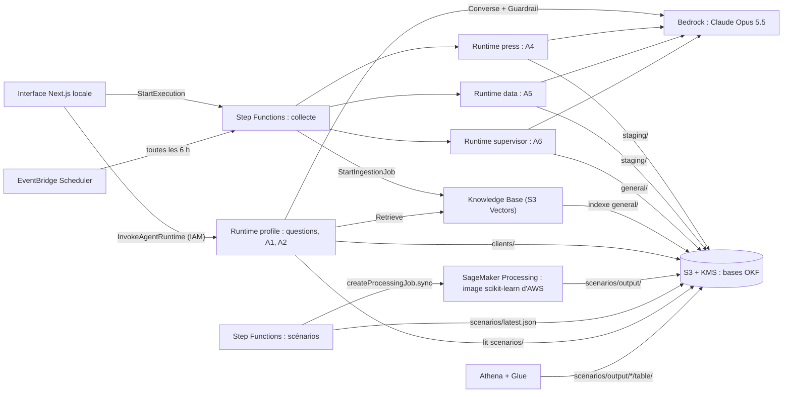
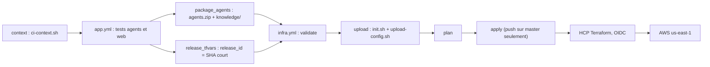

# AlphaForge AI : infrastructure

Moitié **infrastructure** du mono repo `app/` + `infrastructure/`. Elle reçoit le zip du code des agents construit par `.github/workflows/app.yml` dans le même run GitHub Actions, puis déploie sur AWS via HCP Terraform. Le contrat entre l'interface, les runtimes et cette infra est dans [`app/CONTRACTS.md`](../app/CONTRACTS.md).

## Ce qui est déployé

Compte AWS Workshop Studio du Datathon, `us-east-1`, environnement `sandbox`, préfixe `alphaforge-sandbox`.

| Service | Fichier | Rôle |
| --- | --- | --- |
| AgentCore Runtime | `infra/agentcore.tf` | Quatre runtimes tirés d'un seul zip Python : `profile` (questions de base, A1, A2), `press` (A4), `data` (A5), `supervisor` (A6). Un rôle IAM par runtime, limité à ses préfixes S3. Facultatif (`portfolio_enabled`) : `portfolio`, le portefeuille simulé du volet finance, avec son propre zip. |
| S3 + KMS | `infra/s3.tf` | Bases OKF : `general/`, `clients/<id>/`, `staging/`, `runtime/`. Clé KMS du projet, versionnement, TLS obligatoire, accès public bloqué. |
| Knowledge Base + Guardrail | `infra/bedrock.tf` | Knowledge Base sur S3 Vectors (Titan Text Embeddings V2) qui n'indexe que `general/`; Guardrail du cadre responsable (pas de transaction réelle, renseignements personnels bloqués ou masqués). |
| Step Functions | `infra/stepfunctions.tf` | Collecte : A4 et A5 en parallèle, A6, puis ingestion de la Knowledge Base. |
| EventBridge Scheduler | `infra/scheduler.tf` | Veille : lance la collecte toutes les 6 heures. |
| SageMaker Processing + Step Functions | `infra/scenarios.tf` | Scénarios probabilistes (facultatif, `scenarios_enabled`) : un job sur l'image scikit-learn d'AWS calcule la table des scénarios hors du poste, de façon reproductible (image et code figés, entrées et sorties dans S3). Step Functions le lance (`.sync`), écrit `_done.json` puis `scenarios/latest.json`. |
| Glue + Athena | `infra/scenarios.tf` | Table `scenarios` (parquet, projection de partition sur `run_id`) interrogeable en SQL pour la validation et la démo, sans base à gérer; résultats chiffrés par la clé du bucket. |



## Pipeline



| Événement | Jobs app | Jobs infra |
| --- | --- | --- |
| Push sur `master` | tests, zip, release | validate, upload, plan, apply |
| PR qui touche `infrastructure/**` | tests, zip, release | validate, upload, plan (pas d'apply) |
| Autre PR, autre push, `workflow_dispatch` | tests | aucun |
| Variable de repo `DESTROY_ENV=true` | tests | aucun |

GitHub Actions n'a aucun accès AWS : seul HCP Terraform assume le rôle `alphaforge-tfc-run` par OIDC, et c'est lui qui téléverse le zip dans S3. Le zip porte le SHA du commit (`runtime/agents-<sha>.zip`), donc chaque commit déploie un objet immuable et met les quatre runtimes à jour.

## Layout

```text
infrastructure/
  bootstrap/          OIDC HCP Terraform -> AWS et rôle des runs (une fois, état local)
  infra/              module racine Terraform (le bundle téléversé garde ce dossier)
    build/            artefact du run : agents.zip, knowledge/ (jamais commité)
  deploy/
    envs/sandbox.tfvars   valeurs de l'environnement
    release.auto.tfvars   artefact du run : release_id (jamais commité)
  scripts/            ci-context, init, upload-config, plan, apply, destroy, validate, write-release-tfvars
```

## Mise en place (déjà faite le 2026-11-14, sauf le bootstrap AWS)

1. **Bootstrap AWS**, une seule fois, avec les identifiants du Workshop :

   ```sh
   terraform -chdir=infrastructure/bootstrap init
   terraform -chdir=infrastructure/bootstrap apply
   ```

   Il crée le fournisseur OIDC `app.terraform.io` et le rôle `alphaforge-tfc-run`, assumable seulement par les runs du workspace `larpathon` de l'organisation `larpathon_2026`. Son ARN est déjà dans `deploy/envs/sandbox.tfvars`.
2. **Workspace HCP Terraform** `larpathon` : sans VCS, répertoire de travail `infra`, auto-apply, Terraform 1.17.2, variables d'environnement `TFC_AWS_PROVIDER_AUTH=true` et `TFC_AWS_RUN_ROLE_ARN`.
3. **GitHub** : secret `TF_API_TOKEN`, variables `EPHEMERAL_ENVS_ENABLED=false` et `TFC_PROJECT_ID`.

## Vérifier en local

```sh
cd infrastructure
sh scripts/validate.sh       # terraform init -backend=false, fmt -check, validate
GITHUB_EVENT_NAME=push GITHUB_REF_NAME=master DEFAULT_BRANCH=master sh scripts/ci-context.sh
```

## Pièges

- **Noms AgentCore** : ni tiret ni point, d'où `alphaforge_sandbox_profile`.
- **Tag mobile** : `write-release-tfvars.sh` et la validation de `release_id` refusent tout ce qui n'est pas un SHA.
- **Artefacts absents** : `upload-config.sh` s'arrête si `deploy/release.auto.tfvars` ou `infra/build/agents.zip` manque.
- **Objet absent, réponse 403** : les rôles n'ont `s3:ListBucket` que sous leurs préfixes (condition `s3:prefix`). Pour un objet absent, S3 répond alors `AccessDenied` et non `NoSuchKey`. Step Functions sonde donc les marqueurs par `ListObjectsV2`, et le magasin Python vérifie l'existence par une liste avant de conclure.
- **Clé KMS du bucket** : elle ne délègue pas à IAM. Tout nouveau rôle qui lit ou écrit le bucket doit figurer dans `local.s3_kms_user_role_arns` (`infra/s3.tf`).
- **Workspace VCS** : HCP Terraform refuse le téléversement de configuration sur un workspace relié à un VCS; `larpathon` n'en a pas.
- **Scénarios : bundle du job** : `package.sh` ne construit `infra/build/scenarios/` (`run.sh`, `scenarios.zip`) que si `ALPHAFORGE_PACKAGE_SCENARIOS=1` (en CI : variable de dépôt GitHub du même nom, à brancher dans `app.yml` au moment d'activer les scénarios, ce qui demande un jeton avec le droit `workflow`; absente, rien n'est construit et le déploiement ne dépend pas de ce bundle). Demandé, il échoue au moindre manque : `scenarios/job.py`, le constructeur `alphaforge/finance/backtest/build_data.py`, `requirements-job.txt` figé par `==` (roues x86_64-manylinux_2_28, Python 3.12, celui de l'image), taille. Le bundle ne contient jamais de parquet ni `data/long/raw/`. Poser la variable et `scenarios_enabled = true` ensemble : sinon un bloc `check` de `scenarios.tf` avertit au plan et une exécution échoue au démarrage du job.
- **Runtime `portfolio` : `portfolio_enabled = false`** par défaut (ni runtime, ni rôle, ni zip, ni droit de traçabilité), **activé dans `envs/sandbox.tfvars`**. Activé, le runtime prend `runtime/agents-portfolio-<release>.zip`, que `package.sh` construit par défaut (`ALPHAFORGE_PACKAGE_PORTFOLIO=0` pour s'en passer). Les données longues du moteur (parquets non versionnés) sont lues au premier `build` sous `runtime/data/long/` (déposées par `app/agents/scripts/finance/upload_long_data.py`, sha256 vérifiés via `manifest.json`). Sans ce zip, il prend le zip commun : un bloc `check` avertit au plan, `health` répond et `build` renvoie une erreur qui le dit. Son rôle est dans `finance_trace_runtimes` (journal des décisions, rejeu LLM, `/alphaforge-sandbox/finance`). Le zip vise `aarch64-manylinux_2_28` (cvxpy n'a pas de roue `manylinux2014` pour linux/arm64) : vérifier `health` puis un `build` en mode `rules` au premier déploiement.
- **Runtime `portfolio` : droits X-Ray, à vérifier au premier déploiement** : avec `ALPHAFORGE_OTLP_XRAY=1`, le volet finance envoie ses spans en OTLP à `https://xray.<région>.amazonaws.com/v1/traces` (`finance/observability/telemetry.py`). Le rôle des runtimes n'a que `xray:PutTraceSegments`, `xray:PutTelemetryRecords` et les règles d'échantillonnage; ce point de terminaison demande peut-être `xray:PutSpans` (et `xray:PutSpansForIndexing`). Si les traces n'arrivent pas, ajouter ces actions au rôle `portfolio`.
- **Scénarios : `scenarios_enabled = false`** (défaut) : aucune ressource, aucun droit du rôle `profile` sous `scenarios/`, aucune règle de cycle de vie Athena; le plan est identique à celui sans scénarios.
- **Scénarios : image AWS figée** : `scenarios_image_uri` refuse les étiquettes mobiles (`1.4-2-py312`); changer d'image demande de vérifier la version de Python et de reconstruire le bundle.
- **Scénarios : journal SageMaker** : Terraform crée `/aws/sagemaker/ProcessingJobs` (clé des journaux, 14 jours). Si le groupe existe déjà dans le compte (job lancé à la main), l'apply échoue : l'importer ou le supprimer d'abord.
- **Scénarios : démontage** : le bucket a `force_destroy`, donc les objets écrits par le job et la machine (toutes versions) partent avec lui; le groupe Athena a `force_destroy`; la base et la table Glue sont gérées par Terraform. Restent hors Terraform, sans coût : l'historique des jobs SageMaker (métadonnées) et la règle EventBridge gérée `StepFunctionsGetEventsForSageMakerProcessingJobsRule` créée par Step Functions. `scripts/destroy.sh` refuse `sandbox` : démontage par l'interface HCP Terraform, comme le reste de la pile.
- **Compte supprimé le 2026-11-16** : exporter les bases des clients avant (voir le README racine).
