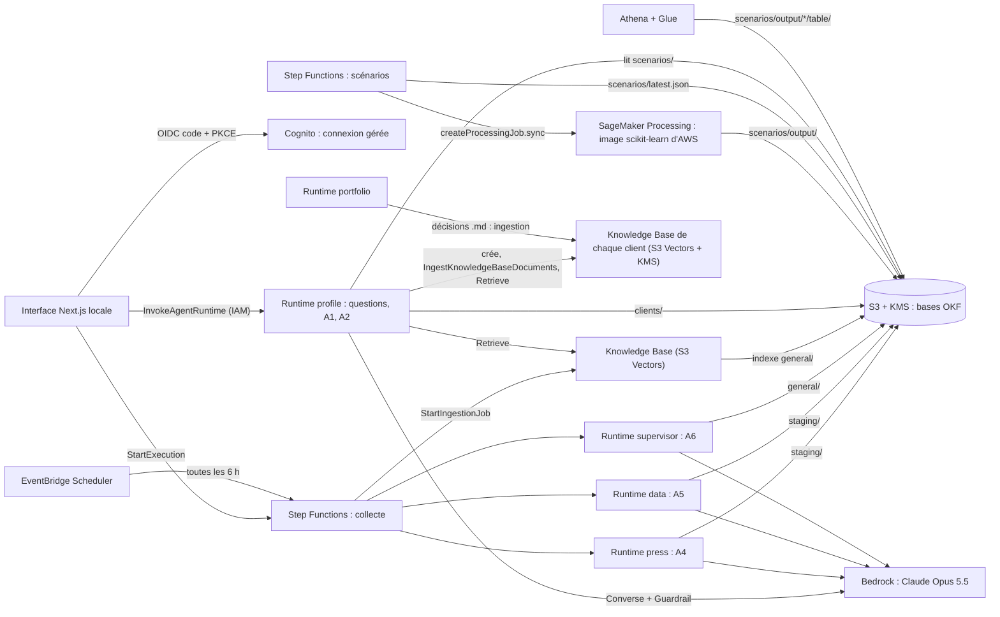
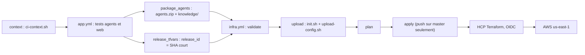

# AlphaForge AI : infrastructure

Moitié **infrastructure** du mono repo `app/` + `infrastructure/`. Elle reçoit le zip du code des agents construit par `.github/workflows/app.yml` dans le même run GitHub Actions, puis déploie sur AWS via HCP Terraform. Le contrat entre l'interface, les runtimes et cette infra est dans [`app/CONTRACTS.md`](../app/CONTRACTS.md).

## Ce qui est déployé

Compte AWS Workshop Studio du Datathon, `us-east-1`, environnement `sandbox`, préfixe `alphaforge-sandbox`.

| Service | Fichier | Rôle |
| --- | --- | --- |
| AgentCore Runtime | `infra/agentcore.tf` | Quatre runtimes tirés d'un seul zip Python : `profile` (questions de base, A1, A2), `press` (A4), `data` (A5), `supervisor` (A6). Un rôle IAM par runtime, limité à ses préfixes S3. Facultatif (`portfolio_enabled`) : `portfolio`, le portefeuille simulé du volet finance, avec son propre zip. |
| S3 + KMS | `infra/s3.tf` | Bases OKF : `general/`, `clients/<id>/`, `staging/`, `runtime/`. Clé KMS du projet, versionnement, TLS obligatoire, accès public bloqué. |
| Knowledge Base + Guardrail | `infra/bedrock.tf` | Knowledge Base sur S3 Vectors (Titan Text Embeddings V2) qui n'indexe que `general/`; Guardrail du cadre responsable (pas de transaction réelle, renseignements personnels bloqués ou masqués). |
| Knowledge Base de chaque client | `infra/client_kb.tf` | Socle des Knowledge Bases des clients, créées par le runtime `profile` (une par investisseur, hors de l'état Terraform) : bucket S3 Vectors `<préfixe>-client-vectors` chiffré par sa clé KMS (les vecteurs portent le texte des passages), rôle de service des bases, droits de `profile` (création) et de `portfolio` (ingestion, recherche) par étiquette `alphaforge:scope=client`. `client_kb_enabled` (vrai par défaut) pose les variables des runtimes. |
| Step Functions | `infra/stepfunctions.tf` | Collecte : A4 et A5 en parallèle, A6, puis ingestion de la Knowledge Base. |
| EventBridge Scheduler | `infra/scheduler.tf` | Veille : lance la collecte toutes les 6 heures. |
| SageMaker Processing + Step Functions | `infra/scenarios.tf` | Scénarios probabilistes (facultatif, `scenarios_enabled`) : un job sur l'image scikit-learn d'AWS calcule la table des scénarios hors du poste, de façon reproductible (image et code figés, entrées et sorties dans S3). Step Functions le lance (`.sync`), écrit `_done.json` puis `scenarios/latest.json`. |
| ECS Fargate + ALB + CloudFront | `infra/web.tf` | Interface Next.js (`app/web/Dockerfile`), `AGENT_MODE=aws`, image ECR `alphaforge-web:<release_id>`. CloudFront donne le HTTPS sur `*.cloudfront.net` (output `web_url`) ; l'ALB direct (`web_alb_url`, HTTP) garde la connexion 900 s pour un build du portefeuille de plus de 60 s, limite de CloudFront. Tâche en sous-réseau public avec IP publique (pas de NAT), joignable seulement depuis l'ALB. Facultatif (`web_enabled`). |
| Cognito | `infra/auth.tf` | Connexion des investisseurs (facultatif, `auth_enabled`, activé en sandbox) : User Pool (courriel comme identifiant, inscription libre, courriel vérifié par Cognito, plan Essentials), domaine de connexion gérée (version 2, output `auth_domain`), client d'application public (code + PKCE, sans secret), groupe `admin`. La tâche ECS passe en `AUTH_MODE=cognito` avec un secret de session `random_password`. Un compte = un `client_id` (`app/CONTRACTS.md`, section 7.1). |
| Glue + Athena | `infra/scenarios.tf` | Table `scenarios` (parquet, projection de partition sur `run_id`) interrogeable en SQL pour la validation et la démo, sans base à gérer; résultats chiffrés par la clé du bucket. |



## Pipeline



| Événement | Jobs app | Jobs infra |
| --- | --- | --- |
| Push sur `master` | tests, zip, image poussée dans ECR, release | validate, upload, plan, apply |
| PR qui touche `infrastructure/**` | tests, zip, image construite sans push, release | validate, upload, plan (pas d'apply) |
| Autre PR, autre push, `workflow_dispatch` | tests, image construite sans push | aucun |
| Variable de repo `DESTROY_ENV=true` | tests | aucun |

GitHub Actions n'a aucune clé AWS. HCP Terraform assume le rôle `alphaforge-tfc-run` par OIDC, et c'est lui qui téléverse le zip dans S3. Seul le job `build_web`, sur un push de `master`, assume aussi par OIDC le rôle `alphaforge-github-ecr-push`, qui ne peut que pousser dans le dépôt ECR `alphaforge-web`. Le zip porte le SHA du commit (`runtime/agents-<sha>.zip`), donc chaque commit déploie un objet immuable et met les quatre runtimes à jour.

## Layout

```text
infrastructure/
  bootstrap/          OIDC HCP Terraform -> AWS et rôle des runs (main.tf) ; OIDC GitHub,
                      dépôt ECR et rôle de push de l'image (github.tf) ; une fois, état local
  infra/              module racine Terraform (le bundle téléversé garde ce dossier)
    build/            artefact du run : agents.zip, knowledge/ (jamais commité)
  deploy/
    envs/sandbox.tfvars   valeurs de l'environnement
    release.auto.tfvars   artefact du run : release_id (jamais commité)
  scripts/            ci-context, init, upload-config, plan, apply, destroy, validate, write-release-tfvars,
                      clean-client-kbs (Knowledge Bases des clients, à la main)
```

## Mise en place (déjà faite le 2026-11-14, sauf le bootstrap AWS)

1. **Bootstrap AWS**, une seule fois, avec les identifiants du Workshop :

   ```sh
   terraform -chdir=infrastructure/bootstrap init
   terraform -chdir=infrastructure/bootstrap apply
   ```

   Il crée le fournisseur OIDC `app.terraform.io` et le rôle `alphaforge-tfc-run`, assumable seulement par les runs du workspace `larpathon` de l'organisation `larpathon_2026`. Son ARN est déjà dans `deploy/envs/sandbox.tfvars`. `github.tf` (appliqué le 2026-11-15, même état) ajoute le fournisseur OIDC de GitHub Actions, le dépôt ECR `alphaforge-web`, le rôle `alphaforge-github-ecr-push` (branche `master` seulement) et les rôles liés aux services ECS et ELB ; leurs valeurs sont dans l'env du job `context` de `pipeline.yml`.
2. **Workspace HCP Terraform** `larpathon` : sans VCS, répertoire de travail `infra`, auto-apply, Terraform 1.17.2, variables d'environnement `TFC_AWS_PROVIDER_AUTH=true` et `TFC_AWS_RUN_ROLE_ARN`.
3. **GitHub** : secret `TF_API_TOKEN`, variables `EPHEMERAL_ENVS_ENABLED=false` et `TFC_PROJECT_ID`.

## Comptes des investisseurs (Cognito)

Chacun crée son compte lui-même : ouvrir `web_url`, « Se connecter ou créer un compte », puis « Créer un compte » sur la page de Cognito (courriel et mot de passe de 12 caractères au moins, avec minuscule, majuscule et chiffre). Cognito envoie un code au courriel; une fois le code saisi, l'investisseur arrive sur l'interface avec un profil vide, retrouvé ensuite sur tout appareil. Terraform ne crée aucun utilisateur et aucun mot de passe n'est dans le code.

Ajouter quelqu'un au groupe `admin` (lancer une collecte depuis la page Base de connaissances), avec le rôle du Workshop :

```sh
POOL=$(aws cognito-idp list-user-pools --max-results 20 --region us-east-1 \
  --query "UserPools[?Name=='alphaforge-sandbox-investors'].Id" --output text)   # ou l'output auth_user_pool_id
aws cognito-idp admin-add-user-to-group --region us-east-1 \
  --user-pool-id "$POOL" --username personne@example.com --group-name admin
aws cognito-idp admin-list-groups-for-user --region us-east-1 \
  --user-pool-id "$POOL" --username personne@example.com   # vérifier
```

Le courriel sert de nom d'utilisateur. Le groupe entre dans l'ID token : la personne se déconnecte puis se reconnecte pour en profiter. `admin-remove-user-from-group` le retire.

## Vérifier en local

```sh
cd infrastructure
sh scripts/validate.sh       # terraform init -backend=false, fmt -check, validate
GITHUB_EVENT_NAME=push GITHUB_REF_NAME=master DEFAULT_BRANCH=master sh scripts/ci-context.sh
```

## Pièges

- **Noms AgentCore** : ni tiret ni point, d'où `alphaforge_sandbox_profile`.
- **Tag mobile** : `write-release-tfvars.sh` et la validation de `release_id` refusent tout ce qui n'est pas un SHA.
- **Artefacts absents** : `upload-config.sh` s'arrête si `deploy/release.auto.tfvars` ou `infra/build/agents.zip` manque.
- **Objet absent, réponse 403** : les rôles n'ont `s3:ListBucket` que sous leurs préfixes (condition `s3:prefix`). Pour un objet absent, S3 répond alors `AccessDenied` et non `NoSuchKey`. Step Functions sonde donc les marqueurs par `ListObjectsV2`, et le magasin Python vérifie l'existence par une liste avant de conclure.
- **Clé KMS du bucket** : elle ne délègue pas à IAM. Tout nouveau rôle qui lit ou écrit le bucket doit figurer dans `local.s3_kms_user_role_arns` (`infra/s3.tf`).
- **Workspace VCS** : HCP Terraform refuse le téléversement de configuration sur un workspace relié à un VCS; `larpathon` n'en a pas.
- **Runtime `portfolio` : `portfolio_enabled = false`** par défaut (ni runtime, ni rôle, ni zip, ni droit de traçabilité), **activé dans `envs/sandbox.tfvars`**. Activé, le runtime prend `runtime/agents-portfolio-<release>.zip`, que `package.sh` construit par défaut (`ALPHAFORGE_PACKAGE_PORTFOLIO=0` pour s'en passer). Les données longues du moteur (parquets non versionnés) sont lues au premier `build` sous `runtime/data/long/` (déposées par `app/agents/scripts/finance/upload_long_data.py`, sha256 vérifiés via `manifest.json`). Sans ce zip, il prend le zip commun : un bloc `check` avertit au plan, `health` répond et `build` renvoie une erreur qui le dit. Son rôle est dans `finance_trace_runtimes` (journal des décisions, rejeu LLM, `/alphaforge-sandbox/finance`). Le zip vise `aarch64-manylinux_2_28` (cvxpy n'a pas de roue `manylinux2014` pour linux/arm64) : vérifier `health` puis un `build` en mode `rules` au premier déploiement.
- **Scénarios : bundle du job** : `package.sh` construit `infra/build/scenarios/` (`run.sh`, `scenarios.zip`) quand `deploy/envs/<DEPLOY_ENV>.tfvars` (`sandbox` par défaut, le fichier que `upload-config.sh` envoie) pose `scenarios_enabled = true` : le tfvars est la seule source de vérité, et `app.yml` n'a pas à changer (le jeton de l'équipe n'a pas le droit `workflow`). `ALPHAFORGE_PACKAGE_SCENARIOS=0|1`, posée et non vide, l'emporte; une autre valeur, ou une ligne `scenarios_enabled` illisible ou en double, fait échouer le script. Construit, il échoue au moindre manque : `scenarios/job.py`, le constructeur `alphaforge/finance/backtest/build_data.py`, `requirements-job.txt` figé par `==` (roues x86_64-manylinux_2_28, Python 3.12, celui de l'image), taille (200 Mo au plus). Un échec fait échouer `package_agents`, donc tout le déploiement de master (pas seulement les scénarios) : pour s'en passer d'urgence, remettre `scenarios_enabled = false`. Le bundle ne contient jamais de parquet ni `data/long/raw/`, ni les suites de tests de numpy, pandas, scipy et pyarrow ni les en-têtes C++ de pyarrow (132 Mo le 2026-11-15, contre 143 Mo avant ce tri). Si `scenarios_enabled = true` vient d'ailleurs que du tfvars (variable du workspace HCP Terraform), le bundle manque : un bloc `check` de `scenarios.tf` avertit au plan et une exécution échoue au démarrage du job.
- **Observabilité d'AgentCore (tous les runtimes)** : `AGENT_OBSERVABILITY_ENABLED = "true"` (`agentcore_common_env`) fait lancer à `main.py` l'instrumentation d'ADOT (`aws-opentelemetry-distro`, `app/agents/src/alphaforge/otel.py`). Les spans partent en OTLP à `https://xray.<région>.amazonaws.com/v1/traces` (droits `Tracing`, dont `xray:PutSpans` et `xray:PutSpansForIndexing`), les journaux OTLP dans le groupe du runtime (`RuntimeLogStreams`), les métriques en EMF (`Metrics`, espace `bedrock-agentcore`). Transaction Search est réglée par `traceability.tf`. Le volet finance (`ALPHAFORGE_OTLP_XRAY=1`) réutilise alors le provider d'ADOT au lieu d'exporter une seconde fois. ADOT ajoute environ 10 Mo à chaque zip (`agents.zip` 41,7 Mo, `agents-portfolio.zip` 176,1 Mo, mesurés le 2026-11-15). Au premier déploiement, vérifier `otel=on` dans le journal du runtime, puis les sessions du tableau de bord Observability (quelques minutes de délai).
- **Scénarios : `scenarios_enabled = false`** (défaut de la variable; le sandbox pose `true`) : aucune ressource, aucun droit des rôles `profile` et `portfolio` sous `scenarios/`, aucun bundle construit par `package.sh`, aucune règle de cycle de vie Athena; le plan est identique à celui sans scénarios.
- **Scénarios : taille de la configuration HCP Terraform** : le bundle part dans `config.tar.gz` avec `agents.zip` (31,8 Mo) et `agents-portfolio.zip` (167,2 Mo, `portfolio_enabled = true` en sandbox) : `scenarios.zip` 132,0 Mo, soit 331 Mo de zips et un `config.tar.gz` de 327 Mo (mesuré le 2026-11-15, contre 32 Mo avant les deux runtimes facultatifs). HCP Terraform ne publie ni limite de taille pour une version de configuration, ni les ressources de ses machines de run (documentation lue le 2026-11-15); `aws_s3_object` envoie chaque fichier en un seul `PutObject` (5 Go au plus). À surveiller au premier plan : la durée de `upload_configuration` et une éventuelle erreur 413 ou de disque. Repli sans le droit `workflow` (la CI ne peut pas poser `ALPHAFORGE_PACKAGE_SCENARIOS=0`) : remettre `scenarios_enabled = false` dans `sandbox.tfvars`.
- **Scénarios : image AWS figée** : `scenarios_image_uri` refuse les étiquettes mobiles (`1.4-2-py312`); changer d'image demande de vérifier la version de Python et de reconstruire le bundle.
- **Scénarios : journal SageMaker** : Terraform crée `/aws/sagemaker/ProcessingJobs` (clé des journaux, 14 jours). Si le groupe existe déjà dans le compte (job lancé à la main), l'apply échoue : l'importer ou le supprimer d'abord.
- **Scénarios : démontage** : le bucket a `force_destroy`, donc les objets écrits par le job et la machine (toutes versions) partent avec lui; le groupe Athena a `force_destroy`; la base et la table Glue sont gérées par Terraform. Restent hors Terraform, sans coût : l'historique des jobs SageMaker (métadonnées) et la règle EventBridge gérée `StepFunctionsGetEventsForSageMakerProcessingJobsRule` créée par Step Functions. `scripts/destroy.sh` refuse `sandbox` : démontage par l'interface HCP Terraform, comme le reste de la pile.
- **Connexion : lien direct de l'ALB** : avec `auth_enabled = true`, `web_alb_url` (HTTP) n'a plus de session. Le cookie est `Secure` et Cognito n'accepte un retour en HTTP que sur `localhost` : l'ALB n'a pas de certificat sans nom de domaine, d'où la connexion dans Next.js plutôt que l'action `authenticate-cognito` de l'ALB. Un build du portefeuille de plus de 60 s n'a donc plus de voie de secours tant que la connexion est active. Repli : `auth_enabled = false` dans `sandbox.tfvars`, la tâche repasse en `AUTH_MODE=off`.
- **Connexion : courriel de Cognito** : le courriel par défaut de Cognito (`COGNITO_DEFAULT`) a un petit quota d'envoi quotidien, suffisant pour la démo. Au-delà, passer par SES (`email_configuration`).
- **Connexion : secret dans la définition de tâche** : `AUTH_SESSION_SECRET` passe comme les autres variables (`environment` de la tâche ECS) : qui lit les définitions de tâche du compte le lit. Il est marqué sensible, donc le plan affiche `container_definitions` en `(sensitive value)`. Il reste stable d'un apply à l'autre (un déploiement ne déconnecte personne).
- **Connexion : connexion gérée version 2** : elle exige le plan `ESSENTIALS` du User Pool et un style de marque par client d'application (`aws_cognito_managed_login_branding`); sans style, la page de connexion ne s'affiche pas.
- **Knowledge Bases des clients, hors de l'état Terraform** : le runtime `profile` les crée (une par investisseur, `app/agents/src/alphaforge/profile/client_kb.py`), donc un destroy ne les supprime pas (le bucket de vecteurs, en `force_destroy`, emporte seulement les index). Les lister ou les supprimer, avec les identifiants de l'équipe :

  ```sh
  cd infrastructure
  sh scripts/clean-client-kbs.sh            # --dry-run par défaut : liste les bases (étiquette alphaforge:scope=client) et les index client-*
  sh scripts/clean-client-kbs.sh --apply    # supprime ; PREFIX et AWS_REGION pour un autre environnement
  ```

  Les sources des clients sont en `dataDeletionPolicy: RETAIN` : supprimer une base ne dépend pas de son index ni de son rôle, l'ordre par rapport au destroy n'importe pas. Les `clients/<id>/kb.json` restent dans le bucket des bases OKF.
- **Knowledge Bases des clients : quotas du compte** (relevés le 2026-11-15) : 100 Knowledge Bases par compte, non ajustable, dont la base générale ; au-delà, le runtime range l'état `quota` et réessaie après une heure, le questionnaire continue. `StartIngestionJob` est limité à 0,1 requête par seconde pour le compte et sert à la collecte : les clients passent par l'ingestion directe (`IngestKnowledgeBaseDocuments`, 5 requêtes par seconde). `CreateKnowledgeBase` et `CreateDataSource` : 2 requêtes par seconde.
- **Knowledge Bases des clients : clé KMS** : comme celle du bucket, la clé `alias/<préfixe>-client-vectors` ne délègue pas à IAM. Elle nomme le rôle des bases des clients et le runtime `profile` (par S3 Vectors seulement) et le principal `indexing.s3vectors.amazonaws.com`. Le chiffrement d'un bucket de vecteurs ne change pas après sa création : le changer remplace le bucket et ses index.
- **Compte supprimé le 2026-11-16** : exporter les bases des clients avant (voir le README racine).
